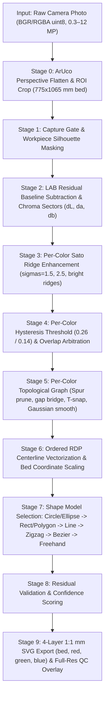

# Urumi Vision: Computer Vision Pipeline Architecture

## 1. End-to-End Pipeline Flow

---

## 2. Pipeline Inputs and Outputs

### Expected Global Inputs
- **Image (`image_bgr` / `src`)**: 8-bit 3-channel (`BGR`) or 4-channel (`RGBA`) array of size $W_{\text{raw}} \times H_{\text{raw}}$ ($0.3\text{ to }12\text{ MP}$). Supports full cutting-bed photos with 4 ArUco markers and pre-cropped cardboard images.
- **Configuration ([`Config`](file:///c:/Users/nikhil/Coding/urumi-vision-app/stroke_detector/config.py#L28-L108))**:
  - Physical bed metrics: $775.0 \times 1065.0\text{ mm}$ ($2000 \times 2748\text{ px}$ when ArUco-warped, $\approx 2.58\text{ px/mm}$).
  - Cardboard baseline estimation: `lab_median_ksize = 61`, `lab_residual_sigma = 1.0`, `ink_l_weight_k = 0.30`.
  - Configurable ink colors ([`ColorSpec`](file:///c:/Users/nikhil/Coding/urumi-vision-app/stroke_detector/config.py#L9-L15)): `red` ($2^\circ$), `green` ($175^\circ$), `blue` ($260^\circ$).
  - Per-color Sato ridge scales: $\sigma \in \{1.5, 2.5\}$ (bright ridges).
  - Per-color hysteresis: `color_hyst_high = 0.26`, `color_hyst_low = 0.14`, `min_color_component_area_px = 40`, `min_color_component_len_mm = 3.0`.
  - Topological graph parameters: `max_spur_len_mm = 1.5`, `max_endpoint_gap_mm = 1.0`, `t_junction_snap_mm = 2.0`, `chain_smooth_sigma_px = 2.0`.

### Expected Global Outputs
- **Status (`status`)**: `"detected"` if at least one curve achieves $\text{confidence} \ge 0.45\text{--}0.50$; otherwise `"not_detected"`.
- **Curves (`curves`)**: List of geometric primitives (`rect`, `polygon`, `circle`, `ellipse`, `line`, `polyline`, `bezier`, `freehand`) containing `color`, `model`, `residual_mm`, and `layer`.
- **Physical SVG (`svg`)**: Layered 1:1 millimeter SVG document (`viewBox="0 0 775 1065"`) containing 4 `<g>` layers in exact order:
  1. `<g id="bed" data-role="reference">`: bed outline rectangle and cardboard sheet outline.
  2. `<g id="red">`: red marker strokes (`#e53935`).
  3. `<g id="green">`: green marker strokes (`#43a047`).
  4. `<g id="blue">`: blue marker strokes (`#1e88e5`).
- **QC Overlay Image**: Full-resolution image blending all 4 SVG layers over the flattened photo at 50% opacity.

---

## 3. Stage Details

| # | Stage | Input | What it does | Output |
| :--- | :--- | :--- | :--- | :--- |
| **0** | **ArUco Flatten & Conditional ROI Crop** ([`detect_and_warp_aruco`](file:///c:/Users/nikhil/Coding/urumi-vision-app/stroke_detector/stages.py#L43-L93), [`detect_cardboard_roi`](file:///c:/Users/nikhil/Coding/urumi-vision-app/stroke_detector/stages.py#L136-L163)) | Raw camera image (`uint8` `BGR`/`RGBA`) + [`Config`](file:///c:/Users/nikhil/Coding/urumi-vision-app/stroke_detector/config.py#L28-L108) | Detects 4 ArUco markers (`DICT_4X4_50`) and warps the cutting bed to $2000 \times 2748\text{ px}$ ($775 \times 1065\text{ mm}$). Extracts cardboard sheet outline polygon for reference bed layer. Crops to workpiece ROI and shaves outer borders. | Cropped ROI image, cardboard polygon in bed coordinates, ROI offset $(x_{\text{roi}}, y_{\text{roi}})$, and bed shape |
| **1** | **Capture & Quality Gate** ([`stage1_capture_gate`](file:///c:/Users/nikhil/Coding/urumi-vision-app/stroke_detector/stages.py#L166-L359)) | Cropped ROI image (`uint8` `BGR`) | Computes variance of Laplacian (`blur_score`) and mean brightness. Builds `ignore_mask` for cutting bed margins and white UI overlays. Rejects unreadable inputs. | [`CaptureOutput`](file:///c:/Users/nikhil/Coding/urumi-vision-app/stroke_detector/config.py#L120-L136): ROI image, boolean `ignore_mask`, [`QualityReport`](file:///c:/Users/nikhil/Coding/urumi-vision-app/stroke_detector/config.py#L112-L118), cardboard polygon |
| **2** | **LAB Baseline Subtraction & Chroma Sectors** ([`stage2_preprocess`](file:///c:/Users/nikhil/Coding/urumi-vision-app/stroke_detector/stages.py#L365-L566)) | [`CaptureOutput`](file:///c:/Users/nikhil/Coding/urumi-vision-app/stroke_detector/config.py#L120-L136) | Converts zoomed ROI to LAB. Estimates baseline with 61 px median blur and subtracts it to obtain residuals `dL`, `da`, `db`. Calculates ink strength $s = \sqrt{da^2 + db^2} + k \cdot \max(-dL, 0)$ ($k = 0.30$) and chroma angle. Evaluates soft color membership signals for red, green, and blue. | [`PreprocessOutput`](file:///c:/Users/nikhil/Coding/urumi-vision-app/stroke_detector/config.py#L139-L157): residuals `dL, da, db`, `ink_strength`, `chroma_angle_deg`, and `color_signals` dict |
| **3** | **Per-Color Sato Ridge Enhancement** ([`stage3_enhance_strokes`](file:///c:/Users/nikhil/Coding/urumi-vision-app/stroke_detector/stages.py#L602-L722)) | [`PreprocessOutput`](file:///c:/Users/nikhil/Coding/urumi-vision-app/stroke_detector/config.py#L139-L157) | Runs 2D bright ridge Sato filter on each color signal ($\sigma \in \{1.5, 2.5\}$). Normalizes by 99.5th percentile into $[0.0, 1.0]$. | [`EnhancementOutput`](file:///c:/Users/nikhil/Coding/urumi-vision-app/stroke_detector/config.py#L160-L165): `color_strokeness` maps and overall `strokeness` |
| **4** | **Per-Color Hysteresis & Overlap Arbitration** ([`stage4_hysteresis_threshold`](file:///c:/Users/nikhil/Coding/urumi-vision-app/stroke_detector/stages.py#L725-L892)) | [`EnhancementOutput`](file:///c:/Users/nikhil/Coding/urumi-vision-app/stroke_detector/config.py#L160-L165) | Applies hysteresis (`high = 0.26`, `low = 0.14`) to each color map. Discards components $< 40\text{ px}$ area or $< 3\text{ mm}$ length. Where color masks overlap, assigns pixels to the color with the larger signal. Downstream stages run per color. | [`ThresholdOutput`](file:///c:/Users/nikhil/Coding/urumi-vision-app/stroke_detector/config.py#L168-L173): `color_masks` dict and combined mask |
| **5** | **Per-Color Topological Graph & Smoothing** ([`stage5_skeleton_and_grouping`](file:///c:/Users/nikhil/Coding/urumi-vision-app/stroke_detector/stages.py#L995-L1204), [`_trace_component_chains`](file:///c:/Users/nikhil/Coding/urumi-vision-app/stroke_detector/stages.py#L1441-L1774), [`_close_gaps_and_snap_t_junctions`](file:///c:/Users/nikhil/Coding/urumi-vision-app/stroke_detector/stages.py#L1831-L2083)) | [`ThresholdOutput`](file:///c:/Users/nikhil/Coding/urumi-vision-app/stroke_detector/config.py#L168-L173) | Skeletonizes each color mask. Decomposes into junction/endpoint graph. Prunes spurs $\le 1.5\text{ mm}$ (~4 px). Merges degree-2 chains. Bridges gaps $\le 1.0\text{ mm}$ and collinear crossings $\le 32\text{ px}$. Closes 3-sided trapezoid flaps. Snaps T-junction endpoints onto same-color strokes ($\le 2.0\text{ mm}$). Smooths chains with 1D Gaussian ($\sigma = 2\text{ px}$) preserving endpoints. | [`SkeletonOutput`](file:///c:/Users/nikhil/Coding/urumi-vision-app/stroke_detector/config.py#L176-L183): `color_skeletons`, `color_chains`, and debug `graph_nodes_vis` |
| **6** | **Vectorize & Scale to Bed** ([`stage6_vectorize`](file:///c:/Users/nikhil/Coding/urumi-vision-app/stroke_detector/stages.py#L2086-L2197)) | [`SkeletonOutput`](file:///c:/Users/nikhil/Coding/urumi-vision-app/stroke_detector/config.py#L176-L183) + [`PreprocessOutput`](file:///c:/Users/nikhil/Coding/urumi-vision-app/stroke_detector/config.py#L139-L157) | Simplifies smoothed chains using RDP. Carries color tag through every chain. Maps coordinates back to bed pixels. | [`VectorizeOutput`](file:///c:/Users/nikhil/Coding/urumi-vision-app/stroke_detector/config.py#L197-L200): list of [`TracedCurve`](file:///c:/Users/nikhil/Coding/urumi-vision-app/stroke_detector/config.py#L186-L194) objects with color metadata |
| **7 & 8** | **Strict Shape Selection & Validation** ([`stage7_and_8_fit_and_validate`](file:///c:/Users/nikhil/Coding/urumi-vision-app/stroke_detector/fitting.py#L920-L1278)) | List of [`TracedCurve`](file:///c:/Users/nikhil/Coding/urumi-vision-app/stroke_detector/config.py#L186-L194) objects | Fits models in priority order: (1) Circle/Ellipse, (2) Rectangle ($90^\circ \pm 10.5^\circ$) or closed polygon (trapezoids/triangles), (3) Straight line, (4) Zigzag polyline, (5) Schneider cubic Bezier path (wave), (6) Freehand fallback. Computes confidence and fit residual in millimeters. | List of validated [`FittedCurve`](file:///c:/Users/nikhil/Coding/urumi-vision-app/stroke_detector/config.py#L203-L217) objects with `color`, `model`, `residual_mm`, and `confidence` |
| **9** | **4-Layer SVG, JSON & QC Overlay** ([`run_pipeline`](file:///c:/Users/nikhil/Coding/urumi-vision-app/stroke_detector/pipeline.py#L230-L455), [`generate_layered_svg`](file:///c:/Users/nikhil/Coding/urumi-vision-app/stroke_detector/pipeline.py#L55-L200), [`render_qc_overlay`](file:///c:/Users/nikhil/Coding/urumi-vision-app/stroke_detector/viz.py#L140-L237)) | Validated curves + bed geometry | Generates SVG (`viewBox="0 0 775 1065"`) with 4 layers (`bed`, `red`, `green`, `blue`). Exports JSON containing stroke properties and bed references. Saves full-resolution 50% opacity QC overlay image. | JSON dictionary, `output.svg`, and `10_qc_overlay.png` |
