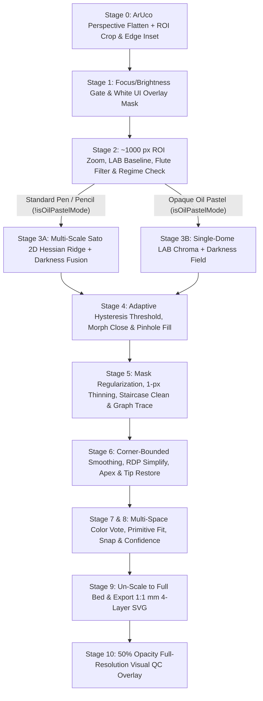
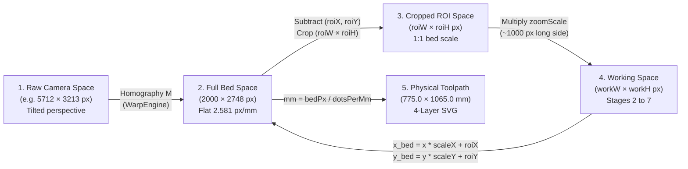
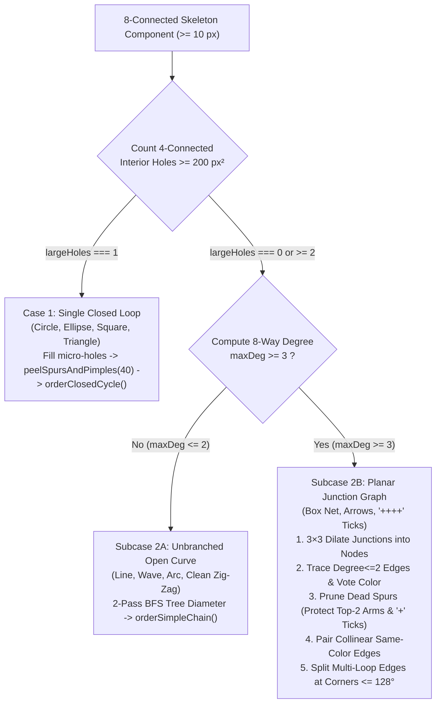
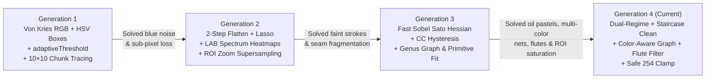

 # Complete Textbook Reference: End-to-End Stroke Detection & Vectorization Workflow

This textbook explains the entire computer-vision and computational-geometry pipeline implemented in [pipeline_dryrun_stroke_detector.html](file:///c:/Users/nikhil/Coding/urumi-vision-app/pipeline_dryrun_stroke_detector.html) and its supporting modules:
- [WarpEngine.js](file:///c:/Users/nikhil/Coding/urumi-vision-app/pipeline/WarpEngine.js) — 4-corner ArUco marker detection and perspective homography flattening.
- [ContourRoiDetector.js](file:///c:/Users/nikhil/Coding/urumi-vision-app/pipeline/ContourRoiDetector.js) — Classical HSV cardboard color segmentation and ink-cluster fallback.
- [CardboardDetector.js](file:///c:/Users/nikhil/Coding/urumi-vision-app/pipeline/CardboardDetector.js) — In-browser YOLOv8 neural-network workpiece detector via ONNX Runtime Web.
- [trace_skeleton.js](file:///c:/Users/nikhil/Coding/urumi-vision-app/lib/trace_skeleton.js) — Zhang-Suen binary morphological skeletonization.
- [SvgGenerator.js](file:///c:/Users/nikhil/Coding/urumi-vision-app/pipeline/SvgGenerator.js) — Physical-millimeter (`1:1 mm`) 4-layer CNC SVG generator.

**No prior background in computer vision, linear algebra, color science, or CNC toolpaths is assumed.** Every concept, data type, mathematical formula, threshold constant, and design trade-off is explained from first principles.

> [!TIP]
> Looking for a practical step-by-step operator guide on how to run the app, take photos, choose presets, adjust controls, and troubleshoot issues? See the companion manual: [USER_INSTRUCTION_MANUAL.md](file:///c:/Users/nikhil/Coding/urumi-vision-app/docs/USER_INSTRUCTION_MANUAL.md).

---

## Table of Contents

1. [Chapter 0: Foundational Primer (Read This First)](#chapter-0-foundational-primer-read-this-first)
   - [0.1 What Physical Problem Are We Solving?](#01-what-physical-problem-are-we-solving)
   - [0.2 How Computers Store Images in Memory](#02-how-computers-store-images-in-memory)
   - [0.3 Color Spaces: RGB, HSV, and CIE LAB](#03-color-spaces-rgb-hsv-and-cie-lab)
   - [0.4 Filters, Blurs, and Spatial Scales](#04-filters-blurs-and-spatial-scales)
   - [0.5 Derivatives, Ridges, and the Hessian Matrix](#05-derivatives-ridges-and-the-hessian-matrix)
   - [0.6 Binary Masks, Connectivity (4-Way vs. 8-Way), and Morphology](#06-binary-masks-connectivity-4-way-vs-8-way-and-morphology)
   - [0.7 Robust Statistics: Percentiles, Median, and MAD](#07-robust-statistics-percentiles-median-and-mad)
   - [0.8 The Five Coordinate Spaces](#08-the-five-coordinate-spaces)
2. [Chapter 1: Browser Runtime, Memory Management, and UI Controls](#chapter-1-browser-runtime-memory-management-and-ui-controls)
3. [Chapter 2 (Stage 0): Bed Perspective Flattening and Workpiece ROI Extraction](#chapter-2-stage-0-bed-perspective-flattening-and-workpiece-roi-extraction)
4. [Chapter 3 (Stage 1): Capture Quality Gate and UI Overlay Masking](#chapter-3-stage-1-capture-quality-gate-and-ui-overlay-masking)
5. [Chapter 4 (Stage 2): ROI Supersampling, LAB Baseline, Flute Suppression, and Regime Detection](#chapter-4-stage-2-roi-supersampling-lab-baseline-flute-suppression-and-regime-detection)
6. [Chapter 5 (Stage 3): Dual-Regime Stroke Enhancement (Sato Hessian Ridge vs. Chroma Dome)](#chapter-5-stage-3-dual-regime-stroke-enhancement-sato-hessian-ridge-vs-chroma-dome)
7. [Chapter 6 (Stage 4): Adaptive Hysteresis Thresholding, Morphology, and Margin Cleanup](#chapter-6-stage-4-adaptive-hysteresis-thresholding-morphology-and-margin-cleanup)
8. [Chapter 7 (Stage 5): Boundary Regularization, Zhang-Suen Thinning, Staircase Cleanup, and Graph Tracing](#chapter-7-stage-5-boundary-regularization-zhang-suen-thinning-staircase-cleanup-and-graph-tracing)
9. [Chapter 8 (Stage 6): Corner-Aware Smoothing, RDP Simplification, and Oil-Pastel Geometry Restoration](#chapter-8-stage-6-corner-aware-smoothing-rdp-simplification-and-oil-pastel-geometry-restoration)
10. [Chapter 9 (Stages 7 & 8): Multi-Space Color Voting, Geometric Primitive Fitting, Constraint Snapping, and Confidence](#chapter-9-stages-7--8-multi-space-color-voting-geometric-primitive-fitting-constraint-snapping-and-confidence)
11. [Chapter 10 (Stages 9 & 10): Full-Bed Millimeter SVG Generation and 50% QC Overlay](#chapter-10-stages-9--10-full-bed-millimeter-svg-generation-and-50-qc-overlay)
12. [Chapter 11: Evolution Across Previous Iterations — What We Tried, Why It Failed, and What Made It Better](#chapter-11-evolution-across-previous-iterations--what-we-tried-why-it-failed-and-what-made-it-better)
   - [11.1 Generation 1: Von Kries RGB Balancing, Adaptive Thresholding, and 10×10 Chunk Tracing](#111-generation-1-von-kries-rgb-balancing-adaptive-thresholding-and-1010-chunk-tracing)
   - [11.2 Generation 2: Two-Step Flattening, LAB Chromaticity Heatmaps, and ROI Zoom Supersampling](#112-generation-2-two-step-flattening-lab-chromaticity-heatmaps-and-roi-zoom-supersampling)
   - [11.3 Generation 3: Sato 2D Hessian Ridges, Connected-Component Hysteresis, and Genus Graph Tracing](#113-generation-3-sato-2d-hessian-ridges-connected-component-hysteresis-and-genus-graph-tracing)
   - [11.4 Generation 4: Five Benchmark-Driven Refinements in the Current Browser Pipeline](#114-generation-4-five-benchmark-driven-refinements-in-the-current-browser-pipeline)
   - [11.5 Master Evolution Summary Table (Early Methods vs. Current Methods)](#115-master-evolution-summary-table-early-methods-vs-current-methods)
13. [Chapter 12: Quick Glossary of Terms](#chapter-12-quick-glossary-of-terms)

---

## Chapter 0: Foundational Primer (Read This First)

### 0.1 What Physical Problem Are We Solving?

Imagine an operator places a flat piece of brown corrugated cardboard onto a large black CNC cutting table (`775 mm` wide by `1065 mm` tall). Instead of designing a box in CAD software, the operator picks up colored pens, pencils, markers, or oil pastels and draws directly onto the cardboard by hand:

- **Blue or Black lines (`thru_cut` layer):** Tell the machine to cut all the way through the cardboard sheet with a sharp drag knife or oscillating blade.
- **Red lines (`score` layer):** Tell the machine to cut partially through the top paper liner so the cardboard can fold cleanly outward along a sharp crease.
- **Green lines (`crease` layer):** Tell the machine to press a blunt creasing wheel into the cardboard without cutting the paper fibers, creating an inward fold line.

An overhead camera (such as a mounted smartphone or industrial camera) takes a single photograph of the table. That raw photograph cannot be sent directly to a CNC machine for five reasons:

1. **Perspective distortion:** If the camera is tilted even slightly, a `100 mm` square looks like a skewed trapezoid, and a circle looks like an oval.
2. **Pixel grid vs. vector paths:** A photo is a grid of millions of colored dots (pixels). A CNC machine needs mathematical vector commands: *"Move to `(x1, y1)` in millimeters, lower the red scoring tool, and move in a straight line to `(x2, y2)`."*
3. **Stroke thickness:** Even a thin pen line is `3` to `6` pixels wide; an oil pastel stroke is `12` to `18` pixels wide. If you trace the outer edges of a thick line, the blade will cut *twice* (once along the left edge of the ink and once along the right edge) instead of once down the exact centerline.
4. **Cardboard surface noise:** Brown kraft cardboard is not clean white paper. It has dark wood-pulp flecks, uneven room shadows, folds, and periodic parallel shadow stripes from the internal wavy layer (*corrugated fluting*).
5. **Color ambiguity at intersections:** Where a green fold line touches a red score line at a corner, the two inks mix on the brown cardboard.

The 11-stage pipeline turns that noisy, skewed camera photo into clean, single-centerline, color-separated, millimeter-accurate geometric toolpaths (`line`, `circle`, `ellipse`, and sharp-corner `polyline`).



---

### 0.2 How Computers Store Images in Memory

A digital image of width $W$ columns and height $H$ rows is stored in memory as a **1-dimensional flat array** in **row-major order** (left-to-right across row `0`, then row `1`, down to row `H - 1`):

- Origin `(x = 0, y = 0)` is the **top-left corner**.
- `x` increases to the **right** (`0` to `W - 1`).
- `y` increases **downward** (`0` to `H - 1`).
- For a single-channel image (1 number per pixel), pixel `(x, y)` sits at array index:
  $$i = y \cdot W + x$$
- For a 3-channel RGB image (3 numbers per pixel), pixel `(x, y)` occupies three consecutive slots: `3*i` (Red), `3*i + 1` (Green), and `3*i + 2` (Blue).
- For a 4-channel HTML Canvas RGBA image, pixel `(x, y)` occupies four slots: `4*i` (R), `4*i + 1` (G), `4*i + 2` (B), and `4*i + 3` (Alpha transparency).

OpenCV.js uses specific matrix data types:
- `cv.CV_8UC1`: 1 channel of **unsigned 8-bit integers** (`Uint8Array`), holding whole numbers from `0` to `255` inclusive. `0` means black/off; `255` means white/on.
- `cv.CV_8UC3` / `cv.CV_8UC4`: 3 or 4 channels of `0..255` bytes per pixel.
- `cv.CV_32F` (`data32F`): 1 channel of **32-bit floating-point numbers** (`Float32Array`), which can hold negative numbers and decimals (for example, `-14.75` or `0.342`). This is essential whenever we subtract two images (because `100 - 120 = -20`, which would wrap around or clamp to `0` in unsigned 8-bit math!).
- `cv.CV_32S` (`data32S`): 1 channel of **32-bit signed integers** (`Int32Array`), used for connected-component IDs (because an image can have more than `255` separate connected blobs, so an 8-bit label would overflow!).

> [!IMPORTANT]
> **Why you see `.delete()` everywhere in the code:** JavaScript has an automatic garbage collector, *but OpenCV.js runs inside WebAssembly (C++ compiled to WASM).* Every `new cv.Mat()` allocates raw C++ heap memory outside JavaScript's garbage collector. If you forget to call `mat.delete()`, each pipeline run leaks tens of megabytes until the browser tab crashes.

> [!TIP]
> **Why you see `i += 4` or `(i & 3) === 0` in statistics loops:** `(i & 3) === 0` is a fast bitwise check for *"is `i` divisible by 4?"* Sampling every 4th pixel (`25%` of an `800,000`-pixel array = `200,000` samples) produces virtually identical medians and percentiles while cutting sorting time by `4×`.

---

### 0.3 Color Spaces: RGB, HSV, and CIE LAB

#### 1. Why Raw RGB Fails on Cardboard
In **RGB**, brightness and color are tangled together. Under bright overhead light, bare brown cardboard might have `RGB = (195, 160, 120)`. Under a slight shadow 10 cm away, the exact same cardboard has `RGB = (135, 110, 82)`. Every channel changed by `30%`, even though no ink is present!

#### 2. HSV (Hue, Saturation, Value) — Used in Stage 0 Workpiece Detection
HSV rearranges RGB into a cylinder:
- **H (Hue, `0..180` in OpenCV 8-bit):** Which rainbow color angle it is (`0` = red, `20–30` = orange/tan/yellow, `60` = green, `120` = blue).
- **S (Saturation, `0..255`):** How vivid/colorful vs. neutral gray/black/white it is.
- **V (Value, `0..255`):** How bright the brightest channel is.

Because the cutting mat is neutral black (`S < 25` or `V < 35`) and brown cardboard is warm tan (`H` between `7` and `42`, `S >= 25`, `V >= 35`), a single `cv.inRange` box in HSV cleanly separates the cardboard sheet from the black mat.

#### 3. CIE LAB (`L*`, `a*`, `b*`) — The Workhorse of Stages 1–8
**CIE LAB** was designed around human vision so Euclidean distance matches perceived color difference, and lightness is completely decoupled from pigment hue:

- **`L*` (Lightness):** Pure brightness from black to white (`0` to `255` in OpenCV 8-bit LAB). Shadows and corrugation ripples change `L*` almost exclusively.
- **`a*` (Green $\leftrightarrow$ Red opponent axis):** Neutral gray sits at **`128`** in OpenCV 8-bit LAB.
  - Values **above `128`** ($\Delta a > 0$) are **Red / Magenta**.
  - Values **below `128`** ($\Delta a < 0$) are **Green / Teal**.
- **`b*` (Blue $\leftrightarrow$ Yellow opponent axis):** Neutral gray also sits at **`128`**.
  - Values **above `128`** ($\Delta b > 0$) are **Yellow / Tan** (bare brown cardboard sits around `a* ≈ 134, b* ≈ 152` because brown is warm yellow-orange!).
  - Values **below `128`** ($\Delta b < 0$) are **Blue / Violet**.

When we subtract the bare cardboard's background `(bgA, bgB)` from a pixel's `(a*, b*)`, we get the **chromatic residual vector** $(\Delta a, \Delta b)$:
- **Chroma Magnitude** $C = \sqrt{\Delta a^2 + \Delta b^2}$: How strongly colored the ink is relative to the cardboard underneath it (`0` = bare cardboard or neutral gray/black shadow; `> 4` = colored ink!).
- **Hue Angle** $\theta = (\text{atan2}(\Delta b, \Delta a) \cdot \frac{180}{\pi} + 360) \bmod 360^\circ$:
  - **Red ink** pushes $+\Delta a$ strongly ($\theta$ near `0°` / `360°`, wrapping across `310°..360°` and `0°..52°`).
  - **Green ink** pushes $-\Delta a$ and slightly $+\Delta b$ relative to tan ($\theta$ in `125°..235°`).
  - **Blue ink** pushes $-\Delta b$ strongly ($\theta$ in `235°..315°`).

---

### 0.4 Filters, Blurs, and Spatial Scales

1. **Gaussian Blur (`cv.GaussianBlur`):** Replaces each pixel with a bell-curve weighted average of its neighbors controlled by standard deviation $\sigma$ (in pixels). Features narrower than $\sim 2\sigma$ are smoothed away; features wider than $\sim 4\sigma$ survive.
   - Small $\sigma = 1.0\text{--}2.5\text{ px}$ smooths single-pixel camera sensor grain.
   - Huge $\sigma = 25\text{ px}$ erases all thin ink lines (`3–15 px` wide) completely, leaving *only* the slow room-lighting brightness map! Subtracting that blurred map from the original image (*flat-fielding*) flattens uneven lighting!
   - Anisotropic Gaussian blur (`sigmaX = 18.0, sigmaY = 0.8`) blurs `18 px` horizontally while barely blurring vertically (`0.8 px`), isolating horizontal stripes!
2. **Median Blur (`cv.medianBlur(..., 61)`):** Sorts all $61 \times 61 = 3,721$ pixels in a window and picks the middle value. Why use a `61 × 61` median instead of a Gaussian blur for color background? Because if a bright red marker stroke (`6 px` wide) passes through the window, it occupies only $6 \times 61 = 366$ pixels (`< 10%` of the window). A Gaussian average would get pulled toward red (creating a false cyan halo around the stroke when subtracted!), whereas the **median** (`50th` percentile) ignores the `10%` ink pixels completely and returns the exact color of the bare cardboard!
3. **Bilateral Filter (`cv.bilateralFilter(src, dst, d=7, sigmaColor=12, sigmaSpace=5)`):** A regular blur averages across sharp stroke boundaries. A bilateral filter multiplies two weights: how close a neighbor is in *space* (`sigmaSpace = 5 px`) **and** how close it is in *brightness* (`sigmaColor = 12`). Flat cardboard grain (`±4` brightness) gets smoothed flat, while a sharp ink edge (`-20` brightness jump) is **not** blurred across!

---

### 0.5 Derivatives, Ridges, and the Hessian Matrix

How does a computer distinguish a **line/stroke** from a **shadow edge** or a **flat dark patch**? With calculus derivatives!

Imagine walking perpendicular across a dark pen stroke in our flat-field image `flatBi` (where bare cardboard = `0` and dark ink = `-20`, forming a valley):
- **0th derivative (intensity $f$):** Drops from `0` down to `-20` at the center of the stroke, then rises back to `0`.
- **1st derivative (slope $f'$):** Negative going down the left wall, **zero right at the center of the stroke**, and positive going up the right wall. (That is why Canny edge detectors find *two* parallel edges on the sides of a stroke instead of one centerline!)
- **2nd derivative (curvature $f''$):** Measures how fast the slope bends. At the bottom of a dark valley (the exact centerline of a dark stroke!), the slope bends sharply upward from negative to positive, so **$f''$ reaches a strong positive peak right on the centerline!** Meanwhile, on a flat ramp or gradual shadow, $f'' = 0$!

Because strokes on cardboard run at *any* angle (horizontal, vertical, `45°`, curved), we compute all four 2D second partial derivatives at scale $\sigma$ using Sobel operators (`cv.Sobel`), forming the symmetric $2 \times 2$ **Hessian Matrix**:

$$H(\mathbf{x}; \sigma) = \sigma^2 \begin{bmatrix} \frac{\partial^2 I}{\partial x^2} & \frac{\partial^2 I}{\partial x \partial y} \\ \frac{\partial^2 I}{\partial x \partial y} & \frac{\partial^2 I}{\partial y^2} \end{bmatrix} = \begin{bmatrix} a & c \\ c & b \end{bmatrix}$$

Why multiply by $\sigma^2$? Taking two spatial derivatives of a Gaussian of width $\sigma$ shrinks its amplitude by $1/\sigma^2$. Multiplying by $\sigma^2$ (**Lindeberg scale normalization**) puts thin-stroke responses ($\sigma = 1.5$) and wider-stroke responses ($\sigma = 2.5$) in the exact same numerical units so we can take `max` across scales (**Sato multi-scale ridge filter**)!

The eigenvalues of a $2 \times 2$ symmetric matrix $\begin{bmatrix} a & c \\ c & b \end{bmatrix}$ are the curvatures along the two principal axes (across the stroke and along the stroke):

$$\lambda_{1,2} = \frac{1}{2}\left((a + b) \pm \sqrt{(a - b)^2 + 4c^2}\right)$$

For a dark stroke (`flatBi < 0`), the curvature *across* the valley is strongly positive ($\lambda_1 \gg 0$), while the curvature *along* the length of the stroke is near zero ($\lambda_2 \approx 0$). Thus $\lambda_1$ is a rotation-invariant **strokeness score**!

---

### 0.6 Binary Masks, Connectivity (4-Way vs. 8-Way), and Morphology

Once strokes are thresholded into a binary mask (`255` = stroke foreground, `0` = background), pixel geometry obeys discrete topology rules:

- **4-Connectivity:** A pixel touches only its 4 orthogonal neighbors (`N, S, E, W`). Diagonal pixels do *not* connect.
- **8-Connectivity:** A pixel touches all 8 surrounding neighbors (`N, S, E, W, NW, NE, SE, SW`). Diagonal pixels *do* connect.

> [!IMPORTANT]
> **Why Foreground Uses 8-Connectivity While Background Holes Use 4-Connectivity:**
> Consider a 1-pixel diagonal line running at `45°`: `(0,0), (1,1), (2,2)`. Under 8-connectivity, that diagonal line is a single unbroken closed wall. If you also used 8-connectivity for the background (`0`s), the background inside a diamond could "leak diagonally" right between `(0,0)` and `(1,1)` to the outside! By pairing **8-connected foreground** with **4-connected background** (`cv.connectedComponentsWithStats(..., 4)` in `fillSmallMaskHoles` and `traceSkeletonComponents`), the discrete Jordan Curve Theorem holds: every 8-connected closed loop cleanly separates inside from outside without diagonal leaks!

Key morphological operations used on binary masks:
- **Dilation (`cv.dilate`):** Slides a shape (*structuring element*, such as an ellipse of diameter $k$) and turns a pixel ON if *any* pixel under the kernel is ON. Expands foreground outward by $\lfloor k/2 \rfloor$ pixels.
- **Erosion (`cv.erode`):** Turns a pixel ON only if *all* pixels under the kernel are ON. Shrinks foreground inward by $\lfloor k/2 \rfloor$ pixels.
- **Morphological Closing (`cv.MORPH_CLOSE` = Dilate followed by Erode):** Bridges narrow gaps smaller than $k$ pixels and smooths narrow inward notches, *without* permanently fattening the overall stroke width (because the erosion undoes the outer expansion!).

---

### 0.7 Robust Statistics: Percentiles, Median, and MAD

In computer vision, the **mean** and **standard deviation** are dangerous because a few extreme pixels (such as ink strokes or a dark cardboard edge) skew them wildly. Instead, this pipeline uses **order statistics** (computed by sorting pixel values from smallest to largest):

- **$q$-th Percentile (`p80`, `p95`, `p995`, `p999`):** The value at index $\lfloor N \cdot q \rfloor$ of the sorted array. Since ink strokes rarely cover more than `5%–15%` of a cardboard sheet, `p50` (the median) and `p80` measure the **background noise floor**, whereas `p95`, `p97`, `p99.5`, and `p99.9` measure the **stroke signal**.
- **MAD (Median Absolute Deviation) (`medianAndMad`, [L1125-L1131](file:///c:/Users/nikhil/Coding/urumi-vision-app/pipeline_dryrun_stroke_detector.html#L1125-L1131)):**
  1. Find the median $m = \text{median}(X)$.
  2. Compute absolute distance of every sample from the median: $d_i = |x_i - m|$.
  3. Take the median of those deviations and multiply by **`1.4826`**:
     $$\hat{\sigma}_{\text{MAD}} = 1.4826 \cdot \text{median}(|X - \text{median}(X)|)$$
  - **Why `1.4826`?** For pure Gaussian noise with standard deviation $\sigma$, $50\%$ of values fall within $\pm 0.6745\sigma$, and $1 / 0.6745 = 1.4826$. Multiplying by `1.4826` makes $\hat{\sigma}_{\text{MAD}}$ equal the true Gaussian standard deviation $\sigma$ on pure background noise while being **100% immune** to up to `50%` outlier ink pixels!

---

### 0.8 The Five Coordinate Spaces

Every pixel coordinate travels through five well-defined coordinate frames from camera capture to final SVG export:



Keeping Stages 2–7 in **Working Space (`workW × workH`)** ensures pixel-denominated parameters (such as `sigma = 1.5 px` or `spurPruneLen = 10 px`) work identically whether the user drew on a tiny `120 mm` scrap (zoomed up `2×`) or a huge `600 mm` sheet (scaled to `1000 px`). Then Stage 7 un-scales every vertex back to **Full Bed Space** via `x_bed = x_work * scaleX + roiX` and **Physical Millimeter Space** via `x_mm = x_bed / dotsPerMm`.

---

## Chapter 1: Browser Runtime, Memory Management, and UI Controls

**Implementation:** [pipeline_dryrun_stroke_detector.html](file:///c:/Users/nikhil/Coding/urumi-vision-app/pipeline_dryrun_stroke_detector.html#L359-L858)

### 1.1 Asynchronous OpenCV.js Boot & Dual-CDN Failover ([L725-L787](file:///c:/Users/nikhil/Coding/urumi-vision-app/pipeline_dryrun_stroke_detector.html#L725-L787))

OpenCV.js is a `~10 MB` WebAssembly binary loaded asynchronously (`<script async src="https://docs.opencv.org/4.9.0/opencv.js">`). Different builds of OpenCV.js initialize differently:
1. Some expose `cv.Mat` immediately when `onload` fires.
2. Modularized builds export `cv` as a `Promise` (`typeof cv.then === 'function'`) that resolves to the initialized module.
3. Emscripten runtime builds create a global `cv` object first and compile WASM in the background, firing `cv.onRuntimeInitialized` later.

`onOpenCvReady()` handles **all three** initialization patterns plus a `100 ms` safety `setInterval` poll. If `docs.opencv.org` is unreachable or blocked by a firewall, `onOpenCvError()` automatically injects a fallback `<script>` from `cdn.jsdelivr.net/npm/@techstark/opencv-js@4.9.0-release.3/dist/opencv.js`. Until `markReady()` runs, `#fileInput` and `#btnRun` remain `disabled` so the user cannot trigger `ReferenceError: cv is not defined`.

### 1.2 Complete Toolbar Parameter & Preset Reference

| Control / Element ID | Default | Range / Options | Exact Role in the Pipeline |
| :--- | :--- | :--- | :--- |
| `#presetFinePen` | Button | `1.0, 1.8` / `95%` / `85%` / `16px` / `16px` | Tunes Hessian scales and thresholds for thin `0.5 mm` ballpoint pens and faint pencil lines. |
| `#presetMarker` | Button | `1.5, 2.5` / `97%` / `90%` / `22px` / `24px` | Standard preset for felt-tip markers and medium colored pencils. |
| `#presetNoisy` | Button | `2.0, 3.0` / `98%` / `92%` / `30px` / `28px` | Wider scales and stricter cutoffs for coarse, heavily fluted corrugated cardboard. |
| `#penBlue`, `#penRed`, `#penGreen`, `#penBlack` | All `checked` | Boolean checkboxes | Enables/disables tool layers in Stage 7 (`blue/black -> thru_cut`, `red -> score`, `green -> crease`). |
| `#useAruco` | `checked` | Boolean | Runs 4-marker perspective flattening in Stage 0 (`WarpEngine`). |
| `#roiDetectorSelect` | `contour` | `contour`, `yolo`, `none` | Selects workpiece finder: HSV/adaptive contour (`ContourRoiDetector`), YOLOv8 ONNX (`CardboardDetector`), or full bed. |
| `#roiInset` | `16 px` | `0..150 px` | Shaves the auto-detected cardboard box inward on all 4 sides to discard physical cut-edge shadows. |
| `#useLasso` | `checked` | Boolean | Opens the interactive polygon/rectangle Lasso confirmation window before Stage 1. |
| `#sigmaInput` | `1.5, 2.5` | Comma-separated floats | Gaussian scales $\sigma$ (in working pixels) for Stage 3 Sato Hessian ridge enhancement. |
| `#hystHigh` / `#hystLow` | `97.0` / `84` | Percentiles (`75..99.5` / `55..98`) | Stage 4 percentile cutoffs for strong seed pixels and weak connected stroke pixels. |
| `#closeKernelSize` | `5 px` | Odd integer `3..9 px` | Elliptical morphological closing kernel in Stage 4 (auto-overridden to `3 px` in oil-pastel and high-flute modes). |
| `#bridgeDistPx` | `12 px` | `0..40 px` | Maximum pixel gap bridged between aligned same-color skeleton endpoints in Stage 5. |
| `#roiBorderMarginPx` | `18 px` | `0..40 px` | Outer perimeter width zeroed in Stages 4 & 5 so crop boundary edges never become strokes. |
| `#minSpanPx` | `22 px` | `10..300 px` | Minimum bounding-box diagonal (`hypot(w, h)`) for keeping skeleton components; also sets `minChainLengthPx = max(14, 0.65 * minSpanPx)`. |
| `#spurLenPx` | `24 px` | `0..100 px` | Maximum length (in pixels) of dead-end junction whiskers deactivated during Stage 5 graph tracing. |

---

## Chapter 2 (Stage 0): Bed Perspective Flattening and Workpiece ROI Extraction

**Implementation:** [pipeline_dryrun_stroke_detector.html](file:///c:/Users/nikhil/Coding/urumi-vision-app/pipeline_dryrun_stroke_detector.html#L2400-L2515), [WarpEngine.js](file:///c:/Users/nikhil/Coding/urumi-vision-app/pipeline/WarpEngine.js), [ContourRoiDetector.js](file:///c:/Users/nikhil/Coding/urumi-vision-app/pipeline/ContourRoiDetector.js), [CardboardDetector.js](file:///c:/Users/nikhil/Coding/urumi-vision-app/pipeline/CardboardDetector.js)

### 2.1 Step 0A: 4-Corner ArUco Perspective Homography (`WarpEngine`)

#### How ArUco Markers Work
Printed at the four corners of the CNC bed frame are square black-and-white binary fiducial tags from OpenCV's **`DICT_4X4_50`** dictionary (each tag encodes a unique integer ID inside a $4 \times 4$ bit grid surrounded by a black border):
- **ID `12`** = Top-Left (`TL`)
- **ID `13`** = Top-Right (`TR`)
- **ID `14`** = Bottom-Right (`BR`)
- **ID `15`** = Bottom-Left (`BL`)

*(Legacy smaller frames use IDs `0..3` for `150×230 mm`, `4..7` for `210×290 mm`, and `8..11` for `270×350 mm`.)*

#### Step-by-Step Execution in `WarpEngine.normalizePerspective`
1. **1× Marker Detection + 2× Bicubic Fallback ([WarpEngine.js L17-L47](file:///c:/Users/nikhil/Coding/urumi-vision-app/pipeline/WarpEngine.js#L17-L47)):**
   - Runs `cv.aruco_ArucoDetector` with corner refinement (`aruco_RefineParameters(10, 3, true)`).
   - Computes each marker's center $(c_x, c_y)$ as the average of its 4 corner coordinates.
   - **Small-detail engineering:** If steep camera angle or motion blur causes 1 to 3 markers to be found (missing 1 corner), `WarpEngine` upscales the grayscale photo **`2.0×` with bicubic interpolation** (`cv.INTER_CUBIC`), runs detection again, and divides recovered coordinates by `2.0` (`sum / 8.0` for 4 corners).
2. **Rotation-Proof ID Ordering ([WarpEngine.js L58-L74](file:///c:/Users/nikhil/Coding/urumi-vision-app/pipeline/WarpEngine.js#L58-L74)):**
   - Instead of sorting markers by image `x`/`y` (which breaks if a user holds their phone sideways or upside down!), corners are mapped **strictly by marker ID (`12, 13, 14, 15`)**. This automatically rotates any sideways or upside-down photo into upright machine orientation!
3. **Physical Margin & Pixel Scale Math ([WarpEngine.js L87-L149](file:///c:/Users/nikhil/Coding/urumi-vision-app/pipeline/WarpEngine.js#L87-L149)):**
   - On the full-size custom bed, the ArUco marker *centers* span `physWidth = 830.0 mm` by `physHeight = 1130.0 mm`, while the inner usable cutting mat inside the checkered frame measures **`cropPhysW = 775.0 mm` by `cropPhysH = 1065.0 mm`**.
   - Therefore, the physical inset margin from each ArUco center to the inner cutting bed edge is:
     $$\text{arucoMarginX} = \frac{830 - 775}{2} = 27.5\text{ mm}, \qquad \text{arucoMarginY} = \frac{1130 - 1065}{2} = 32.5\text{ mm}$$
   - Fixing `outW = 2000 px` gives:
     $$\text{dotsPerMm} = \frac{2000}{775.0} \approx 2.580645\text{ px/mm}, \qquad \text{outH} = \text{round}(2.580645 \times 1065.0) = 2748\text{ px}$$
   - Notice the clever destination-triangle trick (`dstTri` at [WarpEngine.js L144-L149](file:///c:/Users/nikhil/Coding/urumi-vision-app/pipeline/WarpEngine.js#L144-L149)): the 4 ArUco centers are mapped to **negative/out-of-bounds** pixel coordinates `(-marginXPx, -marginYPx)` through `(outW + marginXPx, outH + marginYPx)`. When `cv.warpPerspective` renders the `2000 × 2748` canvas (`[0..outW, 0..outH]`), the outer white-and-black checkered ArUco border is **automatically cropped away** in the exact same matrix pass!
4. **3×3 Projective Homography (`cv.getPerspectiveTransform` + `cv.warpPerspective`):**
   - Solves the exact 8-degree-of-freedom $3 \times 3$ projective matrix $M$ mapping the 4 source marker centers to the 4 destination points, correcting camera tilt, roll, yaw, and distance in one operation.

---

### 2.2 Step 0B: Workpiece ROI Detection, Edge Shaving, and Interactive Lasso

Why not run stroke detection directly on the `2000 × 2748` warped bed?
- If the user placed a small `150 × 150 mm` (`387 × 387 px`) cardboard piece in the middle of the bed and we shrank the whole `2748 px` bed to `1000 px`, that cardboard piece would shrink to just `140 × 140 px` — turning thin pen lines into sub-pixel mush!
- Conversely, cropping the cardboard piece *first* and zooming *up* to `~1000 px` gives `2×–3×` higher pixel resolution on the actual ink while eliminating `85%` of empty black mat!

Three ROI selection options are supported ([L2432-L2513](file:///c:/Users/nikhil/Coding/urumi-vision-app/pipeline_dryrun_stroke_detector.html#L2432-L2513)):

1. **Option 1 — Classical HSV Contour Detector (`ContourRoiDetector.detect`, default):**
   - Converts `workImg` to HSV and keeps brown/tan pixels with `H in [7..42], S in [25..255], V in [35..255]`.
   - Zeroes a `frameMargin = 90 px` perimeter strip so any leftover wooden/table edge near the bed frame cannot connect to the workpiece.
   - Runs a `25 × 25` rectangular `cv.MORPH_CLOSE` so dark marker lines drawn near the edge of the cardboard do not split the cardboard mask into pieces.
   - Picks the largest external contour with `area > 8000 px²` and pads its bounding box by `padding = 35 px`.
   - *Fallback (`detectInkCluster`):* If white paper is used instead of brown cardboard (so HSV finds no brown sheet), falls back to adaptive Gaussian thresholding (`blockSize = 51, C = 10`) and bounds all ink contours with `area > 200 px²`.

2. **Option 2 — YOLOv8 Neural Network (`CardboardDetector.detect`):**
   - Resizes the bed image onto a `640 × 640` canvas, normalizes RGB to `[0, 1]` float32 planar `NCHW` format (`[1, 3, 640, 640]`), and runs `cardboard_detector.onnx` in WebAssembly via ONNX Runtime Web (`ort.InferenceSession`).
   - Scans all `8,400` YOLOv8 multi-scale feature-pyramid anchors (`80×80 + 40×40 + 20×20 = 8,400`), picks the highest-scoring anchor above `0.25`, and maps `(cx, cy, w, h)` back to full bed pixels.

3. **Physical Cardboard Edge Shaving (`roiInset = 16 px`, [L2457-L2468](file:///c:/Users/nikhil/Coding/urumi-vision-app/pipeline_dryrun_stroke_detector.html#L2457-L2468)):**
   - Thick cardboard casts a sharp dark shadow where its cut edge meets the black mat. That shadow looks exactly like a straight black pen stroke! Shaving `shavePx = 16 px` inward from all four sides of `detectedBox` (clamped to at most `40%` of box width/height so tiny boxes never invert) strips away the physical cut edge before cropping.

4. **Interactive Lasso Confirmation (`openLassoToolAsync`, [L859-L1021](file:///c:/Users/nikhil/Coding/urumi-vision-app/pipeline_dryrun_stroke_detector.html#L859-L1021)):**
   - Displays the flattened bed dimmed by `55%` outside the auto-detected rectangle (or lets the operator click a custom freeform polygon).
   - Rasterizes the confirmed polygon/rectangle into `userMaskMat` (`255` inside, `0` outside) via `cv.fillPoly`, computes its tight bounding box `(roiX, roiY, roiW, roiH)` via `getMaskBoundingBox`, and crops `roiCropMat` and `roiMaskCrop`.

---

## Chapter 3 (Stage 1): Capture Quality Gate and UI Overlay Masking

**Implementation:** [pipeline_dryrun_stroke_detector.html](file:///c:/Users/nikhil/Coding/urumi-vision-app/pipeline_dryrun_stroke_detector.html#L2516-L2558)

### Step-by-Step Operations

1. **Focus Sharpness Metric (`blurScore` — Variance of Laplacian):**
   - Applies a 2D discrete Laplacian filter (`cv.Laplacian(grayRoi, lap, cv.CV_64F)`), which computes $\frac{\partial^2 I}{\partial x^2} + \frac{\partial^2 I}{\partial y^2}$ at every pixel.
   - Computes standard deviation $\sigma_{\text{Lap}}$ via `cv.meanStdDev` and squares it: $\text{blurScore} = \sigma_{\text{Lap}}^2$.
   - **Why?** An out-of-focus camera blurs sharp transitions, causing second derivatives to collapse near zero ($\text{blurScore} < 15$). A crisp in-focus cardboard texture typically scores `35` to `150+`.
2. **Exposure Metric (`brightness`):**
   - Computes `cv.mean(grayRoi)[0]` (`0..255`) to log underexposed (`< 60`) or blown-out (`> 230`) captures.
3. **CIE LAB Channel Split:**
   - Converts `roiCropMat` (`RGBA` $\to$ `RGB` $\to$ `Lab`) and splits into `lRoi`, `aRoi`, and `bRoi`.
4. **Near-White UI Overlay & Outside-Lasso Ignore Mask (`ignoreMask`):**
   - Flags any pixel where **`L > 235` AND `min(R, G, B) > 215`** as `255` (ignored), and if any such pixel exists, dilates `ignoreMask` with a **`21 × 21` elliptical kernel**.
   - Also sets `ignoreMask[i] = 255` wherever `roiMaskCrop[i] === 0` (the corners outside a slanted polygon Lasso).

### Technical Justifications
- **Why check BOTH `L > 235` AND `min(R, G, B) > 215`?** Some screenshots or camera apps burn white text/crosshairs onto the image. Bright yellow or lime oil pastel can have high `L`, *but* its Blue channel `B` is low (`< 150`), so `min(R, G, B) > 215` ensures we mask **only pure achromatic white overlays**, never bright colored pastel!
- **Why dilate overlays by `21 × 21` (`10 px` radius)?** Anti-aliased halo pixels around white UI text create steep brightness cliffs that ring inside Stage 2/3 Gaussian filters up to `3 * sigma` pixels away. Dilating by `10 px` swallows the entire anti-aliased skirt.

---

## Chapter 4 (Stage 2): ROI Supersampling, LAB Baseline, Flute Suppression, and Regime Detection

**Implementation:** [pipeline_dryrun_stroke_detector.html](file:///c:/Users/nikhil/Coding/urumi-vision-app/pipeline_dryrun_stroke_detector.html#L2559-L2716)

Stage 2 prepares a clean, lighting-flattened, resolution-normalized signal image `flatBi` and decides whether the drawing was made with **standard dark/thin pens & pencils** or **thick, bright opaque oil pastels**.

### 4.1 Adaptive Working Resolution (`zoomScale`, [L2559-L2579](file:///c:/Users/nikhil/Coding/urumi-vision-app/pipeline_dryrun_stroke_detector.html#L2559-L2579))
Let `roiLongSide = Math.max(roiW, roiH)`:
- If `roiLongSide < 500 px`: **`zoomScale = 2.0`** using **bicubic interpolation (`cv.INTER_CUBIC`)**.
  - *Why?* Small shapes have strokes only `1.5–2.5 px` wide on the raw bed. Bicubic upsampling reconstructs smooth `3–5 px` profiles so Zhang-Suen thinning in Stage 5 does not delete corners or collapse small triangles!
- If `500 <= roiLongSide <= 1000 px`: **`zoomScale = 1.0`** (native resolution preserved untouched).
- If `roiLongSide > 1000 px`: **`zoomScale = 1000.0 / roiLongSide`** using **area-averaging (`cv.INTER_AREA`)**.
  - *Why `cv.INTER_AREA` when shrinking?* Nearest-neighbor or bilinear downsampling aliases thin lines (skipping rows/columns and poking holes in strokes), whereas `INTER_AREA` integrates over the source pixel footprint like a physical camera sensor!
- Notice `ignoreMask` is resized with **`cv.INTER_NEAREST`** so binary mask values stay strictly `0` or `255` without creating gray `127` boundary pixels!
- Scale factors `scaleX = roiW / workW` and `scaleY = roiH / workH` are saved to map final vectors back to exact bed coordinates.

### 4.2 Perimeter Guard & Median Cardboard Inpainting ([L2582-L2615](file:///c:/Users/nikhil/Coding/urumi-vision-app/pipeline_dryrun_stroke_detector.html#L2582-L2615))
1. Marks an outer ring `borderIgnorePx = clamp(round(6 * zoomScale), 6, 12)` around `ignoreWork` as `255`.
2. Computes the global median cardboard color `(medL, medA, medB)` across all valid (`ignoreWork === 0`) pixels.
3. **Overwrites every ignored pixel (`ignoreWork > 0`) in `lWork`, `aWork`, and `bWork` with `(medL, medA, medB)`.**
   - *Why is this tiny detail so important?* Outside a slanted polygon Lasso, `roiCropMat` contains pitch-black cutting bed (`L* ≈ 15`) right next to tan cardboard (`L* ≈ 185`). If we left `L* = 15` in those ignored pixels, the `sigma = 25` Gaussian background blur in the next step would bleed darkness `50 px` inward across the polygon boundary, creating a giant fake dark ridge along the entire Lasso edge! Filling ignored pixels with `medL` makes the boundary invisible to every spatial blur!

### 4.3 Local `61 × 61` Median Baseline & MAD `inkGate` ([L2620-L2641](file:///c:/Users/nikhil/Coding/urumi-vision-app/pipeline_dryrun_stroke_detector.html#L2620-L2641))
- Computes local background `bgLMat`, `bgAMat`, `bgBMat` via `cv.medianBlur(..., 61)`.
- At each valid pixel, computes combined chromatic + darkness deviation:
  $$\text{inkStrength}[i] = \sqrt{(a_i - \text{bgA}_i)^2 + (b_i - \text{bgB}_i)^2} + 0.30 \cdot \max(0, \text{bgL}_i - L_i)$$
- Estimates robust noise floor via `medianAndMad` and sets `inkFloor = median + 3.2 * max(sigma, 0.05)`. Pixels above `inkFloor` set `inkGate[i] = 1` (used for per-color ridge statistics in Stage 3).

### 4.4 Flat-Fielding, Directional Corrugated-Flute Cancellation, and Chroma Contrast Boost ([L2644-L2686](file:///c:/Users/nikhil/Coding/urumi-vision-app/pipeline_dryrun_stroke_detector.html#L2644-L2686))

This 40-line loop solves three hard physical problems in sequence:

1. **Illumination Flat-Fielding:**
   $$\text{ld}_0 = L_{\text{float}} - \text{GaussianBlur}(L_{\text{float}}, \sigma = 25)$$
   Bare cardboard becomes `~0`, room lighting gradients vanish, and dark ink strokes become **negative** (`-5` to `-40`).
2. **Directional Corrugated-Flute Ripple Suppression:**
   - Corrugated cardboard has internal parallel flutes that create faint, long horizontal or vertical brightness waves (`±3` to `±8` in `ld0`).
   - Two elongated blurs measure purely horizontal and purely vertical wave components:
     - `fluteH = GaussianBlur(flatRaw, sigmaX = 18.0, sigmaY = 0.8)`
     - `fluteV = GaussianBlur(flatRaw, sigmaX = 0.8, sigmaY = 18.0)`
   - Picks whichever axis has the stronger ripple: `fRip = |fluteH| >= |fluteV| ? fluteH : fluteV`.
   - Computes two soft protection weights:
     $$w_L = \text{clamp}\!\left(1 - \frac{|\text{ld}_0|}{14.0},\, 0,\, 1\right), \qquad w_C = \text{clamp}\!\left(1 - \frac{\text{rawChr}}{7.0},\, 0,\, 1\right)$$
   - Subtracts the flute ripple **only** where both $w_L$ and $w_C$ are non-zero:
     $$\text{ld} = \text{ld}_0 - 0.80 \cdot \text{fRip} \cdot w_L \cdot w_C$$
   - *Why the soft weights $w_L$ and $w_C$?* What if the user drew a real horizontal red or green pen line? A real pen line either has color (`rawChr >= 7`, making $w_C = 0$) or strong darkness (`|ld0| >= 14`, making $w_L = 0$)! So real horizontal/vertical strokes suffer **zero** attenuation, while faint neutral cardboard flutes (`|ld0| < 14` and `rawChr < 7`) lose `80%` of their ripple!
3. **Pale-Green Amplification & Chroma-Assisted Darkness Boost:**
   - Light green colored pencil on tan cardboard barely darkens `L*` (`ld ≈ -2.5`), so on `L*` alone it looks almost invisible!
   - When `da < 0` (greenward shift), `da` is multiplied by **`1.85×`** before computing `chromaDev = hypot(da, db)`.
   - If the pixel is at least slightly dark (`ld < 0`) and distinctly colored (`chromaDev > 5.2`), we deepen its valley:
     $$\text{darkW} = \min\!\left(1.0, \frac{-\text{ld}}{3.5}\right), \qquad \text{boost} = \min\!\big(12.0,\; 0.95 \cdot \text{darkW} \cdot (\text{chromaDev} - 5.2)\big), \qquad \text{ld} \leftarrow \text{ld} - \text{boost}$$
   - *Why multiply by `darkW`?* Colored noise specks on bright cardboard bumps (`ld >= 0`) have `darkW = 0`, so they are not boosted; genuine strokes (`ld < -3.5`) get full chroma contrast!
4. **Edge-Preserving Bilateral Smoothing:**
   - `cv.bilateralFilter(flatRaw, flatBi, 7, 12, 5)` smooths wood-fiber grain inside `flatRaw` while keeping stroke walls crisp.

### 4.5 Automatic Oil-Pastel Regime Detection (`isOilPastelMode`, [L2665, L2685](file:///c:/Users/nikhil/Coding/urumi-vision-app/pipeline_dryrun_stroke_detector.html#L2685))
- Counts valid pixels where **`ld0 >= -2.0` AND `hypot(a - bgA, b - bgB) >= 11.0`** (pixels that are **as bright as or brighter than** the cardboard *and* strongly colored!).
- Sets `isOilPastelMode = (brightChromaCnt / validPixCnt) >= 0.012` (`>= 1.2%` of the ROI).
- *Why does this work with 100% reliability?* Translucent inks, ballpoint pens, markers, and colored pencils absorb light (*subtractive color*), so they are always darker than the cardboard (`ld0 < -3`). Opaque wax oil pastels (especially lime green and sky blue) reflect *more* light than brown cardboard (`ld0 >= 0`) and have massive pigment saturation (`chroma >= 15–40`).

---

## Chapter 5 (Stage 3): Dual-Regime Stroke Enhancement (Sato Hessian Ridge vs. Chroma Dome)

**Implementation:** [pipeline_dryrun_stroke_detector.html](file:///c:/Users/nikhil/Coding/urumi-vision-app/pipeline_dryrun_stroke_detector.html#L2717-L2797) and `computeSatoStrokeness` ([L1044-L1120](file:///c:/Users/nikhil/Coding/urumi-vision-app/pipeline_dryrun_stroke_detector.html#L1044-L1120))

### 5.1 Regime A (`!isOilPastelMode`): Multi-Scale Sato 2D Hessian Ridge + Darkness Fusion

Inside `computeSatoStrokeness(flatBi, ignoreWork.data, sigmas)`:

1. **Multi-Scale Hessian Eigenvalue Loop ([L1049-L1068](file:///c:/Users/nikhil/Coding/urumi-vision-app/pipeline_dryrun_stroke_detector.html#L1049-L1068)):**
   - For each scale $s \in \text{sigmas}$ (default `[1.5, 2.5]`):
     - Blurs `flatBi` with Gaussian $\sigma = s$.
     - Computes 2nd-order `3 × 3` Sobel derivatives `dxx`, `dyy`, `dxy`. Because OpenCV's `3 × 3` Sobel kernel `[1, 2, 1]` has sum `4`, its gain is `4×`, so multiplying by `0.25` normalizes the discrete derivative: `s2 = s * s * 0.25`.
     - **Dark-Valley Gate (`flatD[i] < -1.2`, [L1060](file:///c:/Users/nikhil/Coding/urumi-vision-app/pipeline_dryrun_stroke_detector.html#L1060)):** Skips any pixel that is not darker than background by at least `1.2 L*` units!
       - *Why?* Suppose two dark parallel lines sit `8 px` apart with bare cardboard (`flatD = 0`) in the gap between them. A wide Gaussian blur ($s = 2.5$) spills negative skirts from both lines into the middle of the gap, creating upward curvature ($\lambda_1 > 0$) right on bare cardboard! Gating with `flatD[i] < -1.2` guarantees bare cardboard can **never** emit a phantom bridge!
     - Computes maximum principal curvature $\lambda_1 = \frac{1}{2}((a + b) + \sqrt{(a - b)^2 + 4c^2})$ and keeps the maximum across scales in `outMax[i]`.

2. **Blank-Cardboard Texture Rejection (`isPureTexture`, [L1082-L1099](file:///c:/Users/nikhil/Coding/urumi-vision-app/pipeline_dryrun_stroke_detector.html#L1082-L1099)):**
   - What if a user runs the pipeline on an **empty sheet of cardboard with zero drawings**? Without a guard, dividing noise by `maxVal` would stretch faint cardboard grain up to `[0..1]` and hallucinate random strokes!
   - Computes signal-to-noise ratios comparing `p99.9` against `p95`, `p80`, and `p70` above median `p50`:
     $$\text{snr95} = \frac{p_{99.9} - p_{50}}{p_{95} - p_{50}}, \quad \text{snr80} = \frac{p_{99.9} - p_{50}}{p_{80} - p_{50}}, \quad \text{snr70} = \frac{p_{99.9} - p_{50}}{p_{70} - p_{50}}$$
   - If `maxVal < 0.22` OR (`maxVal < 8.0` AND `snr95 < 3.6` AND `snr80 < 22.0` AND `snr70 < 32.0`), the image has no sharp stroke peaks standing above the texture distribution, so `outMax` is zeroed cleanly!

3. **Outlier-Resistant `[0..1]` Normalization & Ink-Darkness Fusion ([L1100-L1115](file:///c:/Users/nikhil/Coding/urumi-vision-app/pipeline_dryrun_stroke_detector.html#L1100-L1115)):**
   - Computes:
     ```javascript
     const robustMax = p999 > 0 ? Math.min(maxVal, p999 * 1.15) : maxVal;
     const normDenom = Math.max(1e-6, Math.max(p995, robustMax * 0.72));
     ```
   - **Why `robustMax = min(maxVal, p999 * 1.15)`?** If a manual Lasso polygon includes a tiny 2-pixel sliver of the black cutting mat (`L* = 15` next to cardboard `L* = 185`), that border cliff spikes `maxVal` to `~66.0`, while genuine thin ballpoint pen strokes inside the cardboard have $\lambda_1 \approx 6.0$! Using `p999 * 1.15` ignores `< 0.1%` border slivers so faint interior strokes are not crushed by `10×`!
   - **Why fuse `inkDark = max(0, -flatData[i])` when `inkDark > 6.0`?** At the center of a thick `X`-intersection or sharp arrow apex, ink pools into a wide flat dark puddle (`10 px` across). Inside a flat puddle, 2nd-derivative curvature $\lambda_1$ drops near zero — leaving a **black hole right in the middle of the intersection** (which would turn a `+` crossing into a `O` ring during thinning!). Fusing `inkScore = min(1.0, (inkDark - 6.0) / 16.0)` keeps dark ink puddle interiors solid `1.0`!

### 5.2 Regime B (`isOilPastelMode`): Single-Dome LAB Chroma + Darkness Field ([L2719-L2757](file:///c:/Users/nikhil/Coding/urumi-vision-app/pipeline_dryrun_stroke_detector.html#L2719-L2757))

Why **not** use the Sato Hessian filter on oil pastels?
1. Lime-green and cyan oil pastels are **brighter** than cardboard (`flatBi > 0`), so a dark-ridge Sato filter (`flatD < -1.2`) sees **zero** on them!
2. Oil-pastel strokes are `12–18 px` wide with flat opaque tops. Running a 2nd-derivative filter with `sigma = 1.5..2.5` on a `16 px` flat-topped ribbon responds to its *two outer edges*, turning one stroke into **two parallel tracks**!

Instead, Oil-Pastel Mode builds a direct **single-dome pigment field**:
$$\text{chr}_i = \sqrt{(da_i < 0 ? 1.55 \cdot da_i : da_i)^2 + db_i^2}, \qquad \text{sig}_i = \text{chr}_i + 0.25 \cdot \max(0, -dL_i)$$
$$\text{oilRaw}_i = \max(0, \text{sig}_i - 8.2)$$
- Subtracts `chromaFloor = 8.2` (tight enough to reject wax smudges and cardboard grain without webbing tight zig-zag V-valleys), blurs gently with `GaussianBlur(sigma = 0.8)`, and normalizes by `0.85 * p98` of non-zero foreground pixels into `[0..1]`.

---

## Chapter 6 (Stage 4): Adaptive Hysteresis Thresholding, Morphology, and Margin Cleanup

**Implementation:** [pipeline_dryrun_stroke_detector.html](file:///c:/Users/nikhil/Coding/urumi-vision-app/pipeline_dryrun_stroke_detector.html#L2798-L2903)

### 6.1 Why Single-Threshold Binarization Always Fails
Suppose you pick a single cutoff on `satoRes.floatMap`:
- Set it **high (`0.28`)**: Cardboard grain disappears, *but* wherever pen pressure lightens slightly in the middle of a line or at tapered stroke tips (`0.12`), the stroke shatters into disconnected dashes!
- Set it **low (`0.07`)**: Strokes stay connected end-to-end, *but* thousands of faint `0.08` cardboard wood-grain flecks across the background light up as false strokes!

**Hysteresis thresholding** (invented by John Canny) gets the best of both worlds using **two** thresholds (`highVal` and `lowVal`):
1. Build `highMask` (`strokeness > highThreshU8`) — strict, clean **seed pixels** guaranteed to be real ink.
2. Build `lowMask` (`strokeness > lowThreshU8`) — permissive **continuation pixels** that include faint stroke tails.
3. Run 8-connected components (`cv.connectedComponentsWithStats`) on `lowMask` and **keep an entire `lowMask` blob if and only if it contains at least one `highMask` seed pixel** (`hasHigh[label] = 1`)! Faint stroke tails stay attached to their strong stroke core, while isolated `0.10` background grain blobs have zero `highMask` seeds and vanish completely!

### 6.2 Corrugated Flute-Noise Detection (`isHighFluteNoiseMode`, [L2810-L2820](file:///c:/Users/nikhil/Coding/urumi-vision-app/pipeline_dryrun_stroke_detector.html#L2810-L2820))
- Measures `p80` (the 80th percentile of `validStrokeness`).
- On smooth cardboard, `> 80%` of pixels are flat background (`p80 ≈ 0.000..0.025`). On heavy corrugated cardboard (such as `2_colour_test.jpg`), residual flute shadows push **`p80 >= 0.035`** (e.g., `0.060`).
- When `isHighFluteNoiseMode` (`!isOilPastelMode && p80 >= 0.035`) triggers:
  1. Faint neutral halo pixels (`lDiffOrig > -9.5 && chromaWeighted < 5.5`) are multiplied by **`0.35×`** so flute shadows between nearby parallel lines cannot bridge them together.
  2. Morphological closing shrinks from `5 × 5` down to **`3 × 3`** so adjacent zig-zag teeth or dense hatch ticks (`++++`) do not fuse into solid blobs.

### 6.3 Adaptive Threshold Capping & The Critical `254` `uint8` Clamp ([L2821-L2840](file:///c:/Users/nikhil/Coding/urumi-vision-app/pipeline_dryrun_stroke_detector.html#L2821-L2840))

1. **Percentile Lookup:** Reads `pHigh` at `highPct` (default `97%`) and `pLow` at `lowPct` (default `84%`).
2. **Dense-Stroke Cap (`p95 > Math.max(0.10, 2.8 * p80)`):**
   - What happens if a user draws a dense diagram where ink covers `6%` of the ROI? Then the top `6%` of sorted pixels (`94%..100%`) are *all* inside ink strokes (`strokeness = 1.00`), so the `97th` percentile `pHigh` shoots all the way up to **`1.00`**!
   - Whenever `p95 > Math.max(0.10, 2.8 * p80)`, the pipeline detects that strokes exceed `5%` of the ROI (both on corrugated cardboard where `p80 > 0.035` *and* on smooth cardboard where `p80 = 0.00`!) and caps `pHigh` relative to the background floor:
     $$p_{\text{High}} \leftarrow \min\!\big(p_{\text{High}},\; \max(0.24,\; 4.2 \cdot p_{80})\big)$$
3. **Hard Ceiling & Safe 8-Bit Integer Threshold (`highThreshU8 <= 254`):**
   - `highVal` is bounded to `[0.18, 0.45]` in standard mode (`0.36` in oil-pastel mode), and `lowVal` is set to `0.20` (oil pastel), `pLow` in `[0.07, 0.13]` (flute mode), or `[0.06, 0.07]` (clean mode).
   - Before calling `cv.threshold(satoMat, highMask, highThreshU8, 255, cv.THRESH_BINARY)`, we compute:
     ```javascript
     const highThreshU8 = Math.min(254, Math.max(1, Math.round(highVal * 255)));
     const lowThreshU8  = Math.min(highThreshU8, Math.max(1, Math.round(lowVal * 255)));
     ```
   - **Why `Math.min(254, ...)`?** OpenCV's `cv.THRESH_BINARY` evaluates **`pixel > thresh`** (**strictly greater**, NOT `>=`!). Since `satoMat` is an 8-bit unsigned image (`0..255`), if `thresh` ever equaled `255`, `pixel > 255` would be **impossible** for every pixel in the universe, producing a `100%` black mask! Clamping to `254` guarantees `255` pixels always pass.

### 6.4 Morphological Closing, `28 px²` Pinhole Fill, and Perimeter Clearing ([L2851-L2867](file:///c:/Users/nikhil/Coding/urumi-vision-app/pipeline_dryrun_stroke_detector.html#L2851-L2867))
1. **Elliptical `cv.MORPH_CLOSE` (`3 × 3` or `5 × 5`):** Welds micro-breaks (`1–2 px`) along dry ballpoint or pencil strokes using an isotropic elliptical kernel (unlike a square kernel, an ellipse treats diagonal lines and axis-aligned lines equally).
2. **Interior Pinhole Fill (`fillSmallMaskHoles(hystMat, 28)`, [L1135-L1158](file:///c:/Users/nikhil/Coding/urumi-vision-app/pipeline_dryrun_stroke_detector.html#L1135-L1158)):**
   - Inverts `hystMat`, finds 4-connected background blobs that do **not** touch the image border, and fills any interior hole with **`area < 28 px²`**.
   - *Why `28 px²` instead of `200 px²`?* At a sharp V-peak of a tight zig-zag (`WWWW`), the two angled stroke walls can touch slightly at the base or blur near the tip, enclosing a genuine triangular background pocket of `60–180 px²`. Filling holes `< 200 px²` filled in the teeth of zig-zags and collapsed them into flat blobs! `28 px²` (`~5 × 5 px`) fills genuine ink-puddle pinholes at `+` junctions without touching real geometric loops or zig-zag valleys!
3. **Margin & Corner Label Masking:**
   - Zeroes `effectiveBorderPx = Math.max(roiBorderMarginPx, borderIgnorePx + 4)` around all 4 edges.
   - In `isOilPastelMode`, also zeroes `x < 46 && y > 0.70 * workH` if a handwritten margin title (such as `"OIL PASTEL"` written along the bottom-left edge of the sample card) sits on the border.

---

## Chapter 7 (Stage 5): Boundary Regularization, Zhang-Suen Thinning, Staircase Cleanup, and Graph Tracing

**Implementation:** [pipeline_dryrun_stroke_detector.html](file:///c:/Users/nikhil/Coding/urumi-vision-app/pipeline_dryrun_stroke_detector.html#L2904-L3138), skeleton helpers ([L1454-L2289](file:///c:/Users/nikhil/Coding/urumi-vision-app/pipeline_dryrun_stroke_detector.html#L1454-L2289)), and [trace_skeleton.js](file:///c:/Users/nikhil/Coding/urumi-vision-app/lib/trace_skeleton.js)

Stage 5 converts a thick binary ink ribbon (`3` to `18` pixels wide) into clean, ordered, 1-pixel-wide centerline chains (`[{ points: [[x, y], ...], isClosed }]`). This is the topological heart of the entire pipeline.

### 7.1 Pre-Thinning Despeckling, Boundary Regularization, and Per-Pixel Color Tagging ([L2910-L2976](file:///c:/Users/nikhil/Coding/urumi-vision-app/pipeline_dryrun_stroke_detector.html#L2910-L2976))

1. **Micro-Speck Filter (`area >= 6 px`):** Drops tiny 1–5 pixel dust blobs from `hystMat` before blurring.
2. **Per-Pixel Chromatic Sector Map (`colorLabelArr`):**
   - Stores a fast per-pixel color tag (`0` = neutral/unknown, `1` = red, `2` = green, `3` = blue) on every foreground pixel using `(da_i, db_i) = (a - medA, b - medB)`:
     - `3` (**Blue**): `db_i <= -3.5 && db_i < da_i - 1.0 && da_i < 2.5`
     - `1` (**Red**): `da_i >= 2.0 && da_i > -db_i * 0.35`
     - `2` (**Green**): `da_i <= -2.0`
   - *Why tag pixels BEFORE thinning?* When a `6 px` wide stroke is thinned to its `1 px` centerline, we want the graph tracer at intersections to immediately know which skeleton edge came from red ink vs. green ink vs. blue ink!
3. **Boundary Regularization (`GaussianBlur` + `threshold`):**
   - Why not run skeleton thinning directly on the raw `hystMat`? Because crayon/pencil/cardboard edges have jagged 1–2 pixel bumps along the sides of a stroke. Medial-axis thinning treats *every bump on the edge of a wide ribbon* as a corner and grows a **false perpendicular side branch (whisker/spur)** toward that bump!
   - Blurring the `0/255` binary mask with `regSigma` (`1.3` clean, `1.0` high-flute, `0.9` oil-pastel) and re-thresholding at `regThresh` (`95` clean, `118` high-flute, `135` oil-pastel) acts like **surface tension** on liquid ink:
     - Notice how `regThresh = 95` (`< 128` midpoint!) is chosen for thin strokes: on a `3 px` thin pen tip, a Gaussian blur drops the tip's peak intensity from `255` down to `~110`. Thresholding at `128` would erode and shorten thin stroke tips, whereas thresholding at `95` smooths ragged side bumps *without* eroding tapered stroke tips!
     - Conversely, on `16 px` thick oil pastels (`regThresh = 135 > 128`), slightly above `128` gently trims outward wax fuzz so tight V-valleys stay separated.
4. **Euclidean Distance Transform (`cv.distanceTransform`, [L2979-L2990](file:///c:/Users/nikhil/Coding/urumi-vision-app/pipeline_dryrun_stroke_detector.html#L2979-L2990)):**
   - Computes for every foreground pixel its exact Euclidean distance (`DIST_L2`) to the nearest background pixel. Doubling the median distance gives the diagnostic `estStrokeWidthPx = clamp(2 * medRad, 3.0, 12.0)`.

---

### 7.2 How Zhang-Suen Thinning Works (`TraceSkeleton.thinningZS`)

How do you peel a `12 px` thick stroke down to `1 px` without breaking its connectivity or shortening its ends? **Zhang-Suen (1984) parallel iterative thinning** peels one outer layer of border pixels per iteration until no more pixels can be safely removed.

Around any foreground pixel $P_1 = (x, y)$, label its 8 neighbors clockwise starting from North:

```text
  P9 (NW)   P2 (N)    P3 (NE)
  P8 (W)    P1 (x,y)  P4 (E)
  P7 (SW)   P6 (S)    P5 (SE)
```

Define two simple local quantities:
- **$B(P_1) = P_2 + P_3 + \dots + P_9$:** Total number of ON (`1`) neighbors around $P_1$.
  - If $B(P_1) = 1$, $P_1$ is a **line endpoint**! Never delete $P_1$, or lines would shrink from their ends into single dots!
  - If $B(P_1) \ge 7$, $P_1$ is deep inside a solid interior, not on the boundary.
  - Thus Zhang-Suen only considers deleting $P_1$ when **$2 \le B(P_1) \le 6$**.
- **$A(P_1)$:** Number of **`0` $\to$ `1` transitions** as you walk clockwise once around the ring $P_2 \to P_3 \to \dots \to P_9 \to P_2$.
  - Suppose $P_1$ is a bridge holding two halves of a line together (for example, $P_2 = 1$ at North and $P_6 = 1$ at South, with East and West `0`). Walking around the ring crosses `0 -> 1` *twice* ($A(P_1) = 2$). Deleting $P_1$ would **cut the line in two**!
  - Only when **$A(P_1) = 1$** do all ON neighbors form a single contiguous arc on one side of $P_1$, meaning $P_1$ is a safe outer border pixel whose removal **cannot** disconnect the graph!

**Why Two Sub-Iterations Are Required:**
What if a stroke is exactly **2 pixels wide**? Both the left pixel and the right pixel satisfy $2 \le B \le 6$ and $A = 1$ at the exact same time! If you deleted all matching pixels simultaneously in one pass, *both* sides of a 2-pixel line would vanish at once, erasing the entire stroke!
Zhang-Suen prevents this by alternating **two directional sub-iterations**:
- **Sub-iteration 0** erodes only **North, East, and North-West/South-East** outer faces ($P_2 \cdot P_4 \cdot P_6 = 0$ and $P_4 \cdot P_6 \cdot P_8 = 0$).
- **Sub-iteration 1** erodes only **South, West, and North-West/South-East** outer faces ($P_2 \cdot P_4 \cdot P_8 = 0$ and $P_2 \cdot P_6 \cdot P_8 = 0$).

On a 2-pixel-wide line, Sub-iteration 0 removes one side, reducing the line to 1 pixel wide, and then Sub-iteration 1 sees $B$ or $A$ changed and stops — preserving a continuous 1-pixel centerline!

---

### 7.3 The Hidden Trap of Zhang-Suen: Staircases & 3-Cliques (`eliminateStaircases`, `removeSkeletonPimples`)

Zhang-Suen produces a skeleton that is minimal under **4-connectivity**, *not* **8-connectivity**! On a `45°` diagonal line or a sharp V-corner, Zhang-Suen leaves behind **L-shaped staircases** and **3-pixel triangles (3-cliques)**:

```text
  Raw Zhang-Suen Staircase:          After eliminateStaircases():
      [X]                                [X]
      [X][X]           ------>              [X]
         [X][X]                                [X]
            [X]                                   [X]
```

**Why is that raw staircase catastrophic if left uncleaned?**
Look at the middle corner pixels in the left diagram: under 8-connectivity, each staircase corner touches **3 neighbors (`degree = 3`)**! Our graph tracer (`traceSkeletonComponents`) identifies intersections by looking for pixels with **`degree >= 3`**. Without staircase removal, *every diagonal wiggle on a zig-zag leg looks like a 3-way T-junction*, shattering a simple 4-leg zig-zag into dozens of tiny fragments and tricking the spur pruner into deleting the outer legs!

Our two-stage topological cleaner ([L1455-L1513](file:///c:/Users/nikhil/Coding/urumi-vision-app/pipeline_dryrun_stroke_detector.html#L1455-L1513)) fixes this completely:
1. **`eliminateStaircases(arr, w, h)`:** Runs 2 directional passes removing redundant L-corners:
   - Pass 0 deletes pixels with `N && E` (when `S, W, SW` are all `0` — because `N` and `E` already touch diagonally!) or `N && W` (when `S, E, SE` are all `0`).
   - Pass 1 symmetrically cleans `S && E` (no `N, W, NW`) and `S && W` (no `N, E, NE`).
   - Splitting into Pass 0 and Pass 1 prevents simultaneous deletion of opposing corners on a 2-pixel diagonal!
2. **`removeSkeletonPimples(arr, w, h)`:** Up to 4 passes removing:
   - Any `degree === 2` pixel whose two neighbors are *already* 8-adjacent to each other (`adj(nbs[0], nbs[1])`) — a redundant bump on the side of a straight segment.
   - Any `degree === 3` pixel (`3-clique` apex pimple) whose three neighbors `A, B, C` already form an 8-connected chain (`(adj(A,B) && adj(B,C))` etc.) — removing the extra pixel at a sharp zig-zag peak without breaking connectivity!

---

### 7.4 Junction Hair Pruning & 4-Way `+` Cross-Tick Protection (`pruneJunctionHairs`, [L1539-L1616](file:///c:/Users/nikhil/Coding/urumi-vision-app/pipeline_dryrun_stroke_detector.html#L1539-L1616))

When two strokes cross or meet at a corner, ink pooling can still leave a tiny `3–9 px` dead-end whisker sticking out of a `degree >= 3` junction. `pruneJunctionHairs` walks inward from every `degree === 1` endpoint up to `maxHairLen` (`10 px`):
- If it does **not** hit a `degree >= 3` junction within `10 px`, it is a genuine standalone stroke — untouched!
- If it **does** hit a junction `(jx, jy)` within `<= 10 px`:
  - **Crucial Cross-Tick Protection ([L1588-L1608](file:///c:/Users/nikhil/Coding/urumi-vision-app/pipeline_dryrun_stroke_detector.html#L1588-L1608)):** What if the user intentionally drew short perpendicular stitch/tally marks across a long line (`++++`, as in `2_colour_test.jpg`), where each half-tick on either side of the main line is `6–9 px` long?
  - Whenever `path.length >= 5`, we compute the incoming unit vector $\mathbf{u} = \frac{(jx - sx, jy - sy)}{\|(jx - sx, jy - sy)\|}$ and step **straight across the junction** (`4` to `7 px` past `(jx, jy)`, allowing `±1 px` lateral tolerance). If skeleton pixels exist on the **exact opposite side** (`hasOpposite === true`), this branch is half of a real `+` crossing, so it is **protected** and never pruned!

---

### 7.5 Same-Color Endpoint Gap Bridging (`linkSkeletonEndpoints`, [L1619-L1712](file:///c:/Users/nikhil/Coding/urumi-vision-app/pipeline_dryrun_stroke_detector.html#L1619-L1712))

If dry ink leaves a `4–12 px` gap in the middle of a stroke, `linkSkeletonEndpoints` finds all `degree === 1` endpoints, measures each endpoint's outward tangent vector over its last `6` pixels, and draws a 1-pixel bridge (`cv.line` + re-thinning) between the closest pair `(i, j)` within `bridgeDistPx = 12 px` when:
1. Their pixel color tags do not conflict (`colI === 0 || colJ === 0 || colI === colJ`), **AND**
2. Either they form a tiny `<= 3.5 px` forward gap (`cosI > 0.25 && cosJ > 0.25`) **OR** both tangents aim collinearly across the gap within `~35°` (`cosI >= 0.82 && cosJ >= 0.82`).

After bridging, components whose bounding-box diagonal `span = hypot(w, h) < minSpanPx` AND `area < 1.4 * minSpanPx` (or tiny `< 50 px` border-hugging fragments) are discarded ([L3035-L3054](file:///c:/Users/nikhil/Coding/urumi-vision-app/pipeline_dryrun_stroke_detector.html#L3035-L3054)).

---

### 7.6 The Universal Color-Aware Graph & Loop Tracer (`traceSkeletonComponents`, [L1866-L2289](file:///c:/Users/nikhil/Coding/urumi-vision-app/pipeline_dryrun_stroke_detector.html#L1866-L2289))

Every 8-connected skeleton component is classified by its **topological genus** (how many large enclosed interior background holes `>= 200 px²` it surrounds when padded by `2 px` and inverted with 4-connectivity) and its **maximum vertex degree `maxDeg`**:



Let's examine each case and why its specific algorithm was chosen:

#### Case 1 (`largeHoles === 1`): Single Simple Closed Shape ([L1918-L1944](file:///c:/Users/nikhil/Coding/urumi-vision-app/pipeline_dryrun_stroke_detector.html#L1918-L1944))
- Examples: Hand-drawn circle, oval, triangle, or rectangle. When someone draws a circle or square by hand, the start and end of their pen stroke often overlap slightly, leaving a `5–15 px` tail sticking out from the loop!
- **2-Core Peeling (`peelSpursAndPimples(loopClean, cw, ch, 40)`):** In graph theory, every pixel on a closed cycle has `degree >= 2`, while any overhanging tail has a `degree === 1` tip! Peeling degree-1 tips for up to `40` iterations strips away overhanging pen tails completely while **never** harming a single pixel of the closed loop!
- **Farthest-Corner Cyclic Walk (`orderClosedCycle`, [L1715-L1795](file:///c:/Users/nikhil/Coding/urumi-vision-app/pipeline_dryrun_stroke_detector.html#L1715-L1795)):**
  - Where should a closed polygon's vertex array start? If you start in the middle of a straight side of a square, Ramer-Douglas-Peucker simplification can keep that arbitrary start point as a fake 5th vertex! By starting at the pixel **farthest from the loop's centroid `(cx, cy)`**, a triangle or rectangle *always* starts right on a true geometric corner!
  - Walks neighbor-by-neighbor around the cycle and appends `[pts[0][0], pts[0][1]]` at the end to close the loop.

#### Subcase 2A (`maxDeg < 3`): Unbranched Open Chain via Two-Pass BFS ([L1798-L1858](file:///c:/Users/nikhil/Coding/urumi-vision-app/pipeline_dryrun_stroke_detector.html#L1798-L1858))
- Examples: Straight line, sine wave, S-curve, or clean zig-zag.
- **Two-Pass Breadth-First Search (`orderSimpleChain`):** A classic $O(N)$ graph-theory theorem states that in any tree/chain:
  1. Run BFS #1 from an arbitrary endpoint (`adj.length <= 1`) to find the farthest node `far1` (guaranteed to be one true end of the longest path).
  2. Run BFS #2 from `far1` to find the opposite farthest node `far2`, recording parent pointers `par2`.
  3. Backtrack `par2` from `far2` to `far1` and reverse. Even if a 1-pixel residual side-bump existed, 2-pass BFS extracts the exact longest end-to-end backbone without getting trapped in a dead end!

#### Subcase 2B (`maxDeg >= 3`): Multi-Loop Planar Box Nets & Crossing Open Graphs ([L1980-L2285](file:///c:/Users/nikhil/Coding/urumi-vision-app/pipeline_dryrun_stroke_detector.html#L1980-L2285))
- Examples: A 6-face cardboard box unfolding net (`box_outline.jpg`, `largeHoles = 5`), an hourglass net (`2_colour_test.jpg`, `largeHoles = 3`), arrows (`<---`), and crossed stitch lines (`++++`).
1. **Junction Node Clustering (`3 × 3` dilation):** At a 4-way X-crossing, skeleton thinning rarely produces one single `degree = 4` pixel; instead it usually produces *two adjacent `degree = 3` pixels* separated by `1–2 px`. Dilating all `deg >= 3` pixels by `3 × 3` merges those adjacent pixels into a single **junction cluster node** centered at `jCenters[j]`.
2. **Edge Extraction & Per-Edge Color Voting ([L2008-L2074](file:///c:/Users/nikhil/Coding/urumi-vision-app/pipeline_dryrun_stroke_detector.html#L2008-L2074)):** Subtracting `juncDil` from `workArr` leaves pure `degree <= 2` edge strands! Each strand is ordered via `orderSimpleChain`, anchored to its touching junction centers `jStart` and `jEnd`, and assigned its dominant `colorLabelArr` (`1 = red`, `2 = green`, `3 = blue`), trimming `3 px` away from both ends so mixed-ink junction pixels cannot pollute the vote!
3. **Protected Dead-End Spur Deactivation ([L2097-L2126](file:///c:/Users/nikhil/Coding/urumi-vision-app/pipeline_dryrun_stroke_detector.html#L2097-L2126)):** At any junction with `>= 3` incident edges, dead-end branches (`jStart === -1 || jEnd === -1`) shorter than `maxSpurLen` (`24 px`) are deactivated *unless*:
   - They are one of the **2 longest arms (`>= 10 px`)** at that junction (protecting arrowheads and zig-zag ends), **OR**
   - They have a **collinear partner across the junction (`dot < -0.55`)** of compatible color (protecting `++++` cross-ticks!).
4. **Color-Compatible Collinear Junction Pairing ([L2128-L2208](file:///c:/Users/nikhil/Coding/urumi-vision-app/pipeline_dryrun_stroke_detector.html#L2128-L2208)):**
   - Measures outward unit tangents $\mathbf{u}_1, \mathbf{u}_2$ (`10 px` away from the junction). Two segments pointing in opposite directions out of the same junction (`180°` straight through) have $\mathbf{u}_1 \cdot \mathbf{u}_2 \approx -1.0$.
   - Pairs segments with `dot < -0.55` (within `~56°` of straight continuation) **only if `colorsCompatible(s1, s2)` is true** (`c1 === 0 || c2 === 0 || c1 === c2`) when `largeHoles >= 2`!
   - *Why is `colorsCompatible` vital?* In `box_outline.jpg`, the center fold square is **green**, while the top and bottom outer box flaps continuing straight along the exact same vertical line are **red**! Without `colorsCompatible`, the top red flap (`100 px`), middle green crease (`100 px`), and bottom red flap (`100 px`) get concatenated into one `300 px` chain that votes `200 red vs. 100 green -> RED`, turning the green crease into a red cut! With `colorsCompatible`, the chain splits cleanly right at the color-change junction!
5. **Sharp-Corner Splitting on Multi-Loop Nets (`largeHoles >= 2`, [L2211-L2274](file:///c:/Users/nikhil/Coding/urumi-vision-app/pipeline_dryrun_stroke_detector.html#L2211-L2274)):**
   - Outer flaps of a box net often form U-shaped 3-sided boundaries between two T-junctions. Simplifying with `epsilon = 2.8` and splitting at corners `<= 128°` breaks each straight box edge into its own clean `line` segment for Stage 7!

Finally, short open islands (`< 14 px`) that align collinearly (`dot <= -0.65`) within `max(15, bridgeDistPx)` of a same-color long chain are spliced onto it, and remaining chains shorter than `minChainLengthPx` (`45 px` in oil-pastel mode) are discarded ([L3059-L3107](file:///c:/Users/nikhil/Coding/urumi-vision-app/pipeline_dryrun_stroke_detector.html#L3059-L3107)).

---

## Chapter 8 (Stage 6): Corner-Aware Smoothing, RDP Simplification, and Oil-Pastel Geometry Restoration

**Implementation:** [pipeline_dryrun_stroke_detector.html](file:///c:/Users/nikhil/Coding/urumi-vision-app/pipeline_dryrun_stroke_detector.html#L3139-L3663)

1-pixel skeleton chains step from integer grid pixel to integer grid pixel (`(10, 20) -> (11, 20) -> (12, 21)`), creating microscopic `±0.5 px` stair-step quantization noise. Stage 6 converts discrete pixel chains into smooth, crisp sub-pixel polylines.

### 8.1 Arc-Length Sharp Corner Detector (`detectSharpCornersJS`, [L3140-L3191](file:///c:/Users/nikhil/Coding/urumi-vision-app/pipeline_dryrun_stroke_detector.html#L3140-L3191))
- Why measure turn angles over an **`8.0 px` arc-length window** (`16.0 px` for wide oil pastels) instead of looking at `[i - 1, i, i + 1]`? Because on an integer pixel grid, adjacent pixels can only step at `0°`, `45°`, or `90°`! Even a perfectly straight line at `22°` alternates `0°` and `45°` steps (`45°` fake corners at every pixel!). Stepping `8 px` backward (`jPrev`) and `8 px` forward (`jNext`) along cumulative arc length `cumS` averages out pixel quantization and measures the true macroscopic bend angle:
  $$\text{turnAngle}[i] = 180^\circ - \arccos\!\left(\frac{(\mathbf{p}_{\text{prev}} - \mathbf{p}_i) \cdot (\mathbf{p}_{\text{next}} - \mathbf{p}_i)}{\|\mathbf{p}_{\text{prev}} - \mathbf{p}_i\|\;\|\mathbf{p}_{\text{next}} - \mathbf{p}_i\|}\right) \cdot \frac{180^\circ}{\pi}$$
- Sorts candidate vertices from sharpest turn downward and runs **Non-Maximum Suppression (NMS)** within `1.1 * windowPx` along arc length so each physical corner emits **exactly one** index at its sharpest peak!

### 8.2 Terminal Pen-Lift Hook Trimming (`trimTerminalHooksJS`, [L3212-L3255](file:///c:/Users/nikhil/Coding/urumi-vision-app/pipeline_dryrun_stroke_detector.html#L3212-L3255))
- When a person finishes drawing a fast straight stroke and lifts their pen, the pen tip often flicks sideways over the last `4–10 px`, or wide-ribbon thinning leaves a slight J-hook at the end.
- On open curves **without** internal corners (`hasInternalCorners === false`, length `>= 45 px`), if the first or last `<= 10 px` bends sharply (`>= 68°`) relative to the main shaft `12` vertices inward, that tiny hook tail is sliced off! (Curves *with* internal corners, like zig-zags or small triangles, skip hook trimming so short legitimate end-legs are never clipped.)

### 8.3 Corner-Bounded 9-Point Tent Smoothing (`smoothChainCornerAwareJS`, [L3193-L3210, L3257-L3306](file:///c:/Users/nikhil/Coding/urumi-vision-app/pipeline_dryrun_stroke_detector.html#L3257-L3306))
- **The Smoothing Dilemma:** If you smooth an entire square or zig-zag with a moving average, every `90°` corner gets rounded off into a melted curve! If you don't smooth at all, curves look jagged!
- **Solution:** `smoothChainCornerAwareJS` splits the chain **at every detected sharp corner index**, pins the corner vertices in place (`out[0]` and `out[m - 1]` of each span are untouched!), and applies a symmetric 9-point triangular ("tent") convolution `[1, 2, 3, 4, 5, 4, 3, 2, 1] / 25` strictly to the interior points *between* corners! Straight sides and curves become silky smooth while `90°` and `45°` vertices remain razor-sharp!

### 8.4 Ramer-Douglas-Peucker Simplification (`rdpSimplify`, [L1161-L1202](file:///c:/Users/nikhil/Coding/urumi-vision-app/pipeline_dryrun_stroke_detector.html#L1161-L1202))
- Recursively draws a chord from the first point to the last point of a polyline and finds the interior point with the maximum perpendicular distance $d_{\max}$:
  $$d_i = \frac{|(y_2 - y_1)x_i - (x_2 - x_1)y_i + x_2 y_1 - y_2 x_1|}{\sqrt{(x_2 - x_1)^2 + (y_2 - y_1)^2}}$$
- If $d_{\max} > \varepsilon$, splits at the farthest point and simplifies both halves; otherwise collapses the entire span into the 2-point straight chord `[pts[0], pts[end]]`!
- **Small-detail engineering for closed loops:** For `isClosed === true`, `rdpSimplify` delegates to `cv.approxPolyDP(..., epsilon, true)`, which treats the vertex ring cyclically so the seam where `pts[0]` meets `pts[end]` never creates a duplicate kink!

### 8.5 Oil-Pastel Geometry Restoration: Why Thick Crayons Need Sub-Skeleton Math ([L3308-L3484](file:///c:/Users/nikhil/Coding/urumi-vision-app/pipeline_dryrun_stroke_detector.html#L3308-L3484))

When a stroke is `16 px` wide (`radius = 8 px`), medial-axis skeletonization suffers two unavoidable geometric distortions:
1. **Shortened open tips:** A round-tipped `16 px` stroke has a semicircular cap of radius `8 px`. Every point on the skeleton is equidistant from the sides and the end cap, so **the skeleton stops `8 px` short of both physical ends of the stroke!**
2. **Blunted V-corners:** Where two `16 px` legs meet at a sharp zig-zag peak or square corner, the inner ink webs slightly while the outer corner rounds off, pulling the medial axis **inward away from the true geometric apex**!

Three dedicated geometric-restoration routines fix both distortions in `isOilPastelMode`:
1. **`isTrueOilPastelZigzagJS` ([L3366-L3380](file:///c:/Users/nikhil/Coding/urumi-vision-app/pipeline_dryrun_stroke_detector.html#L3366-L3380)):** Distinguishes a true sharp zig-zag (`4–6` vertices at `epsilon = 6.0`, every leg `>= 18 px`, every interior angle `<= 125°`) from a smooth wavy S-curve so smooth waves are never turned into angular zig-zags!
2. **`projectZigzagApexCornersJS` & `projectClosedQuadCornersJS` ([L3308-L3364, L3419-L3484](file:///c:/Users/nikhil/Coding/urumi-vision-app/pipeline_dryrun_stroke_detector.html#L3308-L3364)):**
   - Slices the **middle `60%` (`18%..82%`)** of each straight leg (completely ignoring the rounded `18%` corner zones at both ends of the leg!).
   - Fits an exact **Total Least Squares (TLS)** line $(\bar{\mathbf{p}}_k, \mathbf{u}_k)$ to each leg's straight midsection.
   - Analytically intersects consecutive leg lines $L_{k-1}$ and $L_k$ via $2 \times 2$ cross-product determinant:
     $$t = \frac{(\bar{x}_2 - \bar{x}_1)u_{2y} - (\bar{y}_2 - \bar{y}_1)u_{2x}}{u_{1x}u_{2y} - u_{1y}u_{2x}}, \qquad \mathbf{p}_{\text{apex}} = \bar{\mathbf{p}}_1 + t\,\mathbf{u}_1$$
   - Provided $\|\mathbf{p}_{\text{apex}} - \mathbf{p}_k\| \le 18\text{ px}$ (`16 px` for closed quads), snaps the rounded skeleton vertex directly onto the crisp mathematical corner intersection!
3. **`extendOpenStrokeTipsInMaskJS` ([L3382-L3417](file:///c:/Users/nikhil/Coding/urumi-vision-app/pipeline_dryrun_stroke_detector.html#L3382-L3417)):** Rays outward from both open endpoints along their end tangent `1 px` at a time (up to `7 px`), stopping the instant `cleanData` hits `0` — recovering the full painted stroke length without ever overshooting onto bare cardboard!

### 8.6 Mask-Verified Curve Merging (`hasMaskBridgeJS`, [L3540-L3649](file:///c:/Users/nikhil/Coding/urumi-vision-app/pipeline_dryrun_stroke_detector.html#L3540-L3649))
- Iteratively merges open curves of the **same tool layer** whose endpoints lie within `snapRadius6 = 16.0 px` when either:
  1. They continue collinearly across the gap (`dot <= -0.65 && dotB >= 0.55`), **OR**
  2. Both curves are `>= 35 px` long, turn less than `~135°` (`dot <= 0.70`), and **`d <= 4.5 px` OR `hasMaskBridgeJS(epA, epB)` finds real foreground mask pixels (`cleanData > 0`) within a `5 × 5` window around the gap midpoint**!
- *Why `hasMaskBridgeJS`?* Without checking `cleanData` at the midpoint, two completely separate shapes sitting `14 px` apart across empty bare cardboard (such as the bottom-left green square sitting next to the central green trapezoid in `2_colour_test.jpg`) would get welded together by a fake bridge across empty air!

---

## Chapter 9 (Stages 7 & 8): Multi-Space Color Voting, Geometric Primitive Fitting, Constraint Snapping, and Confidence

**Implementation:** `classifyCurveLayer` ([L2292-L2388](file:///c:/Users/nikhil/Coding/urumi-vision-app/pipeline_dryrun_stroke_detector.html#L2292-L2388)), `fitGeometricModel` ([L1255-L1452](file:///c:/Users/nikhil/Coding/urumi-vision-app/pipeline_dryrun_stroke_detector.html#L1255-L1452)), and Stage 7/8 solver ([L3664-L3912](file:///c:/Users/nikhil/Coding/urumi-vision-app/pipeline_dryrun_stroke_detector.html#L3664-L3912))

### 9.1 Multi-Space Color Classification (`classifyCurveLayer`)

Assigning each curve to `thru_cut` (Blue/Black), `score` (Red), or `crease` (Green) uses four subtle anti-error tricks:

1. **Junction Endpoint Trimming ([L2301-L2310](file:///c:/Users/nikhil/Coding/urumi-vision-app/pipeline_dryrun_stroke_detector.html#L2301-L2310)):** On any open curve (`>= 10` points, end gap `> 8 px`), slices off `trim = clamp(floor(N / 6), 4, 12)` points at *both* ends! That way, if a short green segment touches two thick red lines at its endpoints, the mixed-ink intersections are completely excluded from voting!
2. **`5 × 5` Darkest-Core Pixel Search ([L2318-L2330](file:///c:/Users/nikhil/Coding/urumi-vision-app/pipeline_dryrun_stroke_detector.html#L2318-L2330)):** After smoothing or RDP simplification, a chord can sit `1–2 px` off the center of a curved stroke (on anti-aliased cardboard edge pixels). At each of up to `45` evenly spaced sample points, `classifyCurveLayer` searches the `5 × 5` (`±2 px`) neighborhood for the **minimum `L*` pixel** — locking onto the richest ink core!
3. **50/50 Blended Local + Global LAB Residual ([L2333-L2336](file:///c:/Users/nikhil/Coding/urumi-vision-app/pipeline_dryrun_stroke_detector.html#L2333-L2336)):**
   $$\Delta a = 0.5(a - \text{bgA}_{\text{local}}) + 0.5(a - \text{medA}_{\text{global}}), \qquad \Delta b = 0.5(b - \text{bgB}_{\text{local}}) + 0.5(b - \text{medB}_{\text{global}})$$
   - *Why blend local and global baselines?* Local `61 × 61` median adapts to room-light color temperature shifts across large sheets, while global `medA, medB` never suffers chromatic bleed even inside dense clusters of thick oil-pastel strokes!
4. **Dual RGB Optical Absorption + LAB Hue-Angle Decision Rules ([L2349-L2361](file:///c:/Users/nikhil/Coding/urumi-vision-app/pipeline_dryrun_stroke_detector.html#L2349-L2361)):**
   - **Red (`score`):** `(R > G + 24 && R > B + 24 && da >= 2.0)` OR `((deg <= 52° || deg >= 310°) && da >= 2.8 && C >= 3.6)`
   - **Blue (`thru_cut`):** `(B >= R && B >= G && db <= -3.5)` OR `(235° <= deg <= 315° && db <= -3.5 && C >= 3.5)` OR `(db <= -4.0 && db < da - 1.5)`
   - **Green (`crease`):** `(G >= R + 4 && G > B + 8 && da <= -1.5)` OR `(125° <= deg <= 235° && da <= -2.0 && C >= 3.5)`
   - **Black / Graphite Ink (`thru_cut`):** `dL = 0.5 * (localL - minL) + 0.5 * (medL - minL) >= minBlackDarkness` (`11.5` on clean cardboard, `22.0` in `isHighFluteNoiseMode`).
   - **Neutral-Shadow Rejector ([L2365-L2388](file:///c:/Users/nikhil/Coding/urumi-vision-app/pipeline_dryrun_stroke_detector.html#L2365-L2388)):** Colored ink requires `totalColorInk >= max(2, floor(0.22 * nSamples))`, while neutral black/graphite ink requires `activePens.black && votes.black >= max(3, floor(0.35 * nSamples)) && totalColorInk < minColorVotes`. Faint neutral cardboard fold creases and corrugation shadows (`dL < minBlackDarkness`) fail both checks and return `null`!

---

### 9.2 Hierarchical Geometric Model Fitting (`fitGeometricModel`, [L1255-L1452](file:///c:/Users/nikhil/Coding/urumi-vision-app/pipeline_dryrun_stroke_detector.html#L1255-L1452))

First, `densifyPolyline` resamples sparse polylines to uniform `2.0 px` steps so long straight segments and short curved arcs carry proportional weight per unit length (rather than biasing toward corners where vertices cluster!). Then five models are tested in strict priority order:

#### Priority 1: Orthogonal Total Least Squares (PCA) Line (`!isClosed`, [L1268-L1321](file:///c:/Users/nikhil/Coding/urumi-vision-app/pipeline_dryrun_stroke_detector.html#L1268-L1321))
- **Why NOT ordinary linear regression $y = mx + b$?** Because a vertical line has infinite slope $m = \infty$, and ordinary least squares minimizes vertical $\Delta y$ error instead of perpendicular error!
- **Total Least Squares (PCA)** computes the $2 \times 2$ covariance sums $S_{xx} = \sum (x_i - \bar{x})^2$, $S_{yy} = \sum (y_i - \bar{y})^2$, $S_{xy} = \sum (x_i - \bar{x})(y_i - \bar{y})$ and finds the exact principal angle in one closed-form equation:
  $$\theta = \frac{1}{2}\text{atan2}(2 S_{xy},\; S_{xx} - S_{yy})$$
  Works identically at `0°`, `45°`, and `90.000°`!
- **Three Acceptance Gates + The Sign-Change S-Curve Guard:**
  1. Mean perpendicular residual `lineErr <= 2.8 px`.
  2. Inlier fraction (`d <= 2.5 px`) `lineInlierRatio >= 0.65`.
  3. **Sign-Change Guard (`signChanges <= 2` for deviations `|side| > 1.2 px`):** Imagine a shallow `5`-cycle wavy line whose amplitude is only `±2.4 px`! Its average error `lineErr` is `< 1.8 px`, so a naive RMS line fitter would flatten an intentional wavy stroke into a straight line! Counting how many times the curve crosses from `+1.2 px` on the left of the line to `-1.2 px` on the right catches multi-wave oscillations (`signChanges >= 3`) and preserves them as wavy `freehand` curves!

#### Priority 2: Sharp-Polygon Guard (`isSharpPolygon`, [L1324-L1340](file:///c:/Users/nikhil/Coding/urumi-vision-app/pipeline_dryrun_stroke_detector.html#L1324-L1340))
- Before testing circles or ellipses, simplifies closed loops (`isClosed || endGap <= 28 px`) at `epsilon = 4.5 px` and measures the sharpest interior corner via `minInteriorAngleDeg(..., minSeg = 8.0)`.
- If the loop has **`4` to `7` vertices** (`3` to `6` sides: triangle, square, rectangle, pentagon, hexagon) AND **any corner `<= 122.0°`**, it returns immediately as a sharp polygon (`type: 'freehand'`) — **blocking** circle/ellipse fitters from turning a hand-drawn square or triangle into a circle!

#### Priority 3: Algebraic Kåsa Circle Fit ([L1342-L1383](file:///c:/Users/nikhil/Coding/urumi-vision-app/pipeline_dryrun_stroke_detector.html#L1342-L1383))
- How do you fit a circle $(x - u_c)^2 + (y - v_c)^2 = r^2$ without slow iterative non-linear optimization?
- Center coordinates at the mean $(x, y) \leftarrow (p_x - \bar{x}, p_y - \bar{y})$ and define $z = x^2 + y^2$. Expanding $(x - u_c)^2 + (y - v_c)^2 = r^2$ and differentiating squared algebraic error yields a tiny $2 \times 2$ linear system solved in nanoseconds by Cramer's rule:
  $$\begin{bmatrix} S_{xx} & S_{xy} \\ S_{xy} & S_{yy} \end{bmatrix} \begin{bmatrix} u_c \\ v_c \end{bmatrix} = \frac{1}{2}\begin{bmatrix} S_{xz} \\ S_{yz} \end{bmatrix}, \qquad r = \sqrt{u_c^2 + v_c^2 + \frac{S_{xx} + S_{yy}}{n}}$$
- **Acceptance Gates:**
  - Mean radial error `cErr <= max(3.0, 0.065 * r)` (`6.5%` of radius).
  - Radial inlier ratio `cInlierRatio >= 0.80`.
  - **10° Angular Bin Coverage (`cov >= 260°`):** Divides `0°..360°` around `(cx, cy)` into thirty-six `10°` pie slices and requires points in at least `26` slices (`260°`). Why? Without angular coverage, a gentle curved arc (`90°` of a giant circle) has `cErr < 1 px` and `cInlierRatio = 1.0`, which would hallucinate a giant full `360°` circle cutting across the entire workpiece!

#### Priority 4: Fitzgibbon Direct Least-Squares Ellipse (`cv.fitEllipse`, [L1386-L1441](file:///c:/Users/nikhil/Coding/urumi-vision-app/pipeline_dryrun_stroke_detector.html#L1386-L1441))
- Hand-drawn "circles" often end up slightly oval (`rx / ry ≈ 1.25`), failing the `6.5%` circle test. `cv.fitEllipse` fits `(ecx, ecy, rx, ry, angle_deg)`.
- Accepted if `rMin >= 6.0 px`, aspect ratio `rMax / rMin <= 4.0` (preventing cigar-thin degenerate ellipses on straight lines), parametric residual `eErr <= max(3.0, 0.065 * rMax)`, `eInlierRatio >= 0.80`, and angular coverage `eCov >= 260°`.

#### Priority 5: Freehand / Sharp Polyline Fallback ([L1444-L1451](file:///c:/Users/nikhil/Coding/urumi-vision-app/pipeline_dryrun_stroke_detector.html#L1444-L1451))
- Preserves arbitrary curves, waves, arrows, and zig-zags using `simp`.

---

### 9.3 Post-Fit Constraint Solver, Deduplication, and Confidence Scoring ([L3692-L3912](file:///c:/Users/nikhil/Coding/urumi-vision-app/pipeline_dryrun_stroke_detector.html#L3692-L3912))

1. **Horizontal Corrugation-Flute Line Rejector ([L3693-L3700](file:///c:/Users/nikhil/Coding/urumi-vision-app/pipeline_dryrun_stroke_detector.html#L3693-L3700)):**
   - Rejects fitted `line` primitives that are simultaneously short (`len < 65 px`), nearly horizontal (`dy / len < 0.14`, within `~8°` of horizontal), and weak in ridge contrast (`meanContrast < 0.28`).
2. **Non-Transitive Endpoint Snapping & Exact 2-Line Corner Intersection ([L3721-L3795](file:///c:/Users/nikhil/Coding/urumi-vision-app/pipeline_dryrun_stroke_detector.html#L3721-L3795)):**
   - Because Stage 5 carved out `3 × 3` junction clusters at box-net corners, fitted straight lines stop `2–5 px` shy of meeting at an airtight vertex. For a CNC blade or creasing wheel, a `4 px` (`1.5 mm`) corner gap leaves uncut cardboard fibers that tear when folded!
   - Collects endpoints of same-layer `line`/`freehand` primitives within `maxSnapPx = 14.0 px` when **`d <= 5.0 px` OR `hasMaskBridgeJS` confirms mask continuity**.
   - **Why non-transitive 1-hop clustering (`for (let v of adj[start])` without recursive BFS)?** If `A` is `12 px` from `B` and `B` is `12 px` from `C` (e.g., dense `++++` tick tips), recursive transitive clustering could chain `A -> B -> C -> D` across `50 px` and collapse a whole row of ticks onto a single point! 1-hop clustering snaps only direct neighbors.
   - **Exact Line-Line Corner Intersection (`cluster.length === 2`):** When two lines meet at an angle $\ge 20^\circ$ (`|sin θ| >= 0.34`), instead of averaging their two endpoints (which blunts the corner slightly inward), the solver intersects their infinite ray equations and snaps both endpoints to the exact mathematical corner `(ix, iy)`!
3. **Overlapping Line Deduplication (`dDirect < 8.0 || dOpp < 8.0`, [L3798-L3830](file:///c:/Users/nikhil/Coding/urumi-vision-app/pipeline_dryrun_stroke_detector.html#L3798-L3830)):**
   - Removes duplicate collinear line fits whose endpoints match within `8.0 px` total distance (checking both same-direction `dDirect` and reversed-direction `dOpp`). If a red `score` line and a green `crease` line ever overlap on the same boundary, `score` takes priority.
4. **4-Factor Composite Confidence Score ([L3701-L3703, L3905-L3906](file:///c:/Users/nikhil/Coding/urumi-vision-app/pipeline_dryrun_stroke_detector.html#L3701-L3703)):**
   $$\text{conf} = 0.30 \cdot \text{inlierRatio} + 0.30 \cdot \min\!\left(\frac{\text{coverage}}{180}, 1\right) + 0.20 \cdot \max\!\left(0, 1 - \frac{\text{fitError}}{6.0}\right) + 0.20 \cdot \text{meanContrast}$$
   The overall run reports `status = "detected"` when at least one curve exists and `maxConf >= 0.45`.

---

## Chapter 10 (Stages 9 & 10): Full-Bed Millimeter SVG Generation and 50% QC Overlay

**Implementation:** [pipeline_dryrun_stroke_detector.html](file:///c:/Users/nikhil/Coding/urumi-vision-app/pipeline_dryrun_stroke_detector.html#L3913-L3966) and [SvgGenerator.js](file:///c:/Users/nikhil/Coding/urumi-vision-app/pipeline/SvgGenerator.js)

### 10.1 Stage 9: `1:1 mm` 4-Layer CNC SVG (`SvgGenerator.generateLayeredSvg`)
1. Every bed pixel coordinate $(x_{\text{bed}}, y_{\text{bed}})$ is divided by `dotsPerMm = fullBedW / physWidth` (`2000 / 775.0 = 2.580645 px/mm`) and formatted to `0.001 mm` (`1 µm`) precision.
2. Emits `<svg viewBox="0 0 775 1065">` containing four strictly ordered semantic `<g>` groups expected by downstream CNC CAM post-processors:
   - `<g id="bed" data-role="reference">`: Dashed gray reference boundary of the `775 × 1065 mm` table and the detected cardboard ROI polygon (marked `data-role="reference"` so the cutter ignores it).
   - `<g id="red">` (`#e53935` — `score` toolpaths, executed **first** while the sheet is still anchored intact!).
   - `<g id="green">` (`#43a047` — `crease` wheel paths, executed **second** while the sheet is still held flat!).
   - `<g id="blue">` (`#1e88e5` — `thru_cut` blade paths, executed **last** so the part does not shift loose before scoring and creasing finish!).
3. Analytic circles and ellipses are emitted as native `<circle cx cy r/>` and `<ellipse cx cy rx ry transform="rotate(...)"/>` elements rather than segmented polylines, allowing CNC controllers that support G2/G3 arc interpolation to cut smooth, chatter-free curves!

### 10.2 Stage 10: Dual-Halo `50%` Opacity QC Overlay & WASM Heap Cleanup
- Clones the original un-blurred `rgbRoi` crop into `qcBase` and `qcDraw`, draws every final bed-space vector shifted back by `(-roiX, -roiY)` using a **3 px bold color stroke** topped with a **1 px bright pastel centerline highlight** (making vectors crisp against both dark ink and bright pastel!), and blends `0.5 * qcBase + 0.5 * qcDraw` via `cv.addWeighted`.
- An operator can see *simultaneously* the raw photograph ink underneath and the exact CNC centerline sitting directly on top of it, catching any `1 mm` drift instantly before cutting cardboard!
- Finally, lines [L3960-L3966](file:///c:/Users/nikhil/Coding/urumi-vision-app/pipeline_dryrun_stroke_detector.html#L3960-L3966) explicitly `.delete()` all remaining OpenCV WASM matrices and re-enable `#btnRun`.

---

## Chapter 11: Evolution Across Previous Iterations — What We Tried, Why It Failed, and What Made It Better

Today's 11-stage pipeline did not appear all at once. It evolved across **four distinct engineering generations** (and five targeted benchmark iterations inside Generation 4). Understanding the earlier methods — both the ideas that failed and the foundational discoveries that survived — explains *why* every stage in [pipeline_dryrun_stroke_detector.html](file:///c:/Users/nikhil/Coding/urumi-vision-app/pipeline_dryrun_stroke_detector.html) is built the way it is today.



---

### 11.1 Generation 1: Von Kries RGB Balancing, Adaptive Thresholding, and `10×10` Chunk Tracing

**Historical Modules:** Early [InkExtractor.js](file:///c:/Users/nikhil/Coding/urumi-vision-app/pipeline/InkExtractor.js), [pipeline_dryrun.html](file:///c:/Users/nikhil/Coding/urumi-vision-app/pipeline_dryrun.html), and [trace_skeleton.js](file:///c:/Users/nikhil/Coding/urumi-vision-app/lib/trace_skeleton.js) (`TraceSkeleton.fromBoolArray`)

#### What We Tried First
1. **Raw RGB & Von Kries Chromatic White-Balancing:**
   - Brown kraft cardboard reflects much more red light than green or blue (`R ≈ 180, G ≈ 140, B ≈ 85`). Early versions evaluated raw RGB, which misclassified black pens and dark pencil lines as **red** (`score`) simply because the brown cardboard underneath had high `R`!
   - To compensate, we introduced **Von Kries diagonal white-balancing**: dividing every pixel's `(R, G, B)` by the cardboard's median `(medR, medG, medB)` so bare cardboard became neutral white `(255, 255, 255)`.
2. **Grayscale `adaptiveThreshold` + Hard `darkGate` + Fixed HSV Boxes:**
   - Extracted dark strokes with `cv.adaptiveThreshold(..., blockSize = 41, C = 4)` ANDed with a hard ceiling `gray < 175`, then ORed with fixed `cv.inRange` HSV boxes (`red: H 0..12 & 168..179`, `green: H 35..90`, `blue: H 95..145`).
3. **Divide-and-Conquer `10×10` Rectangle Tracing (`TraceSkeleton.traceSkeleton`):**
   - After Zhang-Suen thinning, the library recursively chopped the image into `10 × 10 px` bounding boxes, linked entry/exit points to each box's centroid, and stitched polylines across box seams.

#### Why Generation 1 Hit a Wall
- **The Von Kries Blue-Noise Explosion:** Because brown cardboard absorbs blue light (`medB ≈ 85`), Von Kries multiplied the noisy Blue camera channel by $255 / 85 \approx 3.0\times$! Dark neutral black ink and camera sensor grain inside shadows suddenly bloomed bright blue, turning black/gray shadows into false `thru_cut` paths. Conversely, removing Von Kries made faint green lines disappear against warm reddish cardboard!
- **Blindness to Faint Pencils and Bright Pastels:** Faint colored-pencil lines (`colorpencil.jpg`) are often only `3` gray levels darker than cardboard (missed by `C = 4` or `gray < 175`), while lime-green and sky-blue oil pastels (`IMG_1501.jpg`) are *brighter* than `175` (erased completely by `darkGate`!).
- **`10×10` Seam Jags & Junction Star-Fans:** Chopping skeletons at arbitrary `10 px` grid lines introduced stair-step kinks at every seam, broke closed circles into open arcs, and turned 4-way box-net intersections into distorted radial fans.

#### Breakthroughs from Generation 1 That Still Power Today's Pipeline
Even though HSV/Von Kries thresholding and `10×10` chunking were later replaced, **three key inventions from Generation 1 proved essential and remain in the current code**:
1. **Dynamic Path Fracturing at Color Boundaries:** Discovering that multi-color drawings touching at corners cannot be classified *only* as whole connected blobs — skeleton edges must fracture where ink color changes.
2. **Junction Endpoint Trimming (`trim` points at both ends):** Slicing off the first and last `4–12` points of an open segment before color voting eliminated cross-color contamination at shared T/X-intersections.
3. **Local Darkest-`L*` Core Window Search:** Searching a small `3×3` / `5×5` neighborhood around each simplified polyline sample for the minimum-`L*` pixel ensured color voting always read the center of the ink stroke rather than bare cardboard beside a simplified chord.

---

### 11.2 Generation 2: Two-Step Flattening, LAB Chromaticity Heatmaps, and ROI Zoom Supersampling

**Historical Modules:** [ColorSpectrumAnalyzer.js](file:///c:/Users/nikhil/Coding/urumi-vision-app/pipeline/ColorSpectrumAnalyzer.js), [ContourRoiDetector.js](file:///c:/Users/nikhil/Coding/urumi-vision-app/pipeline/ContourRoiDetector.js), [CardboardDetector.js](file:///c:/Users/nikhil/Coding/urumi-vision-app/pipeline/CardboardDetector.js), and Web Worker pipeline (`svg-skeletonization/`)

#### What Made Generation 2 Better
1. **Proving CIE LAB Superiority via `ColorSpectrumAnalyzer.js`:**
   - We built a diagnostic `64 × 64` 2D histogram renderer plotting `a*` (horizontal) against `b*` (vertical) separately for full-canvas cardboard pixels and thin-ink pixels.
   - The 2D heatmaps revealed immediately why RGB and HSV struggled: uneven lighting shifts brightness (`L*`), while cardboard hue sits in a tight cluster around `(medA ≈ 134, medB ≈ 150)`. Subtracting `(medA, medB)` in **CIE LAB** radiated Red (`+Δa*`), Green (`-Δa*`), and Blue (`-Δb*`) outward like clean compass spokes **with zero blue-channel noise amplification**!
   - Combining LAB residuals with raw **RGB optical absorption checks** (e.g., red pigment absorbs green/blue so `R > G + 24 && R > B + 24`; blue pigment absorbs red/green) gave rock-solid hybrid color separation.
2. **Two-Step `flatten()` $\to$ Lasso $\to$ `process()` & Web Workers:**
   - Previously, users drew ROI masks on the raw, angled camera photo before ArUco warping, which felt awkward and misaligned. Splitting `WarpEngine` into a fast `flatten()` preview step let users confirm the ROI directly on the straightened top-down bed, while moving heavy OpenCV WASM execution into background Web Workers kept the browser UI responsive.
3. **The ROI Zoom Supersampling Breakthrough (Solving Sub-Pixel Stroke Loss):**
   - *What failed before:* Warping the full `2000 × 2748 px` bed and shrinking the whole bed to `1000 px` shrank a small `250 × 330 px` cardboard scrap down to `110 × 150 px`. Thin `0.5 mm` ballpoint lines became `< 1 px` wide, causing corners of small squares and triangles to vanish!
   - *What made it work:* Auto-detecting the cardboard sheet first (via `ContourRoiDetector` HSV kraft segmentation or `CardboardDetector` YOLOv8 ONNX), shaving `roiInset` (`16–24 px`) off the outer cut-edge shadow, **cropping first**, and **bicubic-upsampling (`2.0×–3.5×`) up to a `~1000 px` working canvas** multiplied effective pixel resolution on small drawings by `3×`, then mapped vectors back via `(x * scaleX + roiX, y * scaleY + roiY)`.

---

### 11.3 Generation 3: Sato 2D Hessian Ridges, Connected-Component Hysteresis, and Genus Graph Tracing

**Historical Modules:** Python `stroke_detector/` ([stages.py](file:///c:/Users/nikhil/Coding/urumi-vision-app/stroke_detector/stages.py), [fitting.py](file:///c:/Users/nikhil/Coding/urumi-vision-app/stroke_detector/fitting.py), [TECHNICAL_SPECIFICATIONS.md](file:///c:/Users/nikhil/Coding/urumi-vision-app/docs/TECHNICAL_SPECIFICATIONS.md))

#### Five Major Algorithmic Upgrades Over Generation 2
1. **From Brightness Thresholding to 2nd-Derivative Sato Ridge Curvature:**
   - Replaced `adaptiveThreshold` completely with **Gaussian Flat-Fielding (`sigma = 25`) + Bilateral Filtering + Multi-Scale 2D Sato Hessian Eigenvalues ($\lambda_1$)**.
   - Even when a pencil stroke is only `3` gray levels darker than cardboard, its cross-sectional valley curvature $\lambda_1$ stands sharply above slow lighting gradients ($\lambda_1 = 0$).
   - **8× Speedup (`365 ms` $\to$ `45 ms`):** Replaced generic `skimage.filters.sato` with direct OpenCV `GaussianBlur` + `3×3` `Sobel` second derivatives (`dxx, dyy, dxy`).
2. **From Single Cutoff to Fast OpenCV Connected-Component Hysteresis (`110 ms` $\to$ `3 ms`):**
   - Replaced single-level thresholding (and slow SciPy flood-fill) with `cv.connectedComponentsWithStats` on `lowMask` seeded by `highMask`, keeping faint stroke tips connected while dropping isolated wood-grain specks.
3. **From `10×10` Box Chunking to Topological Genus + Junction Graph Tracing (`traceSkeletonComponents`):**
   - Replaced `TraceSkeleton.traceSkeleton` rectangle splitting with exact graph topology:
     - `largeHoles === 1` $\to$ 2-core spur peeling + cyclic walk (`orderClosedCycle`) for clean closed loops.
     - `maxDeg < 3` $\to$ 2-pass BFS tree diameter (`orderSimpleChain`) for unbroken open curves.
     - `maxDeg >= 3` $\to$ `3×3` junction node clustering + collinear tangent pairing across intersections, which **saved multi-branch arrow wings (`<---`)** that simple tree-diameter tracers previously threw away!
4. **Junction-Aware Spur Pruning:**
   - Early global area filters (`area >= 220 px`) couldn't remove short cardboard-flute whiskers *touching* a real shape because the whisker became part of the shape's connected component! Walking inward from `degree === 1` tips up to `maxHairLen` and deleting only branches that hit a `degree >= 3` junction stripped side whiskers without shortening standalone lines.
5. **Strict "Simplest-Primitive-Wins" Geometric Fitting + 4-Layer `1:1 mm` SVG + `50%` QC Overlay:**
   - Upgraded raw polylines into exact CNC primitives (`TLS Line` $\to$ `Sharp Polygon Guard` $\to$ `Kåsa Circle` $\to$ `Fitzgibbon Ellipse` $\to$ `Polyline`), ordered SVG layers safely (`bed`, `red` score, `green` crease, `blue` cut), and added the `50%` opacity photo verification overlay.

---

### 11.4 Generation 4: Five Benchmark-Driven Refinements in the Current Browser Pipeline

When Generation 3 was ported into [pipeline_dryrun_stroke_detector.html](file:///c:/Users/nikhil/Coding/urumi-vision-app/pipeline_dryrun_stroke_detector.html) and tested against five demanding real-world benchmark sheets, five targeted iterations brought accuracy to target-reference quality:

#### Iteration 4A — Fixing Vanishing Zig-Zag Legs & Melted Corners (`colorpencil.jpg`)
- **What went wrong in Gen 3:** Gen 3 smoothed pixel chains with a global 1D Gaussian filter ($\sigma = 2\text{ px}$), which rounded sharp V-peaks. Worse, Zhang-Suen thinning left 4-connected diagonal staircases whose corners had 8-connected `degree = 3` — tricking the junction tracer into treating `45°` zig-zag peaks as T-junctions and pruning both outer legs as "dead-end spurs"!
- **What made it better:**
  1. Added 2-pass directional `eliminateStaircases` + 3-clique `removeSkeletonPimples` so diagonal lines become pure `degree = 2` chains with zero false junctions.
  2. Protected the **top 2 longest arms (`>= 10 px`)** at every junction so real zig-zag legs and arrowheads can never be deactivated.
  3. Replaced global Gaussian chain blurring with **arc-length sharp corner detection (`detectSharpCornersJS`) + corner-bounded 9-point tent smoothing (`smoothChainCornerAwareJS`)**, smoothing straight spans while keeping corners pinned razor-sharp.

#### Iteration 4B — Solving Thick, Bright Opaque Oil Pastels Across Three Sub-Iterations (`IMG_1501.jpg`)
- **Sub-Iteration 1 (Running Sato on Oil Pastels):** Complete failure — lime-green and sky-blue oil pastels are *brighter* than cardboard (`ld >= 0`), so dark-ridge Sato ignored them, while `16 px` wide dark-red pastel strokes produced hollow double-edge loops along both borders!
- **Sub-Iteration 2 (First Chroma Field `chromaFloor = 5.2, sigma = 1.5, 5×5 close`):** Detected all three colors, *but* wide Gaussian blurring and `5×5` closing webbed across the inner valleys of zig-zags, picked up a stray red smudge next to the central square, rounded corners, and left open strokes `7 px` too short at both ends (due to medial-axis semicircular end-cap retraction).
- **Sub-Iteration 3 (Current Dual-Regime Architecture):**
  1. Automatic `isOilPastelMode` detector (`brightChroma >= 1.2%` of valid ROI) so colored-pencil settings are never disturbed.
  2. Tight single-dome LAB chroma+darkness field (`chromaFloor = 8.2`, `sigma = 0.8`, `high = 0.36 / low = 0.20`, `3×3` close) — eliminates V-valley webbing and rejects faint smudges.
  3. `isTrueOilPastelZigzagJS` separates true angular zig-zags from smooth S-waves so waves stay smooth (`epsilon = 1.4`) while zig-zags use straight chords (`epsilon = 6.0`).
  4. **Sub-skeleton geometry restoration:** `projectZigzagApexCornersJS` and `projectClosedQuadCornersJS` fit Total Least Squares lines to the middle `60%` of each leg/side and intersect them at sharp corners, while `extendOpenStrokeTipsInMaskJS` rays open endpoints outward up to `7 px` inside `cleanData` to recover full stroke length.

#### Iteration 4C — Stopping Cross-Color Collinear Bleed on Box Nets (`box_outline.jpg`)
- **What went wrong:** In a 6-face box net with a **green** center crease square and **red** outer score flaps, the vertical edges met at `180°` straight 4-way junctions. Purely geometric collinear pairing merged `red (100 px) + green (100 px) + red (100 px)` into one `300 px` chain whose majority vote (`200 red > 100 green`) turned the green center square red!
- **What made it better:** Populated per-pixel `colorLabelArr` *before* skeleton tracing, computed dominant color per graph edge (trimming `3 px` from ends), and enforced `colorsCompatible(s1, s2)` during junction pairing so collinear strokes split cleanly whenever ink color changes.

#### Iteration 4D — Defeating Heavy Corrugated Flutes, Hole-Fill Collapse, & Air Bridges (`2_colour_test.jpg`)
- **What went wrong:** Heavy horizontal cardboard fluting (`p80 = 0.060`) exceeded `lowVal = 0.07` and webbed strokes together; `fillSmallMaskHoles(200)` filled the `60–150 px²` triangular gaps between tight zig-zag teeth; `pruneJunctionHairs` deleted short `++++` stitch ticks crossing a baseline; and Stage 6/7 endpoint snapping bridged a `14 px` bare-cardboard gap between an adjacent square and trapezoid.
- **What made it better:**
  1. Stage 2 directional flute ripple subtraction (`fluteH`/`fluteV` gated by `|ld0| < 14 && rawChr < 7`).
  2. Stage 3 `flatD < -1.2` valley gate preventing positive curvature bridges across bare cardboard.
  3. Stage 4 adaptive `isHighFluteNoiseMode` (`p80 >= 0.035`) attenuating neutral halos (`0.35×`) and shrinking close kernel to `3×3`.
  4. Lowered `fillSmallMaskHoles` from `200 px²` to `28 px²` (pinholes only, never zig-zag teeth).
  5. Added opposite-side `+` crossing check (`hasOpposite`) in `pruneJunctionHairs` to preserve `++++` tally marks.
  6. Added `hasMaskBridgeJS` midpoint foreground check before non-collinear Stage 6 merges and Stage 7 snaps.

#### Iteration 4E — Fixing Full-Sheet Smooth-Cardboard ROI Saturation (`high = 1.00` Blackout)
- **What went wrong:** Cropping tightly around one quadrant worked (`high = 0.24`), whereas selecting a full smooth cardboard sheet produced `0` curves (`high = 1.00, low = 0.06`). On smooth cardboard, `> 80%` empty background gave `p80 = 0.00`, which failed the `p80 > 0.01` guard on the dense-stroke cap, leaving `highVal = 1.00` (`thresh = 255`), where OpenCV `cv.THRESH_BINARY` (`pixel > 255`) rejected every 8-bit pixel! Meanwhile, `< 0.1%` black-bed slivers inside Lasso edges spiked `maxVal` `10×` (`65.98` vs. `6.23`).
- **What made it better:** Removed the `p80 > 0.01` requirement (`p95 > Math.max(0.10, 2.8 * p80)`), capped standard `highVal <= 0.45`, clamped `highThreshU8 <= 254`, and replaced raw single-pixel `maxVal` in `normDenom` with outlier-resistant `robustMax = Math.min(maxVal, p999 * 1.15)`.

---

### 11.5 Master Evolution Summary Table (Early Methods vs. Current Methods)

| Pipeline Problem | Early Iteration Method | Limitation Discovered | Current Method & Why It Wins |
| :--- | :--- | :--- | :--- |
| **Workpiece Scaling** | Downscale full `2000×2748` bed to `1000 px` | Small `250 px` sheets shrank to `110 px`; thin pen lines vanished | **Crop ROI first + `2×` bicubic zoom** to `~1000 px`, then un-scale to full bed |
| **Color Normalization** | Raw RGB $\to$ Von Kries RGB white balance | `3×` blue-channel gain turned dark grain & black ink into false blue cuts | **CIE LAB `(Δa*, Δb*)` local+global residuals + RGB optical absorption** |
| **Stroke Extraction** | `adaptiveThreshold` + `gray < 175` + HSV `inRange` | Missed faint `3-level` pencil lines; deleted bright (`L > 175`) oil pastels | **Dual regime:** Multi-scale **Sato 2D Hessian ($\lambda_1$)** for pens/pencils + **LAB Chroma Dome** for oil pastels |
| **Flute Noise** | High global `area >= 220 px` & `span >= 95 px` filter | Deleted valid small shapes & short ticks; kept flutes touching shapes | **Stage 2 directional `fluteH`/`fluteV` subtraction** + **`flatD < -1.2` gate** + **`isHighFluteNoiseMode`** |
| **Binarization** | Single threshold / uncapped `97%` percentile | Fractured faint stroke tips; saturated to `255` (`> 255` blackout) on smooth sheets | **CC Hysteresis** + **`p95 > max(0.10, 2.8*p80)` cap** + **`highVal <= 0.45` & `thresh <= 254` clamp** |
| **Hole Filling** | `fillSmallMaskHoles(..., 200)` | Filled `60–150 px²` triangular valleys between tight zig-zag teeth | **`fillSmallMaskHoles(..., 28)`** — fills `5×5` ink pinholes while preserving zig-zag valleys |
| **Skeleton Topology** | Raw Zhang-Suen + `10×10` box chunk splitting | `10 px` seam kinks; 4-connected staircases caused false `deg >= 3` spur pruning | **2-pass `eliminateStaircases` + 3-clique clean** + **Genus-based `traceSkeletonComponents`** |
| **Junction Pruning** | Delete any branch `<= 32 px` hitting a junction | Deleted outer zig-zag legs and short perpendicular `++++` stitch ticks | **Protect top-2 longest arms (`>= 10 px`)** + **opposite-side `+` cross-tick check (`hasOpposite`)** |
| **Multi-Color Nets** | Trace geometry first, vote color only in Stage 7 | Collinear red+green+red box-net edges merged and voted `100%` red | **Pre-trace `colorLabelArr` + `colorsCompatible` guard** splits junctions at color changes |
| **Chain Smoothing** | Global 1D Gaussian blur ($\sigma = 2\text{ px}$) | Rounded sharp `90°` square corners and zig-zag peaks | **Arc-length corner detector + corner-bounded 9-point tent filter** + **TLS midsection apex intersection** |
| **Endpoint Snapping** | Pure Euclidean distance snap (`<= 16 px`) | Bridged across `14 px` of empty cardboard between separate nearby shapes | **`hasMaskBridgeJS` midpoint mask check** + **non-transitive 1-hop exact line-line intersection** |

---

## Chapter 12: Quick Glossary of Terms

- **ArUco Marker:** A square black-and-white barcode fiducial tag whose 4 corners and unique binary ID let software compute exact camera tilt and millimeter scale.
- **Bilateral Filter:** A smoothing blur that averages nearby pixels *only* if they have similar brightness, smoothing surface grain without blurring sharp ink edges.
- **Chroma ($C$):** Color vividness/saturation measured in CIE LAB as $\sqrt{\Delta a^2 + \Delta b^2}$; zero on black/gray/white, high on vivid inks.
- **Connected Components:** Grouping touching foreground pixels (`255`) into numbered islands so each blob's pixel area and bounding box can be measured.
- **Corrugated Fluting:** The wavy inner paper ribs inside cardboard that create faint, periodic parallel shadow bands across the surface.
- **Flat-Fielding:** Subtracting a heavily blurred copy of an image from itself (`I - blur(I)`) to remove uneven room lighting and shadows.
- **Hessian Matrix:** The $2 \times 2$ matrix of second spatial derivatives $\begin{bmatrix} I_{xx} & I_{xy} \\ I_{xy} & I_{yy} \end{bmatrix}$ measuring how sharply brightness curves in every direction.
- **Homography:** A $3 \times 3$ projective transformation matrix that warps an angled camera view into a flat, top-down orthographic rectangle.
- **Hysteresis Thresholding:** Two-level binarization that keeps weak continuation pixels (`> low`) if and only if they connect to at least one strong seed pixel (`> high`).
- **Kåsa Circle Fit:** Closed-form algebraic least-squares formula that solves best-fit circle center and radius via a $2 \times 2$ linear equation.
- **MAD (Median Absolute Deviation):** Outlier-proof spread estimator $1.4826 \cdot \text{median}(|X - \text{median}(X)|)$ that stays accurate even when up to half the data are extreme outliers.
- **Morphological Closing:** Binary dilation followed immediately by erosion; welds narrow breaks in lines without making strokes permanently thicker.
- **Ramer-Douglas-Peucker (RDP):** Recursive polyline simplification algorithm that removes redundant intermediate points whose perpendicular offset from a straight chord is below $\varepsilon$.
- **ROI (Region of Interest):** The cropped sub-rectangle containing the cardboard workpiece inside the full cutting table.
- **Sato Ridge Filter:** Multi-scale line-enhancement filter using the largest positive Hessian eigenvalue $\lambda_1$ across several Gaussian scales $\sigma$.
- **Skeletonization (Thinning):** Peeling outer layers off a thick binary shape until only a connected 1-pixel-wide medial centerline remains.
- **Total Least Squares (TLS / PCA Line Fit):** Fitting a line by minimizing **perpendicular** distance to all points rather than vertical $\Delta y$ distance, working equally well for horizontal and vertical lines.
