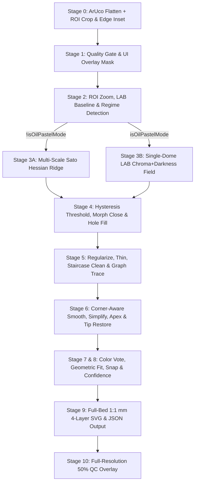

# End-to-End Stroke Detection Workflow (`pipeline_dryrun_stroke_detector.html`)

This document describes the complete 11-stage (Stage 0 to Stage 10) browser-based stroke detection and vectorization workflow implemented in [pipeline_dryrun_stroke_detector.html](file:///c:/Users/nikhil/Coding/urumi-vision-app/pipeline_dryrun_stroke_detector.html). For each stage, it records the exact operations, key parameters, and the technical justification for why each method is used.

---

## High-Level Architecture

---

## Stage 0: Bed Perspective Normalization & ROI Extraction

**Implementation:** `btnRun` click handler ([pipeline_dryrun_stroke_detector.html](file:///c:/Users/nikhil/Coding/urumi-vision-app/pipeline_dryrun_stroke_detector.html#L2300-L2408))

### Methods
1. **4-Corner ArUco Homography (`WarpEngine(2000).normalizePerspective`)**:
   - Detects the 4 corner ArUco markers on the cutting bed and warps the image to a canonical `2000 px` wide bed (`775 × 1065 mm` physical frame).
2. **Workpiece Auto-Detection & Edge Inset (`ContourRoiDetector.detect` / `CardboardDetector` / `openLassoToolAsync`)**:
   - Locates the brown cardboard workpiece bounding box (`detectedBox`) and optionally opens the interactive Lasso modal for confirmation.
   - Shaves `roiInset` (default `16 px`) inward from all 4 sides of `detectedBox` before cropping (`roiX, roiY, roiW, roiH`).

### Justifications
- **Why flatten first?** Camera perspective skews circles into ellipses and distorts physical dimensions. Warping to the ArUco frame establishes a uniform `px/mm` scale (`dots_per_mm`) across the entire workpiece.
- **Why crop and shave `roiInset`?** Processing the entire `2000 × 2748 px` bed wastes resolution on the dark mat and risks detecting the cutting mat or cardboard cut edges as strokes. Shaving `16 px` inward removes the dark shadow along the physical cardboard perimeter.

---

## Stage 1: Capture Quality Gate & Overlay Masking

**Implementation:** [pipeline_dryrun_stroke_detector.html](file:///c:/Users/nikhil/Coding/urumi-vision-app/pipeline_dryrun_stroke_detector.html#L2410-L2451)

### Methods
1. **Focus & Exposure Metrics**: Computes Laplacian variance (`blurScore`) and mean grayscale `brightness` on `grayRoi`.
2. **Color Space Conversion**: Converts `roiCropMat` from `RGBA` to `RGB` and `CIE LAB` (`lRoi`, `aRoi`, `bRoi`).
3. **Overlay & Outside-Lasso Mask (`ignoreMask`)**:
   - Marks near-white UI overlays (`L > 235 && Math.min(r, g, b) > 215`), dilated by a `21 × 21` elliptical kernel.
   - Marks all pixels outside `roiMaskCrop` as ignored (`255`).

### Justifications
- **Why CIE LAB?** LAB separates perceptual lightness (`L*`) from opponent chromaticity (`a*` red-green, `b*` yellow-blue), making brown cardboard illumination changes independent of ink hue.
- **Why dilate `ignoreMask` by `21 × 21`?** Prevents high-contrast UI overlay borders from leaking step-edge responses into the Gaussian blurs and Hessian filters in Stages 2–3.

---

## Stage 2: ROI Supersampling, Background Baseline & Regime Detection

**Implementation:** [pipeline_dryrun_stroke_detector.html](file:///c:/Users/nikhil/Coding/urumi-vision-app/pipeline_dryrun_stroke_detector.html#L2453-L2595)

### Methods
1. **Adaptive Working Resolution**:
   - If `max(roiW, roiH) < 500`, upscales `2.0×` using `cv.INTER_CUBIC`.
   - If `max(roiW, roiH) > 1000`, downscales to `1000 px` long side using `cv.INTER_AREA`.
2. **Border Margin & Neutral Fill**:
   - Adds `borderIgnorePx = clamp(round(6 * zoomScale), 6, 12)` around the working ROI perimeter.
   - Replaces all `ignoreWork > 0` pixels with the median cardboard LAB values `(medL, medA, medB)`.
3. **Local LAB Median Background (`61 × 61` `medianBlur`) & `inkGate`**:
   - Computes `bgLMat`, `bgAMat`, `bgBMat` with `cv.medianBlur(..., 61)`.
   - Computes `inkStrength = hypot(da, db) + 0.30 * max(-dL, 0)` and MAD-calibrated `inkFloor = median + 3.2 * sigma`.
4. **Chroma-Assisted Flat-Field (`flatRaw`, `flatBi`)**:
   - Subtracts a wide illumination field (`GaussianBlur(lFloat, sigma=25)`) from `lFloat`.
   - For dark chromatic pixels (`ld < 0`), boosts contrast when `chromaDev > 5.2` (with `da < 0` weighted `1.85×` for pale green), then applies `cv.bilateralFilter(flatRaw, flatBi, 7, 12, 5)`.
5. **Automatic Drawing-Regime Detection (`isOilPastelMode`)**:
   - Counts valid pixels that are both **bright** relative to cardboard and **high-chroma**: `ld >= -2.0 && hypot(daBg, dbBg) >= 11.0`.
   - Activates `isOilPastelMode` when `brightChromaCnt / validPixCnt >= 0.012` (`>= 1.2%`).

### Justifications
- **Why normalize ROI size to ~`500–1000 px`?** Thin pencil strokes (`3–6 px`) and thick pastel strokes (`12–16 px`) need consistent pixel widths so fixed morphological kernels and smoothing windows behave predictably.
- **Why `61 × 61` median blur + MAD `inkGate`?** Unlike Gaussian blur, a `61 × 61` median ignores ink lines while tracking slow cardboard lighting gradients and rejecting neutral corrugated-flute shadows.
- **Why `1.85×` weighting on `da < 0`?** Light green pencil/pastel on tan cardboard has weak `L*` contrast; amplifying negative `a*` pulls faint green strokes above the noise floor.
- **Why detect `isOilPastelMode` automatically?** Thin pencil/marker strokes are darker than cardboard (`ld < 0`), whereas opaque lime-green and cyan-blue oil-pastel strokes are **brighter** than cardboard (`ld >= 0`) and `3–4×` wider. Separating the two regimes avoids breaking color-pencil accuracy when handling thick opaque pastels.

---

## Stage 3: Stroke Enhancement (Dual Regime)

**Implementation:** [pipeline_dryrun_stroke_detector.html](file:///c:/Users/nikhil/Coding/urumi-vision-app/pipeline_dryrun_stroke_detector.html#L2597-L2676) and `computeSatoStrokeness` ([L1044-L1118](file:///c:/Users/nikhil/Coding/urumi-vision-app/pipeline_dryrun_stroke_detector.html#L1044-L1118))

### Methods
- **Standard Regime (`!isOilPastelMode` — Color Pencil / Marker)**:
  - Runs multi-scale 2D Hessian eigenvalue ridge enhancement (`computeSatoStrokeness`) on `flatBi` with `sigmas = [1.5, 2.5]`:
    $$\lambda_1 = \frac{1}{2}\left((H_{xx} + H_{yy}) + \sqrt{(H_{xx} - H_{yy})^2 + 4H_{xy}^2}\right)$$
  - Fuses flat-field darkness (`inkDark > 6.0`) into the normalized `[0, 1]` ridge map.
- **Oil-Pastel Regime (`isOilPastelMode`)**:
  - Bypasses 2nd-derivative Sato and builds a single-dome LAB chroma+darkness field:
    - `chr = hypot(da < 0 ? da * 1.55 : da, db)`
    - `sig = chr + 0.25 * max(0, -dL)`
    - `oilRaw = max(0, sig - 8.2)`
  - Smooths `oilRaw` with `GaussianBlur(sigma = 0.8)` and normalizes by `0.85 * p98` of non-zero foreground pixels.

### Justifications
- **Why Sato for pencil/marker?** Second-derivative Hessian eigenvalues respond strongly to thin dark ridges (`3–6 px`) and ignore gradual shading or broad cardboard texture. Darkness fusion fills hollow centers at wide stroke junctions.
- **Why a single-dome chroma+darkness field for oil pastel?** Running a 2nd-derivative Sato filter on `12–16 px` flat-topped opaque pastel strokes creates double-edge hollow loops along the stroke borders instead of a single centered ridge. A thresholded chroma+darkness dome produces one solid ridge centered on each pastel stroke.
- **Why `chromaFloor = 8.2` and `sigma = 0.8`?** Lower floors (`5.2`) and wider blurs (`1.5`) create a wide halo that webs across the inner V-valleys of sharp zig-zags and connects nearby smudges.

---

## Stage 4: Hysteresis Thresholding, Morphology & Margin Cleanup

**Implementation:** [pipeline_dryrun_stroke_detector.html](file:///c:/Users/nikhil/Coding/urumi-vision-app/pipeline_dryrun_stroke_detector.html#L2678-L2766)

### Methods
1. **Hysteresis Thresholds**:
   - *Standard*: `highPct = 97.0`, `lowPct = 84.0`, capped relative to `p80` when dense strokes exist (`p95 > 2.8 * p80`), yielding `highVal >= 0.18` and `lowVal in [0.06, 0.07]`.
   - *Oil-Pastel*: `highVal = 0.36`, `lowVal = 0.20`.
   - Keeps `lowMask` connected components that contain at least one `highMask` seed pixel.
2. **Morphological Close & Pinhole Fill**:
   - Applies `cv.MORPH_CLOSE` with an elliptical kernel (`5 × 5` standard, `3 × 3` oil-pastel).
   - Calls `fillSmallMaskHoles(hystMat, 200)` to fill interior holes `< 200 px²`.
3. **Border & Edge-Label Masking**:
   - Zeros `effectiveBorderPx = max(roiBorderMarginPx, borderIgnorePx + 4)`.
   - In `isOilPastelMode`, also zeros the bottom-left margin label zone (`x < 46 && y > workH * 0.70`, e.g., `"OIL PASTEL"`).

### Justifications
- **Why hysteresis?** High seeds reject cardboard grain, while low thresholds preserve faint stroke tips connected to real strokes.
- **Why `3 × 3` close and higher thresholds (`0.36 / 0.20`) in oil-pastel mode?** Thick `16 px` strokes are already solid; a `5 × 5` close or low `0.08` threshold bridges across tight V-corners in zig-zags and picks up faint smudges.
- **Why fill holes `< 200 px²`?** Tiny pinholes inside thick stroke intersections cause Zhang-Suen thinning to emit spurious micro-loops.

---

## Stage 5: Boundary Regularization, Thinning, Staircase Cleanup & Graph Tracing

**Implementation:** [pipeline_dryrun_stroke_detector.html](file:///c:/Users/nikhil/Coding/urumi-vision-app/pipeline_dryrun_stroke_detector.html#L2768-L2999), helpers at [L1452-L2183](file:///c:/Users/nikhil/Coding/urumi-vision-app/pipeline_dryrun_stroke_detector.html#L1452-L2183)

### Methods
1. **Speck Removal & Boundary Regularization**:
   - Removes components with `area < 6 px`.
   - Smooths the binary mask (`GaussianBlur` + `threshold`: `sigma=1.3, thresh=95` standard; `sigma=0.9, thresh=135` oil-pastel) and refills holes `< 200 px²`.
2. **1-px Thinning & 8-Connected Staircase/Pimple Cleanup**:
   - Runs `TraceSkeleton.thinningZS(boolArr, workW, workH)`.
   - Runs `peelSpursAndPimples(boolArr, workW, workH, 1)` and `pruneJunctionHairs(boolArr, workW, workH, 10)`.
   - Inside `removeSkeletonPimples`: runs 2-pass `eliminateStaircases` (removes 4-connected L-corners) and deletes degree-2 / degree-3 triangle-clique pixels whose neighbors are already 8-adjacent.
3. **Same-Color Endpoint Bridging (`linkSkeletonEndpoints`)**:
   - Bridges endpoints within `endpointBridgeMaxDistPx` (`12 px`) when they share the same color label and either point collinearly (`cos >= 0.82`) or form a tiny gap (`<= 3.5 px`), then re-prunes hairs.
4. **Universal Loop + Junction Graph Tracer (`traceSkeletonComponents`)**:
   - *Case 1 (`largeHoles === 1`)*: Peels spurs and orders the closed cycle (`orderClosedCycle`).
   - *Case 2A (`maxDeg < 3`)*: Orders unbranched open curves via two-pass BFS (`orderSimpleChain`).
   - *Case 2B (`maxDeg >= 3`)*: Clusters `deg >= 3` junctions (`3 × 3` dilation), extracts degree-2 edges, protects the 2 longest arms (`>= 10 px`) at every junction, pairs collinear or sharp-turn continuations, and splits multi-loop planar graphs (`largeHoles >= 2`) at sharp corners (`<= 128°`).
5. **Island Merging & Length Filtering**:
   - Merges short open islands (`< 14 px`) into aligned same-color long chains (`<= max(15, bridgeDist)`, `dot <= -0.65`).
   - Drops final chains shorter than `minChainLengthPx` (or `45 px` in oil-pastel mode).

### Justifications
- **Why boundary-regularize before thinning?** Ragged wax/pencil edges cause medial-axis thinning to sprout false side hairs along every stroke.
- **Why `eliminateStaircases` and 3-clique removal?** `thinningZS` leaves 4-connected diagonal staircases and 3-pixel apex triangles. In 8-connectivity, those pixels have degree `>= 3`, causing the graph tracer to misclassify diagonal zig-zag legs as junctions and prune the outer legs as spurs. Removing staircases eliminates those false junctions.
- **Why protect the 2 longest arms at each junction?** Ensures real zig-zag legs or intersecting strokes are never deactivated as dead-end spurs.

---

## Stage 6: Corner-Aware Smoothing, Simplification & Geometry Restoration

**Implementation:** [pipeline_dryrun_stroke_detector.html](file:///c:/Users/nikhil/Coding/urumi-vision-app/pipeline_dryrun_stroke_detector.html#L3001-L3547)

### Methods
1. **Terminal Hook Trimming (`trimTerminalHooksJS`)**:
   - Trims sharp terminal hooks (`<= 10 px`, turn `>= 68°`) only on single-segment lines (`hasInternalCorners === false`).
2. **Corner-Aware Smoothing (`smoothChainCornerAwareJS`)**:
   - Detects sharp corners (`detectSharpCornersJS`) and applies 9-point weighted smoothing (`[1, 2, 3, 4, 5, 4, 3, 2, 1]`) strictly *between* corners (or two global passes on smooth oil-pastel waves).
3. **Regime-Specific Simplification & Corner/Tip Restoration (Oil-Pastel Mode)**:
   - **`isTrueOilPastelZigzagJS`**: Identifies true sharp zig-zags (`4–6` RDP vertices at `epsilon=6.0`, leg lengths `>= 18 px`, interior angles `<= 125°`) so smooth waves stay smooth (`epsilon=1.4`).
   - **`projectZigzagApexCornersJS`**: Fits Total Least Squares (TLS) lines to the middle `60%` (`18%..82%`) of each zig-zag leg and projects interior vertices to the exact line-line intersection (up to `18 px`).
   - **`projectClosedQuadCornersJS`**: For non-circular 4-sided closed loops (`rdpSimplify(6.5)` with `5` points), fits TLS lines to the middle `60%` of each side and intersects them at 4 sharp corners.
   - **`extendOpenStrokeTipsInMaskJS`**: Extends open stroke start/end points along their end tangent up to `7 px` while staying inside `cleanData`.
4. **Post-Simplification Curve Merging**:
   - Merges same-color open curves whose endpoints lie within `16 px` with compatible tangents, then re-runs simplification and oil-pastel apex/tip restoration.

### Justifications
- **Why corner-aware smoothing?** Global smoothing rounds off sharp corners on squares, triangles, and zig-zags; bounding the 9-point filter between detected corners removes pixel-grid jitter without dulling vertices.
- **Why TLS apex projection & tip extension on oil pastels?** Thick `16 px` strokes round off inside V-corners and pull skeleton endpoints inward by ~half the stroke width (`6–8 px`). Intersecting straight leg fits and extending tips inside the binary mask recovers crisp pointed vertices and full stroke length.

---

## Stage 7 & 8: Color Classification, Geometric Fitting, Constraint Solver & Confidence

**Implementation:** `classifyCurveLayer` ([L2186-L2282](file:///c:/Users/nikhil/Coding/urumi-vision-app/pipeline_dryrun_stroke_detector.html#L2186-L2282)), `fitGeometricModel` ([L1253-L1450](file:///c:/Users/nikhil/Coding/urumi-vision-app/pipeline_dryrun_stroke_detector.html#L1253-L1450)), Stage 7/8 loop ([L3549-L3797](file:///c:/Users/nikhil/Coding/urumi-vision-app/pipeline_dryrun_stroke_detector.html#L3549-L3797))

### Methods
1. **Multi-Space Color Voting (`classifyCurveLayer`)**:
   - Trims endpoint/junction regions on open curves, samples up to `45` points, finds the darkest `L*` pixel in a `5 × 5` window, and votes using both optical RGB absorption and local+global LAB residuals (`red -> score`, `blue -> thru_cut`, `green -> crease`, `black -> thru_cut`).
2. **Hierarchical Model Selection (`fitGeometricModel`)**:
   - Tests in order:
     1. **TLS Line**: `signChanges <= 2`, `lineErr <= 2.8 px`, `lineInlierRatio >= 0.65`.
     2. **Sharp Polygon Guard**: Closed loops with `4–7` vertices (`rdpSimplify(4.5)`) and `minInteriorAngleDeg <= 122°` stay polylines.
     3. **Algebraic Kåsa Circle**: `cErr <= max(3.0, 0.065 * r)`, `cInlierRatio >= 0.80`, `coverage >= 260°`.
     4. **Ellipse (`cv.fitEllipse`)**: `eErr <= max(3.0, 0.065 * rMax)`, `eInlierRatio >= 0.80`, `eCov >= 260°`.
     5. **Freehand Polyline**: Fallback for waves, zig-zags, and polygons.
3. **Flute Rejection, Endpoint Snapping & Deduplication**:
   - Rejects short (`< 65 px`), near-horizontal (`dy / len < 0.14`), low-contrast (`< 0.28`) lines (corrugation flutes).
   - Snaps mutual-nearest same-color endpoints within `maxSnapPx = 14.0 px` (using line-line intersection for 2-line corners).
   - Deduplicates overlapping collinear lines (`dDirect < 8.0 || dOpp < 8.0`), prioritizing red `score` over green `crease`.
4. **Confidence Score**:
   - `conf = 0.3 * inlierRatio + 0.3 * min(coverage / 180, 1) + 0.2 * max(0, 1 - fitError / 6) + 0.2 * meanContrast`.
   - Reports `status = 'detected'` when `fittedCurves.length > 0 && maxConf >= 0.45`.

### Justifications
- **Why trim endpoints before color voting?** Prevents multi-color T/X-junctions from contaminating a segment's color vote.
- **Why guard sharp polygons before circle/ellipse fitting?** A hand-drawn 4-sided square or 3-sided triangle can otherwise satisfy loose ellipse residual bounds and get converted into an oval.

---

## Stage 9 & 10: Bed Coordinate Mapping, Layered SVG Export & QC Overlay

**Implementation:** [pipeline_dryrun_stroke_detector.html](file:///c:/Users/nikhil/Coding/urumi-vision-app/pipeline_dryrun_stroke_detector.html#L3798-L3843)

### Methods
1. **Un-Scaling to Full Bed**: Maps every point from zoomed ROI space back to full ArUco bed pixels: `(x * scaleX + roiX, y * scaleY + roiY)`.
2. **4-Layer SVG Generation (`SvgGenerator.generateLayeredSvg`)**: Outputs `1:1 mm` SVG with `<g id="bed">`, `<g id="red">`, `<g id="green">`, and `<g id="blue">`.
3. **Full-Resolution QC Overlay**: Blends (`50% / 50%`) all detected primitives onto the flattened ROI photo `rgbRoi`.

### Justifications
- **Why map back to full bed `mm`?** Downstream cutting/creasing/scoring toolpaths operate in absolute ArUco bed coordinates (`775 × 1065 mm`), while visual QC at `50%` opacity on the original ROI lets an operator immediately verify geometric alignment.
