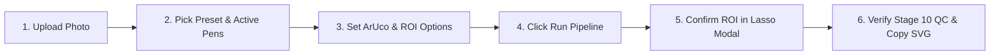

# Urumi Vision: User & Operator Instruction Manual

This manual provides step-by-step instructions to set up the physical cutting bed, take good photographs, run the browser stroke-detection dashboard ([pipeline_dryrun_stroke_detector.html](file:///c:/Users/nikhil/Coding/urumi-vision-app/pipeline_dryrun_stroke_detector.html)), tune parameters for different drawing tools, run the mobile receiver or Python CLI, and solve common problems.

> [!TIP]
> For a mathematical and algorithmic deep dive into how the 11 stages work internally, read the companion textbook: [STROKE_DETECTION_WORKFLOW_END_TO_END.md](file:///c:/Users/nikhil/Coding/urumi-vision-app/docs/STROKE_DETECTION_WORKFLOW_END_TO_END.md).

---

## Table of Contents

1. [Overview and Pen-Color Rules](#1-overview-and-pen-color-rules)
2. [Physical Bed and Camera Preparation](#2-physical-bed-and-camera-preparation)
3. [Starting the Application on Your Computer](#3-starting-the-application-on-your-computer)
4. [Step-by-Step Procedure: Browser Stroke Detector](#4-step-by-step-procedure-browser-stroke-detector)
5. [How to Read Each Stage Card (Quality Check Guide)](#5-how-to-read-each-stage-card-quality-check-guide)
6. [Advanced Settings Tuning Manual](#6-advanced-settings-tuning-manual)
7. [Mobile-to-Desktop Live Camera Workflow](#7-mobile-to-desktop-live-camera-workflow)
8. [Python Command-Line Interface (Batch / Offline Mode)](#8-python-command-line-interface-batch--offline-mode)
9. [Troubleshooting Guide](#9-troubleshooting-guide)

---

## 1. Overview and Pen-Color Rules

Urumi Vision converts hand-drawn lines and shapes on a cardboard sheet into a millimeter-accurate (`1:1 mm`), 4-layer CNC SVG file. The SVG file contains 4 ordered semantic `<g>` layers:

| Layer # | Drawing Color / Input | Tool Layer ID | SVG Group | Machine Operation |
| :--- | :--- | :--- | :--- | :--- |
| **1** | *(Hardware reference)* | `bed` | `<g id="bed" data-role="reference">` | Machine bed frame (`775 × 1065 mm`) and cardboard boundary polygon (reference only; ignored by cutter). |
| **2** | **Red** | `score` | `<g id="red">` | Partial-depth cut through the top paper liner for outward folds (runs 1st). |
| **3** | **Green** | `crease` | `<g id="green">` | Blunt wheel impression for inward folds without cutting fibers (runs 2nd). |
| **4** | **Blue** | `thru_cut` | `<g id="blue">` | Full-depth blade cut all the way through the cardboard (runs 3rd). |
| **—** | **Black** | `thru_cut` | `<g id="blue">` | Full-depth blade cut (mapped to the same `thru_cut` layer as Blue). |

**Supported Drawing Media:**
- Fine ballpoint pens (`0.5 mm` – `0.7 mm`)
- Colored pencils
- Felt-tip / permanent markers
- Thick opaque oil pastels / wax crayons (detected automatically)

---

## 2. Physical Bed and Camera Preparation

Follow this checklist before taking a photograph:

1. **Keep all 4 corner ArUco markers fully visible:**
   - The 4 square black-and-white corner tags (`ID 12` top-left, `ID 13` top-right, `ID 14` bottom-right, `ID 15` bottom-left) must be inside the camera frame and unobstructed by wires, hands, or tools.
2. **Place the cardboard inside the black mat:**
   - Leave at least `20 mm` of visible black mat between the cardboard sheet and the checkered ArUco border so auto-ROI detection cleanly finds all four edges of the cardboard.
3. **Ensure even lighting and sharp focus:**
   - Avoid harsh spotlight glare or dark body/phone shadows across the cardboard.
   - Tap the cardboard on your phone screen to lock focus before pressing the shutter, and hold the camera steady so lines are crisp (`ROI Blur` score in Stage 1 should be `> 30`).
4. **Draw clean, deliberate strokes:**
   - Leave at least `5 mm` inside the physical edge of the cardboard sheet (outer cut-edge margins are shaved away automatically to prevent cardboard edge shadows from registering as cuts).
   - Close loops cleanly when drawing circles, squares, or triangles.

---

## 3. Starting the Application on Your Computer

Because browsers block local WebAssembly models (`cardboard_detector.onnx`) and default test images when opened directly as `file:///`, always serve the project folder over a local HTTP server.

### Step 3.1: Start a Local Web Server

Open PowerShell or Command Prompt in `c:\Users\nikhil\Coding\urumi-vision-app` and run **one** of these commands:

```powershell
# Option A: Using Python (Recommended)
python -m http.server 8000
```

```powershell
# Option B: Using Node.js
npx http-server -p 8000
```

### Step 3.2: Open the Dashboard in Chrome or Edge

1. Open your browser and go to:
   `http://localhost:8000/pipeline_dryrun_stroke_detector.html`
2. Look at the status badge in the top-left corner of the toolbar:
   - Wait `1–3` seconds until `OpenCV loading...` turns green and says **`OpenCV ready`**.
   - Once `OpenCV ready` appears, the **Choose File** input and **Run 9-Stage Pipeline** button unlock automatically.

> [!NOTE]
> **Custom ArUco Bed Sizes:** By default, ArUco IDs `12–15` assume marker centers at `830 × 1130 mm` (`775 × 1065 mm` inner cutting area). If you use a custom frame size, append `?w=<width_mm>&h=<height_mm>` to the URL (for example, `http://localhost:8000/pipeline_dryrun_stroke_detector.html?w=830&h=1130`).

---

## 4. Step-by-Step Procedure: Browser Stroke Detector



### Step 1: Select an Input Image
- Click **Choose File** (`Input` group, Row 1) and select a `.jpg` or `.png` photo from your computer (or keep the preloaded `test_images/colorpencil.jpg` sample to test right away).

### Step 2: Select a Preset (Row 1 — `Presets`)
Click the preset button that matches your drawing tool:
- **Fine Pen (Faint):** Use for thin `0.5 mm` ballpoint pens or light pencil lines (`Sigmas = 1.0, 1.8`, `High/Low = 95% / 85%`, `Min Size = 16 px`, `Prune Spurs = 16 px`).
- **Marker (Default):** Use for felt-tip markers, regular pens, and standard colored pencils (`Sigmas = 1.5, 2.5`, `High/Low = 97% / 90%`, `Min Size = 22 px`, `Prune Spurs = 24 px`).
- **Noisy Cardboard:** Use when coarse, dark corrugated cardboard stripes are heavy (`Sigmas = 2.0, 3.0`, `High/Low = 98% / 92%`, `Min Size = 30 px`, `Prune Spurs = 28 px`).
- *(Note: Thick opaque **Oil Pastels** are detected automatically in Stage 2 — no special preset click is needed.)*

### Step 3: Choose Active Tool Layers (Row 1 — `Active Tool Layers`)
- Keep **Blue (Cut)**, **Red (Score)**, **Green (Crease)**, and **Black (Cut)** checked.
- Uncheck any color you want the detector to ignore completely (for example, uncheck **Black (Cut)** if your cardboard has black pre-printed shipping text that you do not want to cut).

### Step 4: Configure Bed Calibration & Cardboard ROI (Row 2)
1. **Flatten Bed (ArUco):**
   - Keep **checked** whenever photographing the physical cutting bed with 4 corner ArUco markers.
   - **Uncheck** only if you are uploading a pre-cropped close-up photo that has no ArUco markers.
2. **Cardboard ROI Method:**
   - **Auto-Detect (Contours)** *(Default, fastest)*: Automatically finds brown kraft cardboard (or ink clusters on white paper) using OpenCV HSV segmentation.
   - **Auto-Detect (YOLO):** Uses the in-browser YOLOv8 neural network (`cardboard_detector.onnx`) for complex lighting or non-brown sheets.
   - **None (Full Bed):** Processes the entire bed without auto-cropping.
3. **Edge Inset (`16 px` default):**
   - Shaves `16` pixels inward from all four outer edges of the detected cardboard sheet so dark shadows at the cardboard's cut edges are ignored. Increase to `24–36 px` if thick cardboard casts a wide shadow.
4. **Confirm with Lasso:**
   - Keep **checked** if you want to visually inspect or adjust the crop box before detection runs. Uncheck for fully automatic hands-free runs.

### Step 5: Click `Run 9-Stage Pipeline` & Confirm the ROI
1. Click the blue **Run 9-Stage Pipeline** button.
2. If **Confirm with Lasso** is checked (and ArUco flattening succeeded), a fullscreen preview modal opens showing the flattened bed with a blue rectangle around the detected cardboard:
   - **To accept the auto-detected box as-is:** Click **Confirm & Process** (green button).
   - **To draw a new rectangle:** Click **Rectangle**, then click-and-drag across your cardboard area, and click **Confirm & Process**.
   - **To trace an angled or irregular sheet:** Click **Polygon**, click each corner around the cardboard (staying slightly *inside* the physical cardboard edges, off the black mat), and click **Confirm & Process**.
   - **To reset your selection:** Click **Clear**.

---

## 5. How to Read Each Stage Card (Quality Check Guide)

After clicking **Confirm & Process**, read the cards from left to right:

| Card | What You Should See | Warning Sign to Watch For |
| :--- | :--- | :--- |
| **ArUco Flatten & Lasso ROI** | Top: Straightened `2000 × 2748 px` bed. Bottom: Tight crop of your cardboard sheet. | `"No 4 ArUco markers found"` — ensure all 4 corner markers are visible and unblurred. |
| **Stage 1: Quality Gate** | Mostly black mask (black = valid area to process; white = ignored UI overlay or outside-Lasso margin). `ROI Blur > 30`. | Very low `ROI Blur (< 15)` means the camera was out of focus. |
| **Stage 2: Zoom & Flat-Field** | Top: Evenly lit gray cardboard with dark strokes. Bottom: Vivid Red, Green, and Blue stroke pixels on black. | Strong horizontal/vertical stripes remaining on ultra-rough cardboard $\to$ try the **Noisy Cardboard** preset. |
| **Stage 3: Sato Ridge** | Pitch-black background with bright white stroke ridges. | Faint broken ridges on thin ballpoint ink $\to$ switch to **Fine Pen (Faint)**. |
| **Stage 4: Hysteresis Mask** | Solid white strokes, clean per-color composite (`Red/Green/Blue px` counts), and smooth regularized mask. | Webbing between parallel strokes $\to$ raise `High %` slightly or reduce `Close` to `3 px`. |
| **Stage 5: Skeleton Graph** | Crisp `1 px` colored centerlines with yellow dots marking open chain endpoints. | Extra whiskers at corners $\to$ increase `Prune Spurs` by `4–8 px`. |
| **Stage 6: Vectorize** | Smooth simplified polylines overlaid on the zoomed cardboard. | Rounded zig-zag corners $\to$ lower `Sigmas` or check focus. |
| **Stage 7 & 8: Fitted & Confidence** | Exact `line`, `circle`, `ellipse`, and `freehand` labels with `Status: detected` and `Max Confidence >= 0.45`. | `Status: not_detected` means no valid strokes passed color and confidence checks. |
| **Stage 9: Final 4-Layer SVG** | Scalable `775 × 1065 mm` vector drawing with dashed bed reference and colored tool layers. | Inspect SVG element order (`bed`, `red`, `green`, `blue`). |
| **Stage 10: 50% QC Overlay** | **Most important visual check:** Semi-transparent vector lines sitting directly on top of the original ink photo. | Any visible offset between the vector line and the real ink means an ArUco marker was partially occluded or bent. |

---

## 6. Advanced Settings Tuning Manual

Click **Advanced Settings ▾** (Row 1, right side) to reveal Row 3 fine-tuning controls:

> [!IMPORTANT]
> **`High / Low %` are PERCENTILES (`75` to `99.5`), NOT decimals (`0.0` to `1.0`)!**
> Enter values like `97.0` and `84` (meaning the 97th and 84th percentiles). Never enter `1.0` or `0.8`.

1. **Filter Scales (`Sigmas`, default `1.5, 2.5`):**
   - Controls the stroke widths (in working pixels) enhanced by the Stage 3 Hessian filter.
   - Thin ballpoint pen: `1.0, 1.8`
   - Normal pen / colored pencil: `1.5, 2.5`
   - Broad felt marker: `2.0, 3.5`
2. **Detection Thresholds (`High / Low %`, default `97.0` / `84`):**
   - **High % (`75..99.5`):** Controls how strong a pixel must be to *start* a stroke. Raise (e.g., `98.0`) to suppress background specks; lower (e.g., `94.5`) if entire faint strokes are missing.
   - **Low % (`55..98`):** Controls how far faint stroke tails stay connected to strong seeds. Lower (e.g., `80`) if single lines break into dashes; raise (e.g., `90`) if nearby strokes bleed into background grain.
3. **Close (`5 px` default, odd integers `3..9`):**
   - Morphological gap-welding radius in Stage 4. Use `3 px` for tightly spaced zig-zags or dense hatch marks; use `5 px` or `7 px` for dry skippy pens.
4. **Bridge (`12 px` default, `0..40 px`):**
   - Maximum pixel gap jumped between two aligned same-color skeleton endpoints in Stage 5. Set to `0` to disable gap bridging completely.
5. **Border (`18 px` default, `0..40 px`):**
   - Width of the safety frame masked out around the perimeter of the zoomed ROI. Increase to `24–30 px` if edge shadows appear along the border of the crop.
6. **Min Size (`22 px` default, `10..300 px`):**
   - Minimum pixel span required to keep a skeleton component. Lower to `12–16 px` if tiny intentional details or short tick marks are filtered out; raise to `35–50 px` to ignore coarse cardboard blemishes.
7. **Prune Spurs (`24 px` default, `0..100 px`):**
   - Maximum length of dead-end side hairs removed at intersections. Lower to `8–12 px` if short legitimate branches attached to a line are removed; raise to `32 px` if fuzzy marker intersections leave tiny spikes.

---

## 7. Mobile-to-Desktop Live Camera Workflow

To photograph the cutting bed with a smartphone and stream the resulting SVG directly to a desktop computer over Wi-Fi:

1. Start the local server (`python -m http.server 5500`) on the desktop computer.
2. On the desktop browser, open [test_receiver.html](file:///c:/Users/nikhil/Coding/urumi-vision-app/test_receiver.html) at `http://localhost:5500/test_receiver.html`. A **QR code** and pairing URL will appear.
3. Connect your smartphone to the same Wi-Fi network (or expose port `5500` via an HTTPS tunnel if mobile camera permissions require HTTPS) and scan the QR code to open [index.html](file:///c:/Users/nikhil/Coding/urumi-vision-app/index.html).
4. Tap the **Capture** button on your phone, photograph the bed, confirm the Lasso mask if prompted, and view the live processed SVG on the desktop receiver screen.

---

## 8. Python Command-Line Interface (Batch / Offline Mode)

A standalone Python implementation in `stroke_detector/` lets you process images from a terminal or automated script and save `output.svg`, `result.json`, and debug stage PNGs directly to disk.

### Basic CLI Commands

```powershell
# Flatten ArUco bed, auto-crop & zoom cardboard ROI, and save all debug stage PNGs:
python -m stroke_detector.cli test_images/colorpencil.jpg --aruco --auto-roi --debug --out out/colorpencil

# Process an already-cropped image without ArUco markers:
python -m stroke_detector.cli test_images/2_colour_test.jpg --debug --out out/2_colour

# Specify an explicit ROI box (x,y,w,h in warped bed pixels):
python -m stroke_detector.cli test_images/ballPen.jpg --aruco --roi 422,965,1369,1154 --debug --out out/ballpen
```

**Output Files Generated in `--out`:**
- `output.svg` — Final `1:1 mm` 4-layer CNC SVG file.
- `result.json` — Structured JSON containing `status`, `confidence`, `curves` (type, layer, coordinates, residuals), and timing metadata.
- `01_capture.png` through `09_output.png` *(when `--debug` is passed)* — Visual diagnostic panels for every stage.

---

## 9. Troubleshooting Guide

| Symptom | Cause | Immediate Fix |
| :--- | :--- | :--- |
| Top-left badge stays stuck on **`OpenCV loading...`** | No internet access to load OpenCV.js CDN, or browser blocked script. | Check internet connection and press `Ctrl + F5` (the app will automatically try both `docs.opencv.org` and `jsDelivr`). |
| Default image fails to load or YOLO throws a fetch/CORS error | File was opened via double-click (`file:///`) instead of a local server. | Run `python -m http.server 8000` and open `http://localhost:8000/pipeline_dryrun_stroke_detector.html`. |
| Log says **`Less than 4 ArUco markers found`** | One corner marker is outside the photo, covered by a cable/hand, or glared out. | Re-take the photo ensuring all 4 corner tags (`12, 13, 14, 15`) have sharp white borders around them. |
| Cardboard cut edge is detected as a straight blue/black line | Lasso box extended onto the black cutting mat, or cardboard casts a thick edge shadow. | Increase **Edge Inset** to `28 px` (or **Border** to `24 px`), and draw the Lasso slightly *inside* the cardboard perimeter. |
| Faint ballpoint pen or light green pencil lines are missing or dashed | Default `1.5, 2.5` filter scale is too wide for `0.5 mm` ink. | Click the **Fine Pen (Faint)** preset (`Sigmas = 1.0, 1.8`, `High/Low = 95 / 85`). |
| Corrugated cardboard stripes create extra horizontal lines or web strokes together | Coarse cardboard fluting shadows are unusually deep. | Click the **Noisy Cardboard** preset (or set `Close = 3 px` and `Min Size = 30 px`). |
| Pre-printed black shipping stamps or logos on reused cardboard get traced | Black ink maps to `thru_cut` when **Black (Cut)** is enabled. | Uncheck the **Black (Cut)** pill in Row 1 and draw your cut lines with a **Blue** pen instead. |
| A square or triangle got rounded into a circle/ellipse | Corners were drawn very rounded (`> 122°` interior angle). | Draw firmer, pointed corners where sides meet so the sharp-polygon guard locks the vertices. |
