# Image Example: Cardboard Detection and Automated Workpiece ROI Extraction

This document explains the computer vision and deep learning pipeline that detects corrugated cardboard workpieces and creates an automatic Region of Interest (ROI) mask.

---

## 1. Overview and System Parameters

This pipeline automatically finds cardboard workpieces on the cutting table. It replaces manual polygon lasso selection with an automated neural network detector.

### System Parameters

- **Input Image:** Handheld mobile camera photograph (`box_outline.jpg`)
- **Input Resolution:** 2268 x 4032 pixels
- **Calibration System:** 4 ArUco markers (`DICT_4X4_50`, IDs 12 to 15)
- **Cutting Bed Dimensions:** 775.0 x 1065.0 mm inner cutting area
- **Warped Working Resolution:** 2000 x 2748 pixels (2.58 pixels/mm)
- **Neural Network Model:** Fine-tuned YOLOv8 Nano (`cardboard_detector.onnx`)
- **Model Input Size:** 640 x 640 pixels (RGB, NCHW float32)
- **Model Output Shape:** 1 x 5 x 8400 (bounding box and box confidence)
- **Default Confidence Threshold:** 0.25 (25%)
- **Edge Shave Margin:** 20 pixels inward padding
- **Detected Workpiece Confidence:** 93.1%

### Technical Problem and Objective

Manual selection requires user interaction:
- The operator must inspect the image after perspective correction.
- The operator must draw a polygon around the cardboard workpiece.
- Outer borders, gantry frames, and background shadows can cause errors during ink extraction.

The automated detection model solves these problems:
- It isolates the cardboard workpiece automatically.
- It rejects the surrounding machine bed and table elements.
- It removes edge shadows and corrugated flutes before ink extraction.

---

## 2. Input Image to Final Detected Workpiece

Here is the direct comparison between the initial mobile camera photograph and the final isolated workpiece.

### Step 0: Input Capture
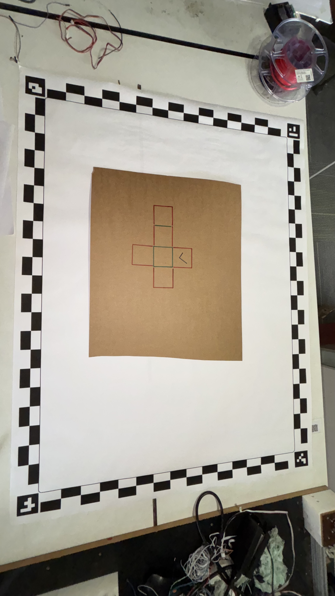
*Raw photograph of the cutting table with ArUco markers and cardboard workpiece.*

### Step 7: Isolated Cardboard Workpiece
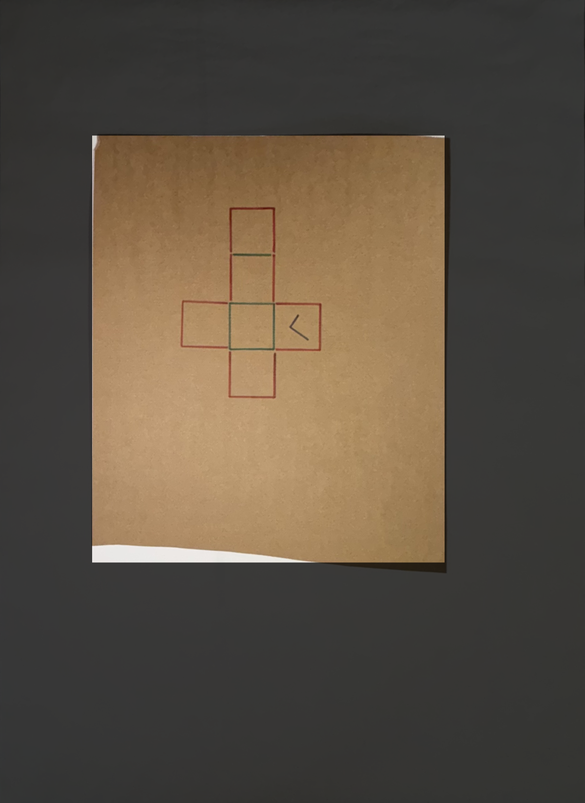
*Workpiece isolated with the automated ROI mask. Background area is attenuated.*

---

## 3. Architecture Flowchart

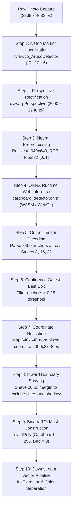

---

## 4. Step-by-Step Pipeline Breakdown

### Phase 1: Image Rectification and Geometric Calibration

---

#### Step 0: Raw Photo Ingestion
- **Input:** Camera image file (`box_outline.jpg`).
- **Dimensions:** 2268 x 4032 pixels.
- **Content:** White calibration bed, 4 corner ArUco markers, and brown corrugated cardboard workpiece.


---

#### Step 1: ArUco Marker Localization
- **Module:** `WarpEngine.js`
- **Function:** `cv.aruco_ArucoDetector`
- **Dictionary:** `DICT_4X4_50`
- **Marker IDs:** 12 (top-left), 13 (top-right), 14 (bottom-right), 15 (bottom-left)
- **Purpose:** Identifies the four physical reference corners. Marker IDs provide orientation independence.

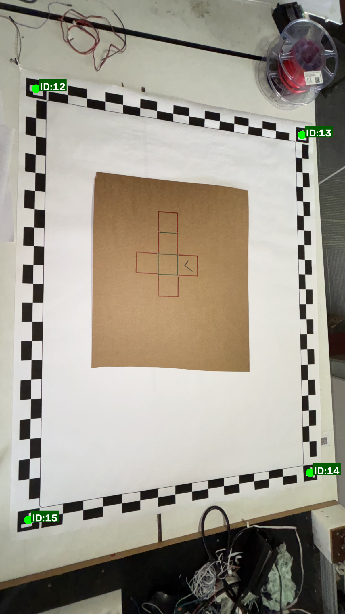

---

#### Step 2: Perspective Homography and Rectification
- **Module:** `WarpEngine.js`
- **Function:** `cv.warpPerspective`
- **Output Dimensions:** 2000 x 2748 pixels.
- **Resolution Scale:** 2.58 pixels/mm.
- **Physical Area:** 775.0 x 1065.0 mm.
- **Purpose:** Removes lens distortion, perspective tilt, and camera angles. Produces a flat, top-down view of the cutting area.

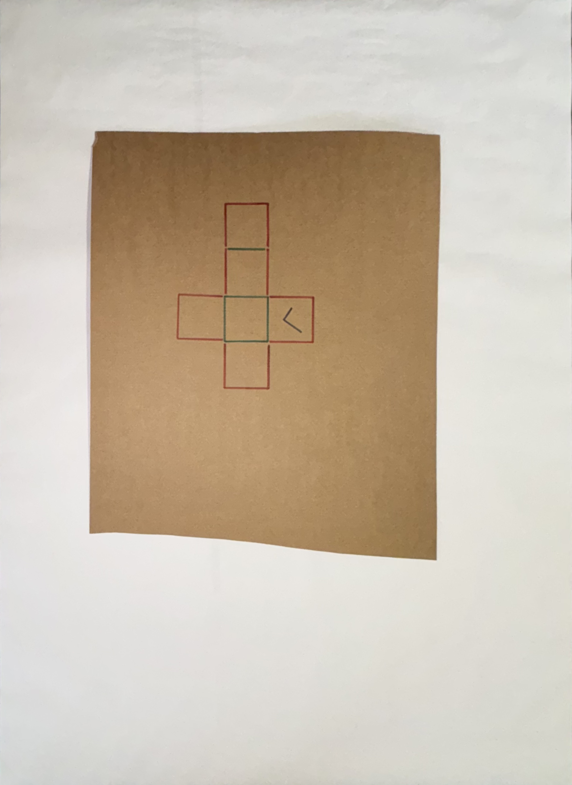

---

### Phase 2: Neural Network Inference and Tensor Processing

---

#### Step 3: Tensor Preprocessing
- **Module:** `CardboardDetector.js`
- **Function:** `preprocess(sourceCanvas)`
- **Input:** 2000 x 2748 pixel rectified canvas.
- **Process:**
  - Draws the canvas to an off-screen 640 x 640 element.
  - Converts pixel data from RGBA to planar RGB format.
  - Normalizes pixel values from `[0..255]` to `[0.0..1.0]`.
- **Output Tensor:** Shape `[1, 3, 640, 640]`, data type `float32`.


---

#### Step 4: ONNX Runtime Web Model Execution
- **Module:** `CardboardDetector.js`
- **Runtime:** `onnxruntime-web` (`ort.InferenceSession`)
- **Backend:** WebAssembly (`wasm`) or WebGL
- **Model File:** `cardboard_detector.onnx` (YOLOv8 Nano backbone)
- **Output Name:** `output0`
- **Output Tensor Shape:** `[1, 5, 8400]`

The output tensor contains 8400 anchor predictions:
- Row 0: Center X coordinate (`cx`)
- Row 1: Center Y coordinate (`cy`)
- Row 2: Box Width (`w`)
- Row 3: Box Height (`h`)
- Row 4: Class Confidence Score (`box`)

The 8400 predictions come from three feature pyramid strides:
- **Stride 8:** 80 x 80 = 6400 grid cells (detects small objects)
- **Stride 16:** 40 x 40 = 1600 grid cells (detects medium objects)
- **Stride 32:** 20 x 20 = 400 grid cells (detects large objects)

The visual comparison below shows confidence score heatmaps for all three strides. The large cardboard sheet activates only the Stride 32 head.

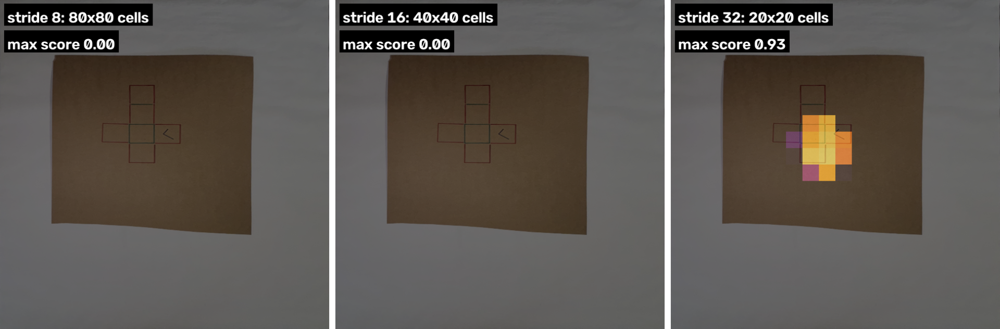
*Left: Stride 8 (0.00 max). Center: Stride 16 (0.00 max). Right: Stride 32 (0.93 max score).*

---

#### Step 5: Candidate Box Extraction
- **Threshold Rule:** Keep all anchors where `confidence > 0.25`.
- **Selection Logic:** Select the candidate anchor with the highest confidence score.
- **Results for Test Image:**
  - Total anchors above 0.25 threshold: 10 anchors
  - Best anchor index: Index 8286
  - Best confidence score: 93.1%

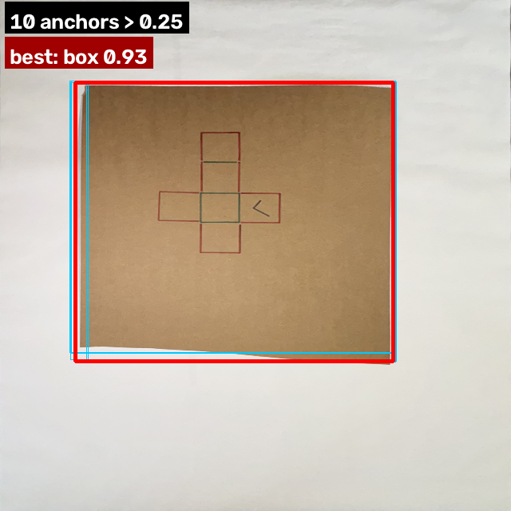
*Cyan rectangles show candidate anchors above 0.25. Red rectangle shows the best candidate.*

---

### Phase 3: Coordinate Remapping and Edge Conditioning

---

#### Step 6: Coordinate Scaling to Warped Canvas
- **Scale Factor X:** 2000 / 640 = 3.125
- **Scale Factor Y:** 2748 / 640 = 4.29375
- **Formula:**
  - `boxX = (cx - w / 2) * scaleX`
  - `boxY = (cy - h / 2) * scaleY`
  - `boxWidth = w * scaleX`
  - `boxHeight = h * scaleY`
- **Unshaved Bounding Box:**
  - X: 295 px
  - Y: 444 px
  - Width: 1244 px
  - Height: 1500 px
  - Confidence: 93.1%

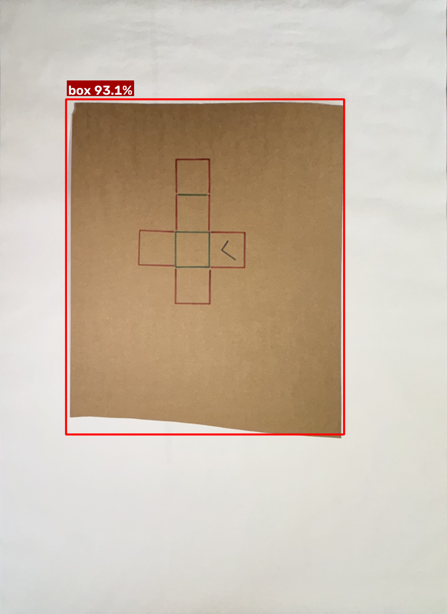
*Raw bounding box (red outline) mapped back to the 2000 x 2748 pixel warped canvas.*

---

#### Step 7: Edge Shaving (Inward Padding)
- **Module:** `pipeline_dryrun.html` (control `roiInset`)
- **Default Inset Value:** 20 pixels
- **Technical Justification:**
  - Cardboard edges often produce deep drop-shadows.
  - Cut edges display rough paper flutes and manufacturing marks.
  - Inward shaving stops edge artifacts from entering downstream ink extraction.
- **Formula:**
  - `insetX = min(shavePx, floor(boxWidth * 0.4))`
  - `insetY = min(shavePx, floor(boxHeight * 0.4))`
  - `finalX = boxX + insetX`
  - `finalY = boxY + insetY`
  - `finalWidth = boxWidth - 2 * insetX`
  - `finalHeight = boxHeight - 2 * insetY`
- **Final Shaved Bounding Box:**
  - X: 315 px
  - Y: 464 px
  - Width: 1204 px
  - Height: 1460 px

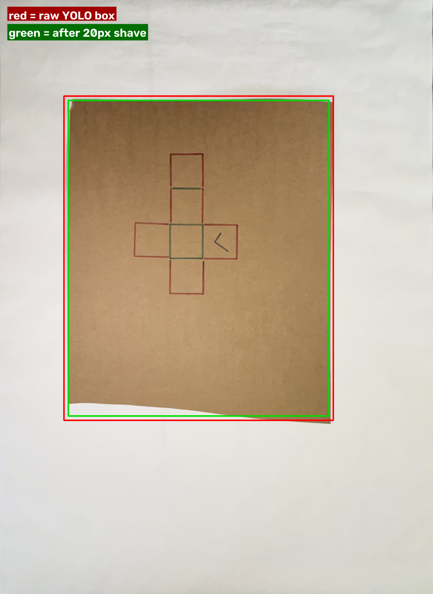
*Red outline shows the raw YOLO box. Green outline shows the clean box after a 20 px inward shave.*

---

### Phase 4: Mask Generation and Workpiece Isolation

---

#### Step 8: Binary ROI Mask Generation
- **Function:** `cv.fillPoly`
- **Output Mat:** Single-channel 8-bit image (`cv.CV_8UC1`), 2000 x 2748 pixels.
- **Pixel Values:**
  - Cardboard Workpiece Interior: 255 (White)
  - Surrounding Calibration Bed: 0 (Black)

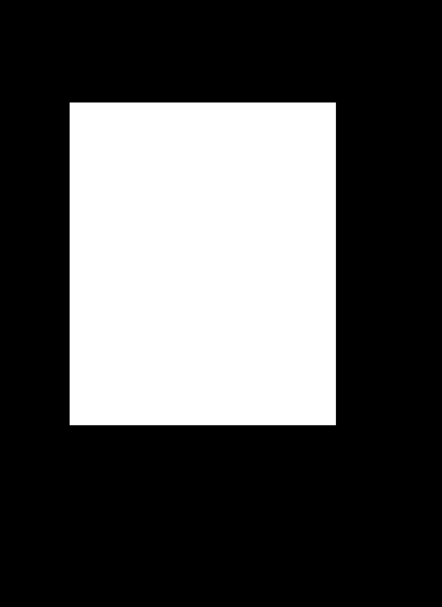
*Binary ROI mask used to restrict subsequent ink extraction stages.*

---

#### Step 9: Downstream Integration
- The binary mask enters `InkExtractor.js`.
- `cv.bitwise_and` applies the mask to the extracted ink strokes.
- Calibration rulers, frame lines, and table shadows outside the mask are excluded.
- Vector paths are generated exclusively from drawings located on the cardboard sheet.


*Final isolated workpiece ready for color separation and centerline skeletonization.*

---

## 5. Model Architecture and Training Details

### Base Architecture
- **Model Framework:** Ultralytics YOLOv8 Nano (`yolov8n`)
- **Task Type:** Object Detection (`detect`)
- **Backbone:** Modified CSPDarknet with C2f modules
- **Neck:** PAN-FPN (Path Aggregation Network)
- **Head:** Decoupled anchor-free detection head
- **Total ONNX Operators:** 233 nodes
- **ONNX Opset Version:** 18
- **Input Name:** `images` (Shape: `1 x 3 x 640 x 640`)
- **Output Name:** `output0` (Shape: `1 x 5 x 8400`)

---

### Training Dataset & Exploratory Data Analysis (EDA)
- **Source Repository:** [corrugated-cardboard-boxes-dataset](https://github.com/chanllon/corrugated-cardboard-boxes-dataset)
- **Reference Notebook:** `cardboard_detector.ipynb` ([Google Colab Training Notebook](https://colab.research.google.com/drive/1olz9D5PFtqu-Yj60ib7PDgB5IqQBRNfl?usp=sharing))
- **Total Annotations:** 1584 labels analyzed in the notebook
  - `cardboard` (`box`): 990 instances
  - `damage`: 594 instances
- **Bounding Box Distribution:** The cardboard instances show box widths from 300 to 1800 pixels and heights from 200 to 1850 pixels.

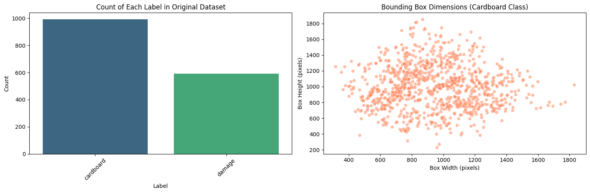
*Visualizations from cardboard_detector.ipynb (Cell 15): Class count distribution and bounding box dimensions.*

---

### Training Loss Curves and Convergence
- **Training Duration:** 30 complete epochs
- **Hardware Acceleration:** NVIDIA Tesla T4 GPU
- **Loss Progression:**
  - `train/box_loss`: Decreased from 0.63 to 0.26
  - `train/cls_loss`: Decreased from 1.41 to 0.18
  - `train/dfl_loss`: Decreased from 1.08 to 0.83
- **Convergence Metrics:**
  - `metrics/precision(B)`: Reached 99.4%
  - `metrics/recall(B)`: Reached 99.8%
  - `metrics/mAP50(B)`: Reached 99.5%
  - `metrics/mAP50-95(B)`: Reached 96.8%

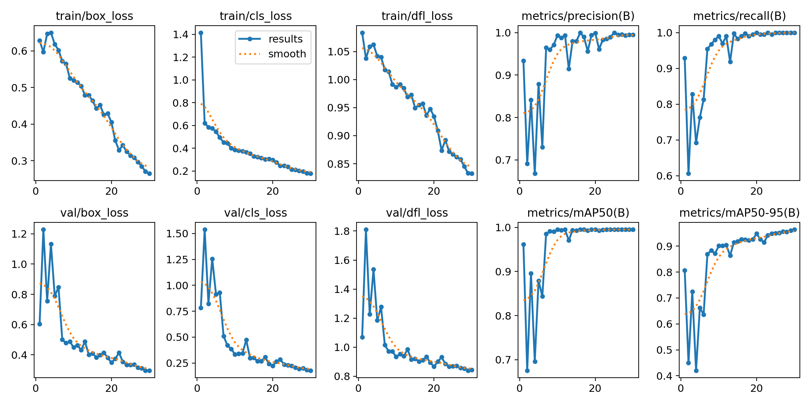
*Training metrics from cardboard_detector.ipynb (Cell 8): Bounding box loss, classification loss, distribution focal loss, and mAP curves across 30 epochs.*

---

### Validation Batch Predictions
The model was validated on held-out images. It accurately detects cardboard boxes under diverse background textures, lighting angles, and packaging tapes.

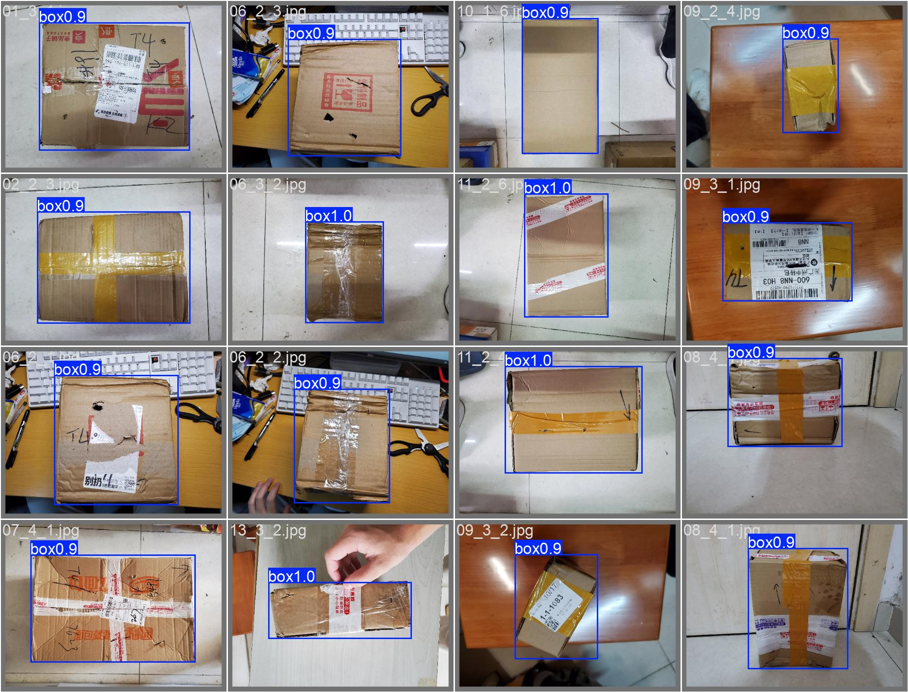
*Validation batch predictions from cardboard_detector.ipynb (Cell 10): 16 test images with box detection confidence between 0.90 and 1.00.*

---

### Validation Confusion Matrix
- **True Cardboard Detections:** 198 correct box predictions
- **Background False Positives:** 20 background misclassifications
- **Background False Negatives:** 0 missed cardboard boxes

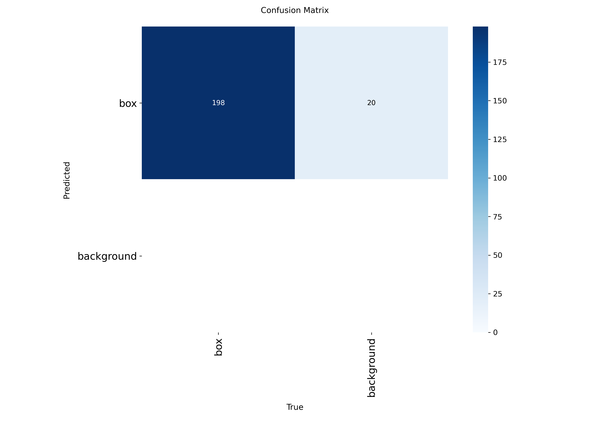
*Confusion matrix from cardboard_detector.ipynb (Cell 10): Shows high sensitivity for the cardboard class.*

---

### Inference Demonstration
The notebook verified model performance on unseen images before ONNX export.

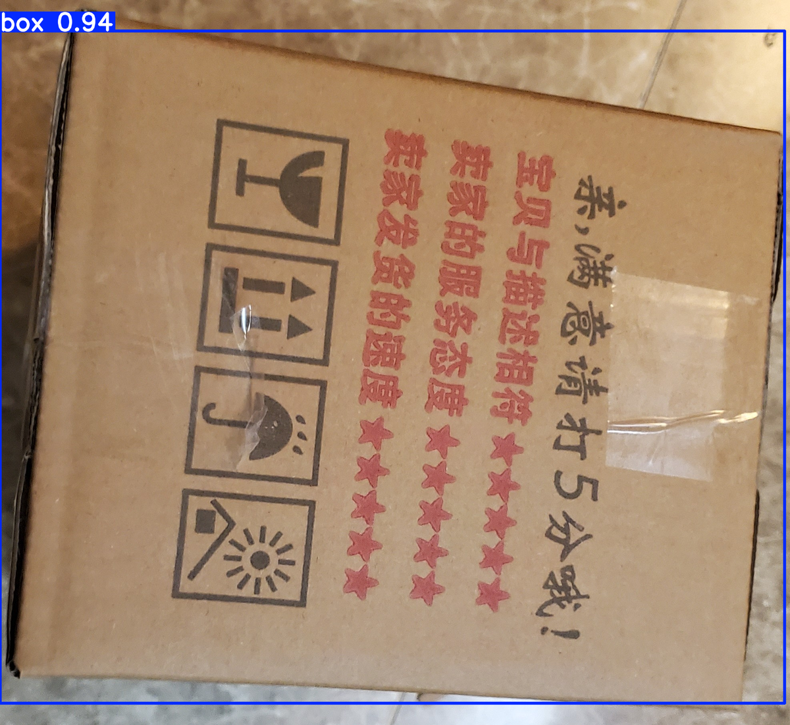
*Sample inference from cardboard_detector.ipynb (Cell 13): Test box detected with 94% confidence.*

---

## 6. Multi-Sample Evaluation and Edge Cases

The detector was evaluated across multiple physical lighting environments and cutting beds:

### Test Case 1: Large Cardboard Sheet on White Bed (`box_outline.jpg`)
- **Workpiece Size:** Large (covers ~33% of the cutting area)
- **Background:** White paper calibration frame
- **Result:** Detected successfully
- **Confidence:** 93.1%

### Test Case 2: Small Cardboard Workpiece on White Bed (`shapes.jpg`)
- **Workpiece Size:** Small (covers ~4% of the cutting area)
- **Background:** White paper calibration frame
- **Result:** Detected successfully
- **Confidence:** 92.9%

### Test Case 3: Small Cardboard Workpiece on Black Felt (`IMG_9869.jpg`)
- **Workpiece Size:** Small
- **Background:** Matte black industrial felt
- **Result:** Below confidence threshold (Score: 2.2%)
- **Handling / Fallback:**
  - The detector returns `null` when confidence is below 0.25.
  - The UI falls back to `ContourRoiDetector.js` (OpenCV chromatic tan filter).
  - The OpenCV contour detector finds the cardboard by color signature (Hue 7 to 42, Saturation > 25).
  - The operator can also use manual Lasso selection.

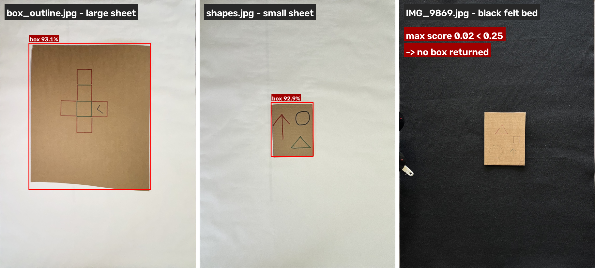
*Left: Large sheet on white bed (93.1%). Center: Small sheet on white bed (92.9%). Right: Sheet on black felt bed (Falls back to contour detection).*

---

## 7. Source Code Cross-Reference

- **`pipeline/CardboardDetector.js`:** Loads `cardboard_detector.onnx` via `onnxruntime-web`, handles image preprocessing, runs inference, and parses the 8400 output anchors.
- **`pipeline/ContourRoiDetector.js`:** Fallback detector using HSV chromatic thresholding and morphological closing.
- **`pipeline/WarpEngine.js`:** Locates the 4 ArUco markers and executes perspective correction.
- **`pipeline/InkExtractor.js`:** Consumes the generated ROI mask to isolate ink drawings.
- **`cardboard_detector.ipynb`:** Jupyter notebook containing training pipeline, EDA plots, metric curves, and ONNX export.
- **`pipeline_dryrun.html`:** Interactive diagnostic interface providing real-time canvas inspection and ROI adjustment controls.

---

## 8. How to Reproduce Locally

1. Start a local HTTP server in the repository root directory:
   ```bash
   npx serve .
   ```
2. Open a browser and navigate to:
   ```text
   http://localhost:3000/pipeline_dryrun.html
   ```
3. Open the **Workpiece ROI Auto-Detect** dropdown menu.
4. Select **YOLO ONNX**.
5. Set the test image input to `test_images/box_outline.jpg` or `test_images/shapes.jpg`.
6. Click the **Run Pipeline** button.
7. Observe the console log output:
   ```text
   Loading CardboardDetector model: cardboard_detector.onnx
   CardboardDetector model ready.
   YOLO Detected Cardboard: [x: 295, y: 444, w: 1244, h: 1500] Conf: 93.1%
   Shaved 20px cardboard edge: [x: 315, y: 464, w: 1204, h: 1460]
   Auto-detected workpiece ROI mask applied.
   ```
8. Verify that the isolated cardboard workpiece passes cleanly into the downstream vectorization pipeline.
