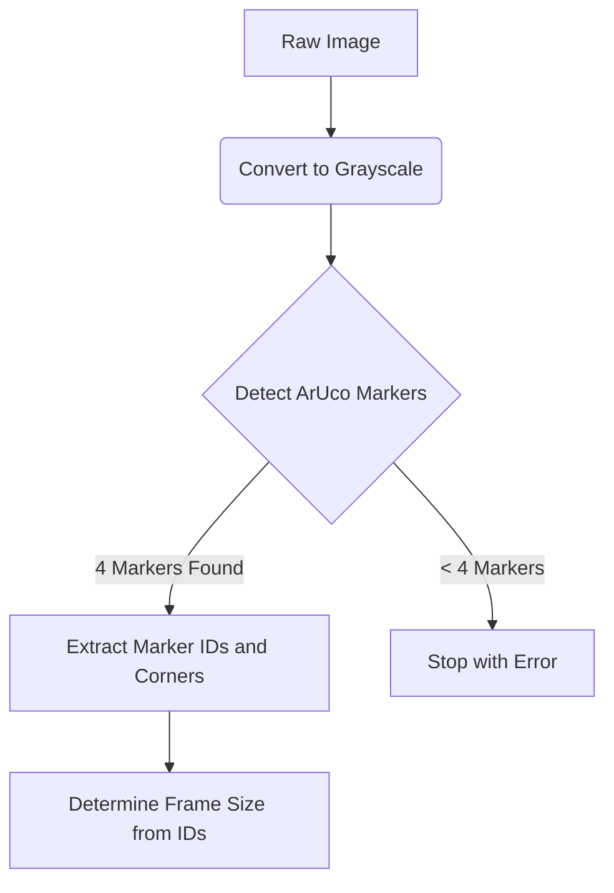
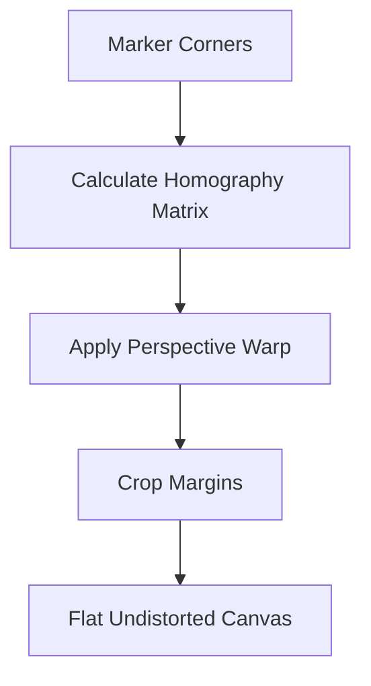
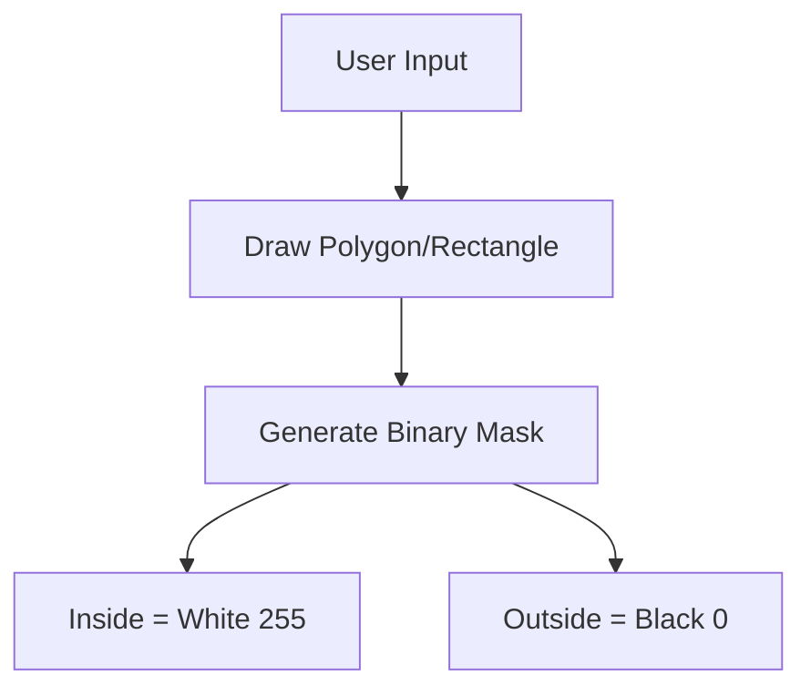
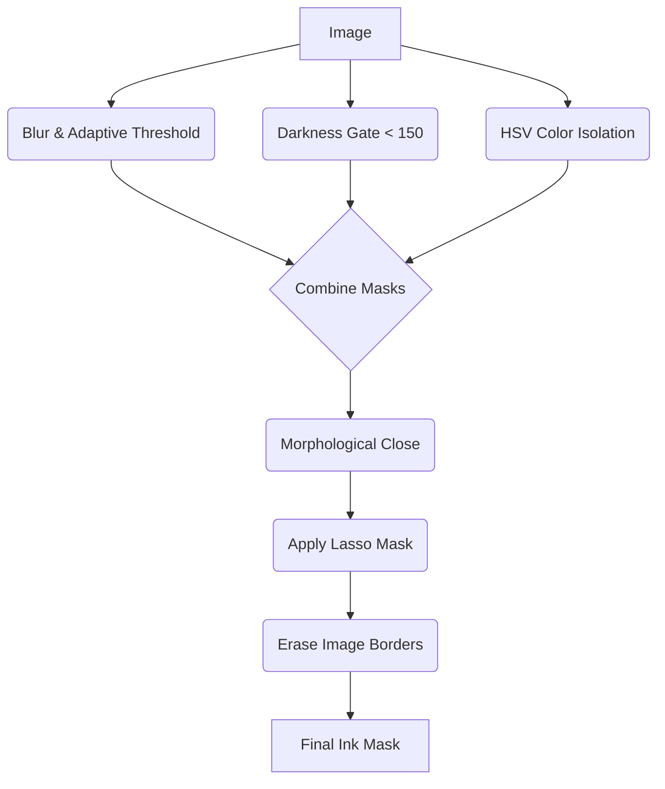
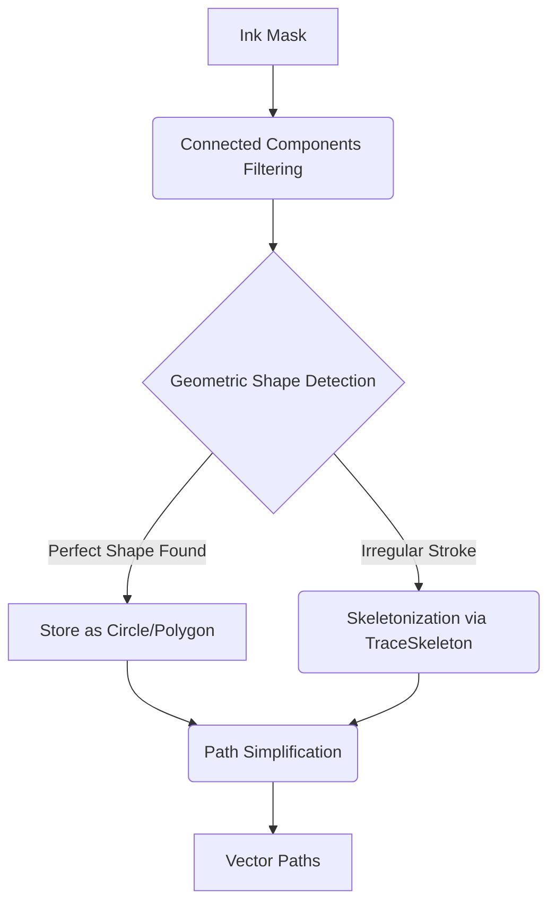
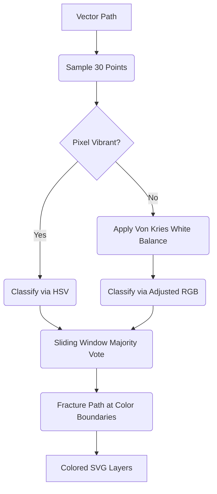
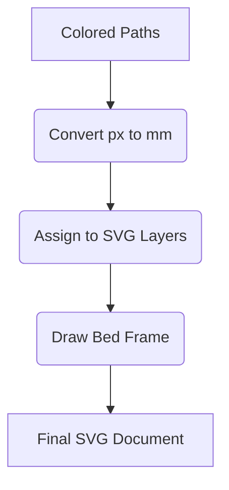
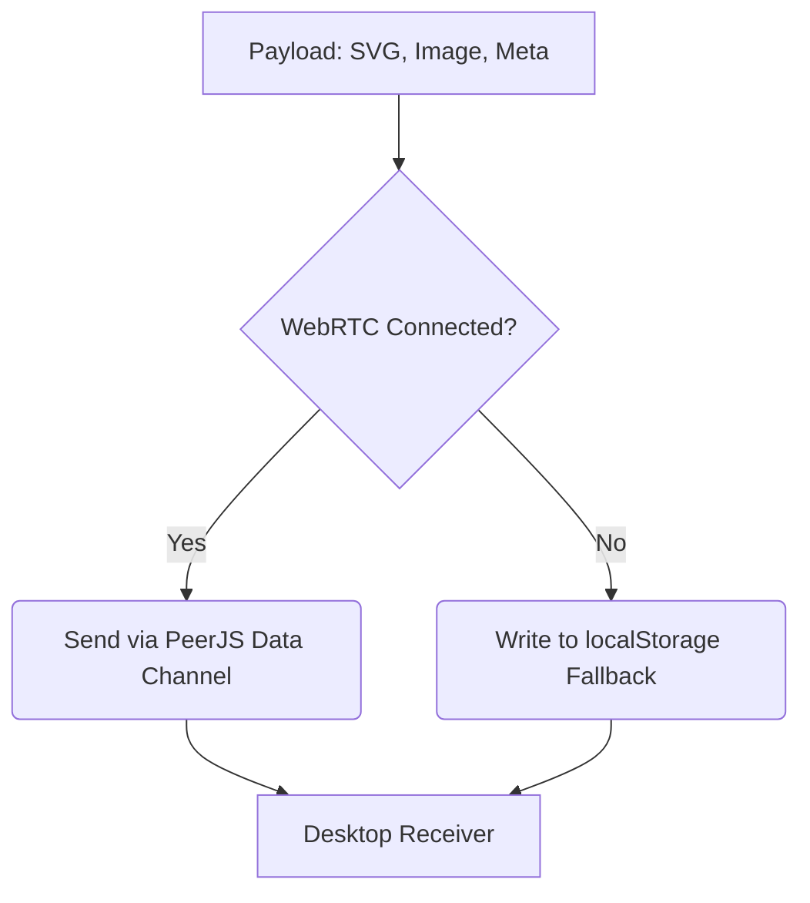

# Urumi Vision Pipeline — Step-by-Step Explanation

---

## Step 1 — ArUco Marker Detection
**Module:** `WarpEngine.normalizePerspective()`

The image is first converted to **grayscale**. OpenCV then searches for **ArUco markers** — small black-and-white square fiducial markers printed on the physical cutting frame.

The system uses the `DICT_4X4_50` dictionary. It looks for exactly **4 markers**, one at each corner of the frame (Top-Left, Top-Right, Bottom-Right, Bottom-Left).

The marker IDs tell the system which physical frame size was used:
| ID Range | Frame Size |
|---|---|
| 0–3  | 150 × 230 mm |
| 4–7  | 210 × 290 mm |
| 8–11 | 270 × 350 mm |
| 12–15 | Custom (from URL params) |

If fewer than 4 markers are found, the pipeline stops with an error.

### Key Functions Used
- `cv.cvtColor()`: The system uses this function to convert the image to grayscale. A grayscale image is necessary for the ArUco detector to find markers.
- `cv.getPredefinedDictionary()`: The system uses this function to load the `DICT_4X4_50` marker dictionary. This dictionary contains the specific patterns for the printed markers.
- `cv.aruco_DetectorParameters()`: The system uses this function to initialize the detector settings. These settings control how the algorithm searches for marker candidates.
- `cv.aruco_RefineParameters()`: The system uses this function to initialize the parameters for corner refinement. This makes the marker detection more accurate.
- `cv.aruco_ArucoDetector()`: The system uses this function to create the main marker detector object. It combines the dictionary and the parameters.
- `detector.detectMarkers()`: The system uses this function to scan the grayscale image. It finds the markers and returns their bounding boxes and IDs.

---

## Step 2 — Perspective Warp
**Module:** `WarpEngine.normalizePerspective()`

The phone camera is never held perfectly flat above the frame. The image will always be slightly tilted or rotated. This step **fixes that distortion**.

The system uses the **center points** of the 4 detected ArUco markers as the source coordinates. It maps them to a perfect rectangle at a fixed output width (2000px). OpenCV's `warpPerspective()` applies a **homography transform** — it mathematically projects the skewed image onto a flat, top-down view.

The margins between the ArUco centers and the actual cutting area boundary are subtracted at this point, so the output image shows only the **inner drawing area** at exact physical proportions.

Output: a flat, undistorted canvas image at `2000 × N px` (where N maintains the physical aspect ratio).

### Key Functions Used
- `cv.matFromArray()`: The system uses this function to convert the JavaScript coordinate arrays into OpenCV Mats. The Mats represent the source and destination triangles for the warp.
- `cv.getPerspectiveTransform()`: The system uses this function to calculate the 3x3 homography matrix. It uses the physical ArUco corner coordinates and the destination flat rectangle.
- `cv.warpPerspective()`: The system uses this function to apply the homography matrix to the raw image. This mathematical projection returns a flat, top-down view of the workspace.

---

## Step 3 — Lasso Masking 
**Module:** Lasso Tool in `app.js`

The user draws a freehand polygon or rectangle on the flattened image to select the region of interest. This removes cardboard edges and unwanted ink outside the workpiece boundary.

Internally, the drawn shape is used to generate a **binary mask canvas**:
- Pixels **inside** the selection = white (255)
- Pixels **outside** the selection = black (0)

This mask is passed alongside the flattened image into the next step.

### Key Functions Used
- `ctx.fill()`: The system uses this standard Canvas 2D API function to fill the drawn polygon. It draws white pixels over a black canvas. This action creates the binary mask.

---

## Step 4 — Ink Detection
**Module:** `InkExtractor.extractColorPaths()`

This is the most complex step. It finds all ink strokes on the image and filters out background noise (cardboard texture, shadows, etc.).

### Sub-steps:

**4a. Adaptive Threshold**
The image is blurred with a bilateral filter (preserves edges, removes noise), then `adaptiveThreshold` finds pixels that are **locally darker than their surroundings** — this catches ink lines even under uneven lighting.

**4b. Darkness Gate**
A second pass keeps only pixels with a raw grayscale value below 150. This prevents paper texture from being picked up while keeping faint, thin ink pixels.

**4c. Colored Ink Detection (HSV)**
The image is converted to **HSV color space** and separate masks are created for red, green, and blue hue ranges. These are combined with the dark-ink mask to capture colored marker strokes that might be too light to pass the darkness gate alone.

**4d. Noise Cleanup**
Morphological close operation (dilation then erosion with a 2×2 rect kernel) bridges thin gaps in the strokes without eroding thin lines.

**4e. Lasso Mask Applied**
If the user drew a selection, `bitwise_and` with the white/black mask removes everything outside the selection.

**4f. Border Exclusion**
A thin strip around the image edge is zeroed out — warping artifacts always appear at the periphery.

### Key Functions Used
- `cv.cvtColor()`: The system uses this function to convert the RGBA image into multiple formats. It creates RGB, HSV, and GRAY versions for different analysis passes.
- `cv.bilateralFilter()`: The system uses this function to blur the image and remove noise. It keeps sharp edges intact. This prevents the cardboard texture from interfering with the ink detection.
- `cv.adaptiveThreshold()`: The system uses this function to create the initial dark-ink mask. It compares each pixel to its local neighborhood. This method detects ink accurately under uneven lighting conditions.
- `cv.threshold()`: The system uses this function to apply a strict darkness gate. It sets a hard limit to remove the background paper texture completely.
- `cv.inRange()`: The system uses this function to isolate specific color hues in the HSV color space. It uses scalar ranges to create separate masks for red, green, and blue ink.
- `cv.bitwise_and()` and `cv.bitwise_or()`: The system uses these functions to combine the different image masks. They join the adaptive mask, the darkness gate, and the color masks together.
- `cv.getStructuringElement()`: The system uses this function to create a rectangular structural kernel. The morphological operations use this kernel to process the pixels.
- `cv.morphologyEx()`: The system uses this function to apply the `cv.MORPH_CLOSE` operation. This action bridges small gaps in the detected ink strokes. It does not erode the thin lines.
- `cv.rectangle()`: The system uses this function to draw black rectangles around the edges of the image matrix. This removes any warping artifacts near the borders.
- `cv.countNonZero()`: The system uses this function to count the number of extracted ink pixels. This is useful for logging and debugging the pipeline.

---

## Step 5 — Vectorization and Skeletonization
**Module:** `InkExtractor._processMaskToPaths()` → `TraceSkeleton`

The binary ink mask is now a set of thick blobs. This step converts those blobs into **thin 1-pixel-wide center lines** (skeletonization), then traces them into **polyline paths**.

### Sub-steps:

**5a. Connected Components Analysis**
OpenCV `connectedComponentsWithStats` finds all separate blobs. Very small blobs (area < 100px, span < 20px) are discarded as noise.

**5b. Geometric Detection and Skeletonization**
First, contour analysis checks if a blob represents a perfect geometric shape (like a circle or polygon with 3-8 vertices) by evaluating its solidity and circularity. If it does, it's extracted as a perfect shape. The remaining irregular strokes are fed into `TraceSkeleton.fromBoolArray()`, a fast thinning algorithm that reduces thick strokes to 1px center lines, outputting them as polylines.

**5c. Path Simplification**
Raw skeletonized paths have hundreds of redundant points. **Douglas-Peucker simplification** reduces them to the minimum number of points that still represent the shape accurately. Small paths use epsilon=1.5px. Large paths use epsilon=3.0px.

### Key Functions Used
- `cv.getStructuringElement()` and `cv.morphologyEx()`: The system uses these functions to close the mask gaps one more time. This happens before the connectivity analysis starts.
- `cv.connectedComponentsWithStats()`: The system uses this function to group the binary mask pixels. It identifies distinct continuous strokes. It also calculates area and bounding box statistics for each stroke to filter out noise.
- `cv.Mat.zeros()`: The system uses this function to create a completely blank image matrix. It uses this blank matrix to reconstruct the filtered paths.
- `TraceSkeleton.fromBoolArray()`: The system uses this fast custom algorithm to thin the ink strokes. It reduces the thick blobs to 1-pixel-wide centerlines.
- `InkExtractor._smoothPath()`: The system uses this custom function to apply a moving average filter. This softens rough or jittery lines in the skeletonized paths.
- `InkExtractor._simplifyPath()`: The system uses this custom recursive function to implement the Douglas-Peucker algorithm. It reduces the number of points in a path while keeping the overall shape.
- `InkExtractor._perpendicularDistance()`: The system uses this custom math function for the Douglas-Peucker algorithm. It measures the distance of a point from a line segment to find redundant points.

---

## Step 6 — Color Classification
**Module:** `InkExtractor.extractColorPaths()` — classification loop

Each path (from Step 5) is sampled at up to 30 evenly-spaced points. At each sample point, the system reads the **original RGB color** from the warped image.

### High-Saturation Fast Path
At each point, the HSV values are checked. If the pixel is vibrant (`Saturation > 80`, `Value > 40`), the hue directly determines the color (Red: <10 or >170, Green: 35–85, Blue: 95–135).

### White Balance Fallback (Von Kries)
If the pixel is faint or dark, it falls back to a White Balance correction. Cardboard has a warm color bias (R=180, G=140, B=100). The system finds a nearby background pixel and scales each channel by `bgAvg / bgChannel` to normalize the local white point before classifying.

### Classification Rules
| Color | Condition | Layer |
|---|---|---|
| Green | `adjG > adjR` AND `bestG > bestB - 5` | `crease` |
| Blue  | `bestB > bestG + 10` AND `bestB > bestR + 5` | `thru_cut` |
| Red   | `adjR > adjG + 5` AND `adjR > adjB + 5` | `score` |
| Other | None of the above | `thru_cut` (default) |

**Whole-Path Classification:** Instead of fracturing a single stroke into multiple colors based on a sliding window, the system determines the dominant color for the **entire path** using majority vote. This ensures continuous strokes are never broken into pieces.

### Key Functions Used
- `Math.sqrt()`: The system uses this function to calculate Euclidean distances along the path segments. This helps to evenly space the sample points.
- `Math.max()` and `Math.min()`: The system uses these functions to constrain the sampling boundaries. They prevent the sampler from reading outside the image edges.
- `Math.round()` and `Math.floor()`: The system uses these functions to convert the path floating point coordinates to integers. These integers act as pixel array indices.
- **White Balance Logic**: The system uses a custom math calculation to correct colors in faint pixels. It scales the pixel channels using the `bgAvg / bgChannel` formula.

---

## Step 7 — SVG Generation
**Module:** `SvgGenerator.generateLayeredSvg()`

All paths are converted from **pixel coordinates** to **millimeter coordinates** by dividing by `dotsPerMm = 2000 / cropPhysWidth`.

The SVG uses a `viewBox` that matches the physical dimensions of the cutting area in mm. SVG units = mm.

Three named layers are output:
| Layer ID | Stroke Color | Meaning |
|---|---|---|
| `thru_cut` | `#3b82f6` (blue) | Cut all the way through |
| `score` | `#ef4444` (red) | Score/perforate |
| `crease` | `#22c55e` (green) | Fold/crease line |

A magenta bed frame rectangle is also drawn at the exact physical boundary.

### Key Functions Used
- `Object.entries()`, `Array.prototype.map()`, `Array.prototype.join()`: The system uses these native JavaScript iterators to traverse the path objects. They format the path coordinates into standard SVG strings.
- **Custom Math (`dotsPerMm`)**: The system uses this conversion function to scale points. It converts the points from raw pixels to physical dimensions using the formula `(px) => (px / dotsPerMm)`.
- **String interpolation**: The system uses template literals to generate the raw SVG markup dynamically. It creates `<svg>`, `<rect>`, `<path>`, `<circle>`, and `<polygon>` elements.

---

## Step 8 — Transmission
**Module:** `Communicator.sendPayload()`

The result object `{ svg, image, meta }` is sent to the desktop via a **PeerJS WebRTC data channel** as a JSON message of type `PROCESSING_COMPLETE`.

If the WebRTC connection is not open (standalone/testing mode), the payload is written to `localStorage` under the key `urumi_payload` and immediately deleted. The desktop `test_receiver.html` listens for the `storage` event and picks this up — this is the **local bridge fallback** for same-browser testing.

### Key Functions Used
- `peer.connect()` and `conn.send()`: The system uses the PeerJS WebRTC API to transmit the final SVG payload to the desktop app.
- `localStorage.setItem()`: The system uses this fallback mechanism to bridge the payload data across browser tabs. This is strictly for local testing without a WebRTC connection.
