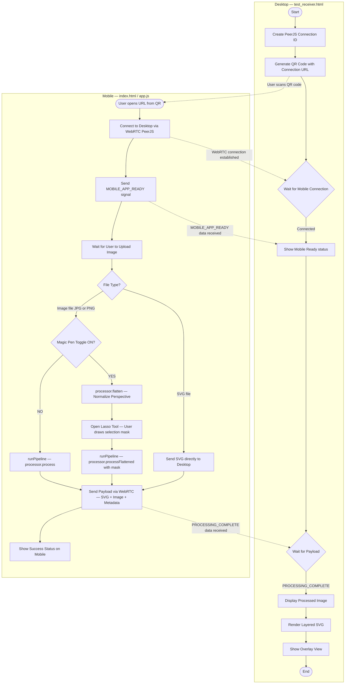
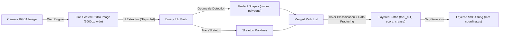

# Urumi Vision — Technical Summary & Architecture Guide

This document summarizes the **Urumi Vision** Notion documentation and its three visual case studies.

---

## 1. System Purpose
Urumi Vision is a browser-based computer vision application. It takes a smartphone photograph of a hand-drawn design on a physical cutting bed (**1130 mm x 830 mm**) and converts it into a 1:1 scale, millimeter-accurate, layered SVG file (**1 SVG unit = 1 mm**) for a CNC cutter.

---

## 2. System Architecture & Function Reference

### 2.1 Mobile Frontend (`app.js` & `index.html`)
This module controls the mobile camera, user interface, and selection tools.
* **`runPipeline(imgCanvas, maskCanvas, isAlreadyFlattened)`**: Main UI orchestrator. It starts the loading spinner, sends the canvas and mask to `ImageProcessor.js`, waits for the processed SVG and image, and sends the payload to the desktop receiver via `Communication.js`. If WebRTC is disconnected, it writes the payload to `localStorage` (`urumi_payload` key) as a fallback.
* **`openLassoTool(img, srcCanvas)`**: Opens a modal where the user draws a polygon or rectangle mask on the flattened image. Pixels inside the mask become white (keep), and pixels outside become black (ignore).
* **`render()`**: Canvas rendering loop that draws the blue polygon or dashed rectangle overlay while the user drags their finger or mouse.
* **`showSuccess(msg, imageUrl, svgData)`** & **`showError(msg)`**: Update the DOM to display green success or red error messages (for example, when the camera misses one of the 4 ArUco markers).

### 2.2 Pipeline Proxy & Web Worker (`ImageProcessor.js` & `pipeline/pipeline.worker.js`)
OpenCV operations are CPU-intensive. To prevent the browser UI from freezing, `ImageProcessor.js` acts as a main-thread proxy that sends raw pixel data to `pipeline.worker.js`, which runs in a background thread.
* **`_extractImageData()`**: Draws an HTML image or canvas onto a hidden 2D canvas and reads raw RGBA pixel arrays via `getImageData()`.
* **`process()`**: Runs the full automatic pipeline in one pass (`Warp -> Extract -> SVG`).
* **`flatten()`**: Runs *only* `WarpEngine.js` and returns the flat, perspective-corrected image so the user can draw a manual Lasso mask on it.
* **`processFlattened()`**: Takes the already-flat image plus the user's Lasso mask, skips the warp step, and runs `InkExtractor.js` and `SvgGenerator.js`.

### 2.3 Perspective Normalization (`pipeline/WarpEngine.js`)
Smartphone photos of a large cutting bed have strong perspective tilt. `normalizePerspective(src, srcMask)` corrects this:
1. Converts the input photo to grayscale (`cv.COLOR_RGBA2GRAY`).
2. Runs OpenCV's `cv.aruco_ArucoDetector` using the `DICT_4X4_50` dictionary and sub-pixel corner refinement (`aruco_RefineParameters(10, 3, true)`).
3. Requires all **4 corner markers**. If fewer than 4 are found, it aborts and returns `null`.
4. Sorts the 4 markers by ID (lowest ID = top-left, highest ID = bottom-left) for rotation invariance.
5. Selects physical board dimensions based on the marker ID range:
   * **IDs 0–3 (Small):** 150 x 230 mm (11 mm margin)
   * **IDs 4–7 (Medium):** 210 x 290 mm (17 mm margin)
   * **IDs 8–11 (Large):** 270 x 350 mm (16 mm margin)
   * **IDs 12–15 (Custom Cutting Bed):** 830 x 1130 mm total frame, cropped to an inner working area of **775 x 1065 mm**.
6. Sets the output width to **2000 pixels** (`dotsPerMm = 2000 / 775 = 2.58 px/mm`, making the output image **2000 x 2748 pixels**).
7. Calls `cv.getPerspectiveTransform` to solve the 3x3 homography matrix `M`, then calls `cv.warpPerspective` with bilinear interpolation to produce a flat, top-down image.

---

## 3. Core Computer Vision Pipeline (`pipeline/InkExtractor.js`)

`extractColorPaths()` executes a 6-stage extraction pipeline:

### Stage A: Dual-Gate & HSV Ink Masking (Steps 1–4)
Cardboard has rough texture, shadows, and uneven lighting. The pipeline combines two masks to isolate real ink:
1. **Dark Ink Mask (Dual-Gate):**
   * **Bilateral Filter (`d=9, sigma=75`):** Blurs cardboard fiber texture while keeping sharp ink edges intact.
   * **Adaptive Threshold (`51x51` window, `C=10`):** Finds pixels that are at least 10 levels darker than their local 51x51 neighborhood.
   * **Absolute Darkness Gate (`brightness < 120`):** Hard cutoff that rejects light paper and faint shadows.
   * Both gates are combined with `AND` (`adaptiveMask AND darkGate = darkInk`).
2. **Colored Ink Mask (`cv.inRange` in HSV space):**
   * **Red:** Hue `0–12` or `168–179`, Saturation `60+`, Value `40+` (two ranges because red wraps around 0/180 on the hue wheel).
   * **Green:** Hue `36–90`, Saturation `60+`, Value `40+`.
   * **Blue:** Hue `100–140`, Saturation `80+`, Value `40+` (higher saturation floor prevents shadow false positives).
3. **Mask Cleanup:**
   * Combines `darkInk OR coloredInkMask` into `allStrokes`.
   * Runs **Morphological Open (`3x3` ellipse)**: erodes by 1 pixel to delete 1–2 px dust specks, then dilates by 1 pixel to restore stroke width.
   * Applies the user or YOLO ROI mask (`AND`) and erases a **1% border strip** (minimum 8 px) on all 4 edges.

### Stage B: Blob Filtering & Geometric Shape Detection (`_processMaskToPaths`)
1. **Blob Filtering:** Runs `MORPH_CLOSE (3x3)` to bridge tiny gaps, then `cv.connectedComponentsWithStats` to measure every isolated ink blob. Keeps a blob only if `area >= 0.005%` of the image OR `max span >= 1%` of the shortest image side (saves thin lines while deleting dust).
2. **Geometric Snapping:**
   * Runs a heavy `MORPH_CLOSE (15x15 ellipse)` copy to fuse hand-drawn shapes, then extracts outer contours (`cv.findContours` with `RETR_EXTERNAL`).
   * Computes `solidity = contour_area / convex_hull_area`.
   * If **`solidity > 0.75`**:
     * Simplifies the contour with `cv.approxPolyDP` (5% perimeter tolerance).
     * Computes `circularity = 4 * pi * area / perimeter^2`.
     * If **`circularity > 0.75`**: Snaps to a circle via `cv.minEnclosingCircle` (`cx, cy, r`).
     * Else if **3 to 8 vertices**: Snaps to a clean polygon and shatters it into 2-point line segments so each edge can keep its own color.
     * Erases the detected shape from the binary mask so it is not skeletonized.

### Stage C: Centerline Skeletonization (`lib/trace_skeleton.js`)
Remaining freehand strokes are converted to a 1D boolean array and sent to `TraceSkeleton.fromBoolArray`:
1. **Phase 1 (Zhang-Suen Thinning):** Iteratively checks the 3x3 neighborhood of every pixel in two sub-iterations (checking neighbor count `2–6` and `0-to-1` transitions) to peel thick marker strokes down to a **1-pixel-wide skeleton**.
2. **Phase 2 (Divide-and-Conquer Tracing):** Recursively splits the image into `10x10` pixel chunks along rows/columns with the fewest crossings, connects entry/exit points inside each chunk, and stitches the polylines together across chunk boundaries.

### Stage D: Post-Processing & Smoothing
1. Rejects oversized noise paths (`> 45%` of image dimension) and hair-thin noise (`aspect ratio > 12:1`).
2. Checks the bounding-box diagonal of each path:
   * **Small details (`diagonal < 80 px`):** Runs `_smoothPath` (2 iterations of weighted moving-average to remove camera jitter) followed by `_simplifyPath` (Douglas-Peucker with tight `epsilon = 1.5`).
   * **Large strokes (`diagonal >= 80 px`):** Skips moving-average smoothing so sharp corners (such as arrowheads) stay sharp, and runs Douglas-Peucker with `epsilon = 3.0`.

### Stage E: Hybrid Color Classification & Path Fracturing (Steps 5–6)
Intersecting lines of different colors merge during skeletonization. To separate them:
1. Samples **2 to 30 points** evenly along each path.
2. Searches a **3x3 window** around each sample point for the darkest pixel (`bestR, bestG, bestB` — the true ink core).
3. Scans **5 to 20 pixels to the right** to find the first non-ink pixel (`bgR, bgG, bgB` — the local cardboard color).
4. **Von Kries White Balance:** Neutralizes the yellow/brown cardboard tint:
   * `adjR = bestR * bgAvg / bgR`
   * `adjG = bestG * bgAvg / bgG`
   * `adjB = bestB * bgAvg / bgB`
5. **Hybrid Decision Rule:**
   * **Green (`crease`):** `adjG > adjR + 5` AND `bestG > bestB + 2` (uses Von Kries for R/G, but raw sensor values for G/B because phone cameras have high blue channel noise in low light).
   * **Blue (`thru_cut`):** `bestB > bestG + 10` AND `bestB > bestR + 5` (raw values only).
   * **Red (`score`):** `adjR > adjG + 15` AND `adjR > adjB + 15` (Von Kries values).
   * **Black (`thru_cut`):** Anything that does not match Red, Green, or Blue.
6. **Sliding-Window Majority Vote:** Smooths color labels across a window of 7 samples on each side to ignore single-pixel camera noise.
7. **Path Fracturing:** Wherever the color label changes along a line, the algorithm splits the polyline at that exact point, assigns each segment to its CNC layer (`thru_cut`, `score`, `crease`), and re-simplifies with `epsilon = 1.5`.

### Stage F: Millimeter SVG Generation (`pipeline/SvgGenerator.js`)
* Computes `toMm(px) = px / dotsPerMm`.
* Builds an SVG with `viewBox="0 0 physWidth physHeight"` where **1 unit = 1 mm**.
* Creates `<g id="bed_frame">` (magenta rectangle border) and `<g>` groups for `thru_cut`, `score`, and `crease` containing `<circle>`, `<polygon>`, and `<path>` elements.

---

## 4. Pipeline Flowcharts

### 4.1 High-Level Desktop & Mobile Workflow

### 4.2 End-to-End Vision Pipeline

---

## 5. Visual Case Studies (Linked Sub-Pages)

### 5.1 Marker Strokes & Complex Shape Extraction
* **Test Image:** `2_colour_test.jpg` (1440 x 2560 px)
* **Key Focus:** Demonstrates how the pipeline processes thick marker strokes (2–5 mm wide), dense cross-hatching, and multi-color shapes without merging closely spaced lines into solid blobs.

### 5.2 Thin Shapes & Line Extraction
* **Test Image:** `IMG_9869.jpg` (3213 x 5712 px)
* **Key Focus:** Demonstrates how bilateral filtering (`9, 75, 75`) and local 51x51 adaptive thresholding preserve faint, low-contrast pen lines on textured corrugated cardboard.

### 5.3 Cardboard Detection & Automated Workpiece ROI (`cardboard_detector.onnx`)
* **Test Image:** `box_outline.jpg` (2268 x 4032 px)
* **Key Focus:** Replaces manual Lasso selection with an automated **YOLOv8 Nano** neural network running in the browser via **ONNX Runtime Web** (WASM/WebGL):
  1. Resizes the `2000 x 2748` warped image to a `640 x 640` float32 RGB tensor `[1, 3, 640, 640]`.
  2. Decodes output tensor `[1, 5, 8400]` across 3 feature pyramid strides (`Stride 8` = 6400 cells, `Stride 16` = 1600 cells, `Stride 32` = 400 cells). Large cardboard sheets activate **Stride 32** (93.1% confidence).
  3. Filters boxes with `confidence > 0.25`, rescales coordinates back to `2000 x 2748`, **shaves 20 pixels inward** on all sides to remove cardboard edge shadows and exposed corrugated flutes, and builds the binary ROI mask (`cv.fillPoly`) automatically.
