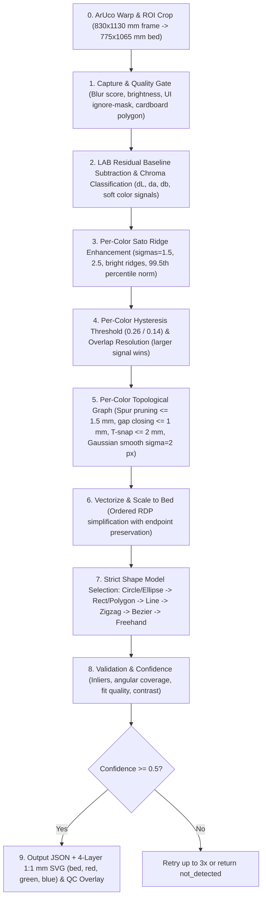

# Thin Hand-Drawn Stroke Detector (`stroke_detector`)

This module detects low-contrast hand-drawn strokes (lines, circles, ellipses, circular arcs, cubic Bezier curves, and freehand curves) on textured cardboard photos. It outputs JSON vector data and millimeter-accurate layered SVG files for the Urumi CNC machine.

## Pipeline Diagram



## Package Layout

- `stroke_detector/config.py`: `Config` and `ColorSpec` dataclasses, intermediate stage result structures.
- `stroke_detector/stages.py`: Pure functions for ArUco perspective flattening, Stages 1 through 6 (per-color LAB segmentation, ridge enhancement, hysteresis, skeleton graph tracing, T-snapping, Gaussian smoothing, and vectorization).
- `stroke_detector/fitting.py`: Pure functions for Stages 7 and 8 (ordered shape model selection: circle, ellipse, rectangle, closed polygon, straight line, zigzag polyline, Schneider cubic Bezier, freehand polyline).
- `stroke_detector/pipeline.py`: Stage 9 orchestrator (`run_pipeline`, `detect_strokes`) and 4-layer SVG generator (`generate_layered_svg`).
- `stroke_detector/viz.py`: Matplotlib side-by-side visualizer and full-resolution QC overlay (`01_capture.png` through `10_qc_overlay.png` + `output.svg`).
- `stroke_detector/cli.py`: Command-line interface.
- `pipeline_dryrun_stroke_detector.html`: Browser-based dashboard implementing the 9-stage pipeline with ArUco flattening, interactive ROI lasso, 4-layer SVG export, and full-resolution QC overlay.

## CLI Usage

```bash
python -m stroke_detector.cli test_images/2_colour_test.jpg --out out_debug/ --debug
```

Add `--aruco` to flatten perspective using the 4 corner ArUco markers (`DICT_4X4_50`) prior to Stage 1.

## Parameter Tuning Guide

| Parameter | Default | Effect & Tuning Advice |
| :--- | :--- | :--- |
| `lab_median_ksize` | `61` | Median blur kernel size for estimating cardboard background baseline in LAB. Must be significantly larger than stroke width. |
| `lab_residual_sigma` | `1.0` | Light Gaussian smoothing sigma applied to residuals `(dL, da, db)`. |
| `ink_l_weight_k` | `0.30` | Weight $k$ for luminance darkening in ink strength $s = \sqrt{da^2 + db^2} + k \cdot \max(-dL, 0)$. Helps dark blue ink. |
| `colors` | `[red, green, blue]` | Data-driven list of `ColorSpec` instances defining chroma angle center, half-width, minimum chroma, and hex color. |
| `ridge_sigmas` | `(1.5, 2.5)` | Multi-scale Sato ridge filter scales in pixels for bright ridge detection on color signals. |
| `color_hyst_high` / `low` | `0.26` / `0.14` | Dual hysteresis threshold values applied to the normalized per-color ridge response. |
| `min_color_component_area_px` | `40` | Minimum connected component area in pixels to eliminate corrugation flute noise. |
| `min_color_component_len_mm` | `3.0` | Minimum component length in physical millimeters. |
| `max_spur_len_mm` | `1.5` | Maximum spur branch length pruned at junctions (~4 px). |
| `max_endpoint_gap_mm` | `1.0` | Maximum endpoint gap closed across broken strokes of the same color. |
| `t_junction_snap_mm` | `2.0` | Snapping radius for connecting open T-junction endpoints onto intersecting strokes of the same color. |
| `chain_smooth_sigma_px` | `2.0` | 1D Gaussian smoothing sigma applied to pixel chains before RDP simplification to eliminate staircase noise. |
| `circle_min_diag_ratio` | `0.01` | Minimum circle radius relative to ROI diagonal. |
| `confidence_threshold` | `0.50` | Minimum combined confidence score required to return status `"detected"`. |

